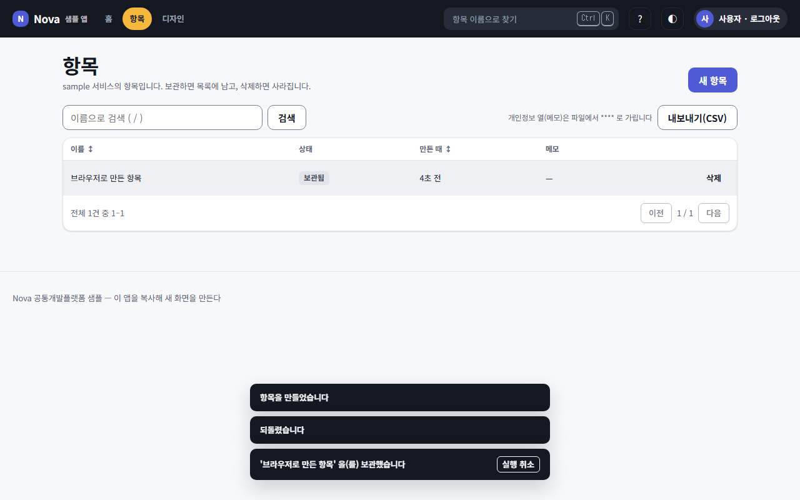
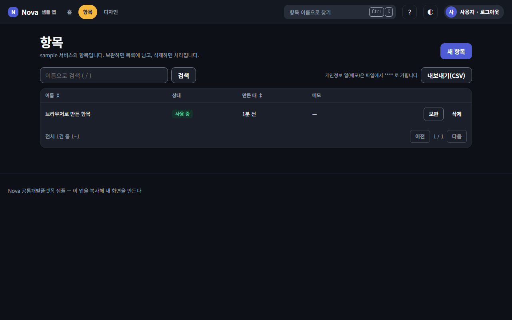
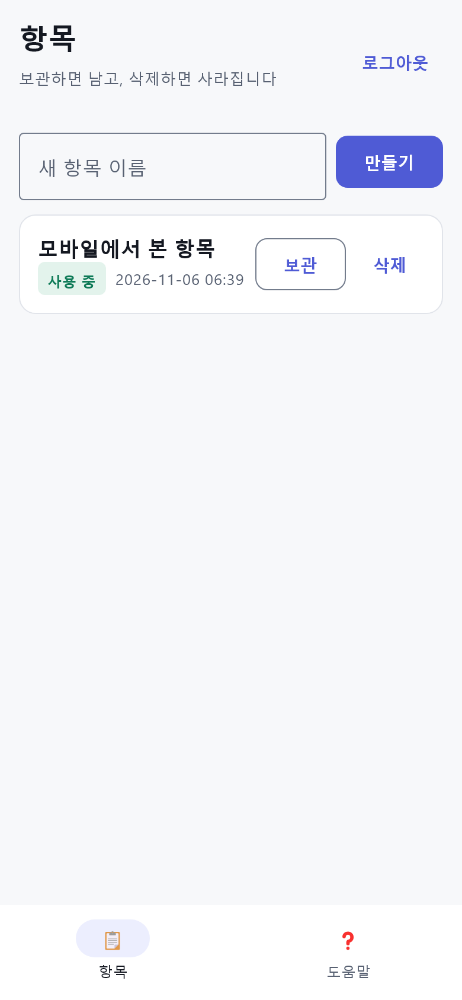

# Nova — 공통개발플랫폼

> 모든 신규 프로그램의 출발점. 새 프로젝트는 Nova 에서 생성되어 **첫날부터 같은 구조 · 같은 문서 프로세스 · 같은 공통 코드 · 같은 화면 규칙**으로 시작한다 — 표준화 · 효율화 · 신속한 개발.

검증된 프로젝트(dayroom2)에서 업무와 무관한 공통부만 추출해 일반화했다. 계획: [master_plan](docs/plans/master_plan.md) · 진행: [plan_index](docs/plans/plan_index.md)

| 웹 샘플 앱 — 목록 · 실행 취소 | 다크 모드 | 모바일(KMP) |
|---|---|---|
|  |  |  |

## 무엇이 들어 있나
| 층 | 내용 |
|---|---|
| ① 문서 프로세스 | 요구 → 마스터플랜 → 세부계획(§4 화면 미리보기 + UX 점검) → task, 이력 · git · 세션 인수인계 · ADR · 검토 · 검증 기록. 번호 · 인덱스 자동(`docs_new.py`), 검사(`docs_index.py --check` — 인덱스 · 링크 · 한국어), 슬래시 명령(지도: [superpowers.md §2](docs/conventions/superpowers.md)) |
| ① 자료 창고 · 제품 정본 | `docs/warehouse/inbound/<분류 8>` 에 받은 자료를 넣으면 `/intake` 가 심층 분석 → 부족한 것만 `/req-interview` → `/prd`(prd.json) → `/foundation`(4단계 질의 · ADR) → `/spec`(spec.json). 결과는 `outbound/<같은 분류>` 로 출고(md · html · json · 인수 점검표 · 질문표 · DDL) — [product](docs/product/README.md) |
| ① 일하는 방법 | **Superpowers** 플러그인 15개 스킬을 Nova 단계에 연결 — 고객 인터뷰(`/req-interview`: 실시간 · 질문지 · 회의록 분석) · 요구 분석(`/req-analyze`: 빌더 점검 · 승인 관문) · 계획 · TDD 실행(`/task-run`) · 코드 검토 · 디버깅 · 완료 전 검증 · 마무리. 기록은 모두 Nova 문서에 한국어로 ([superpowers.md](docs/conventions/superpowers.md)) |
| ① 규칙 | 한국어(규칙 0) · 화면 3층 구조 · **닐슨 10대 휴리스틱**(자동/확인 규칙 + 단점 보완 절차) · 디자인 시스템 · 백엔드 · Git · uv · UUIDv7 |
| ② 백엔드 공통 | `nova_common` — 서비스 팩토리 · 이벤트 버스(Kafka/메모리) · 아웃박스 · 멱등 소비 · DLQ · DB · JWT · 메트릭 · 카탈로그 · 목록 계약 · UUIDv7 |
| ② 서비스 골격 | 게이트웨이(라우팅 · 권한 `<모듈>.<행위>` · 메뉴 · 점검 · 레이트리밋 · 개발 로그인 · 모니터링) · 샘플 서비스 · `new_service.py` |
| ② 인프라 생성기 | `services.json` + `nova.project.json` → k3s(dev/prod) · Helm · docker-compose · Prometheus · Alertmanager · Grafana |
| ① 생성물 원장 · 대장 | 테이블 · API · 화면 · 컴포넌트 · 서비스 · 토픽에 일관 ID, 삭제 · 이동 추적(JSONL 원천) + 대장 4종(화면 · DB 사전 · 권한 · 이벤트, 코드에서 파생 — ADR-004) |
| ① 표준(STD) | 멀티테넌시 · 도메인 팩 · AI 자동화 등급 — 프로젝트마다 판정 의무, 플랫폼이 컨텍스트 전파 · 포트/팩 · actor_type 으로 뒷받침 |
| ③ 디자인 · 웹 | DTCG 토큰 → CSS/Kotlin + WCAG 2.2 AA 대비 검사(라이트 · 다크 모든 쌍), `@nova/ui`(useAction · DataTable · ListPage · FormPage · ErrorState …) · `@nova/sdk`, 샘플 앱 화면(목록 · 상세 · 만들기 · 로그인 · 운영 · 디자인 갤러리 — [화면 대장](docs/registry/screens.md)), 목업 캡처 · 브라우저 스모크 |
| ③ 모바일 | Kotlin Multiplatform — shared(ApiClient · 스토어) · uikit(토큰 · 공통 컴포넌트 · rememberAction) · composeApp(데스크톱 · iOS · Android) · 화면 스냅샷 |
| 생성기 | `new_project.py` — Nova 에서 새 프로젝트 만들기 |

## 새 프로젝트 시작하기
```bash
# Nova 를 받은 곳에서
python nova.py install
python nova.py new-project ../shop --name "쇼핑몰" --slug shop --remote https://github.com/<계정>/shop

cd ../shop
python nova.py install && python nova.py test && python nova.py lint
# docs/requirement 의 첫 요구 원문을 채우고 /plan-new 로 첫 계획
```
바뀌는 것: 프로젝트 이름 · 앱 브랜드 · 앱 ID · 레지스트리 · 도메인 · 원격, 문서 기록(비우고 첫 요구 · 마스터플랜 v0.1 작성).
그대로인 것(플랫폼): `nova_common` · `@nova/*` · `kr.nova.uikit` · 규약 · ADR · 스크립트 — 플랫폼 개선은 Nova 에서 하고 프로젝트로 가져온다.

### GitHub 템플릿으로 시작하기 (Use this template)
Nova 저장소는 GitHub **템플릿 저장소**다. 새 저장소를 템플릿에서 만들면 Nova 의 파일이 기록까지 그대로 복사되므로, **한 번 초기화**해 새 프로젝트로 바꾼다(결과는 `new-project` 와 같다).

1. GitHub 에서 Nova 저장소 → **Use this template → Create a new repository** → 이름 · 공개 범위
2. 초기화 — 둘 중 하나
   - **브라우저에서**: 새 저장소 → **Actions → "Nova 프로젝트 초기화" → Run workflow** → 이름 · slug 입력. 초기화 · lint · 커밋 · 푸시를 Actions 가 한다
   - **내 PC 에서**:
     ```bash
     git clone https://github.com/<계정>/<새 저장소> && cd <새 저장소>
     python nova.py install
     python nova.py init --name "쇼핑몰" --slug shop      # --dry 로 먼저 확인할 수 있다
     python nova.py check
     git add -A && git commit -m "chore(init): Nova 템플릿에서 프로젝트 초기화" && git push
     ```
3. 시작: Claude Code 에서 `/session-start` → 첫 요구 원문 채우기 → `/checklist` 또는 `/req-interview`

- `init` 은 Nova 원천 저장소 · 이미 초기화된 저장소 · 커밋 안 된 변경이 있는 저장소에서는 돌지 않는다(되돌릴 수 있게 — `git checkout . && git clean -fd` 로 원래대로. 새로 생긴 파일까지 지우려면 `clean` 이 필요하다. 무시 파일은 그대로 남는다)
- 상류 기준선: 템플릿에서 갈라진 Nova 커밋을 찾아 `nova.project.json` `upstream.base` 에 남긴다 → 나중에 Nova 의 새 판본은 `/sync-upstream` 으로 받는다. Nova 에 접근할 수 없는 곳(예: Actions 에서 비공개 Nova)이면 비워 두고, 첫 `upstream plan` 전에 Nova 태그로 채운다

## 명령 (Windows · Linux 공통 — `python nova.py help`)
| 명령 | 내용 |
|---|---|
| `install` · `test` · `lint` · `check` | uv 가상환경 · 전체 테스트 · 정적 검사(토큰 · 인프라 · 원장 · 문서) · 둘을 함께 |
| `quick` | 바뀐 곳만 빠른 검사(`--stage T<NN>-<단계>`) |
| `init` · `upstream` | 템플릿 저장소 초기화 · Nova 상류 판본 받기 |
| `checklist` · `migrate` | 요구 체크리스트 폼 · DB 마이그레이션 |
| `run` | 로컬 실행 — 게이트웨이 http://localhost:8080/v1 (개발 계정 `user@nova.dev` / `nova1234`) |
| `gen` | 생성물 전부 다시 만들기 |
| `new-service` · `new-pack` · `new-project` | 서비스 · 도메인 팩 · 새 프로젝트 |
| `tokens` · `mockups` | 디자인 토큰 생성 · 계획서 목업 PNG |
| `web` · `web-build` · `ui-smoke` | 웹 개발 서버 · 빌드 · 브라우저 스모크(주소는 `stack` 상태에서) |
| `stack up` · `status` · `down` | 게이트웨이(메모리 DB) + 데모 로그인 웹을 빈 포트로 띄우고 자식 프로세스까지 내림(`.stack/state.json`) |
| `worktree-new --scratch <이름>` · `worktree-prune [--yes]` | 격리용 작업 폴더(버스 등록) · 병합 끝난 worktree 정리 |
| `kmp-test` · `kmp-build` · `kmp-smoke` · `kmp-snapshots` | 모바일(JDK 21) |
| `e2e-kafka` · `doctor` | 실제 Kafka E2E(Linux/WSL) · 도구 점검 |

전체 명령은 `python nova.py help`. `make` 가 있으면 자주 쓰는 일부(install · test · lint · gen · run · tokens · web …)는 `make test` 처럼 써도 같다(Makefile 은 그 일부의 별칭).

## 일하는 방식 (자세히는 [CLAUDE.md](CLAUDE.md))
```
받은 자료 ──▶ /checklist(폼 자동 채움 → 고객 클릭 확인) → /intake → /prd → /foundation → /spec   docs/product/{intake,prd,spec}.json → docs/warehouse/outbound/*
고객 ─────▶ /req-interview   docs/requirement/interviews/interview_YYMMDD_NN.md   (superpowers:brainstorming)
사용자 요청 ─▶ /req-analyze    docs/requirement/requirement_YYMMDD_NN.md + 빌더 점검 · 승인  (또는 /req-new)
            ─▶ /plan-new       docs/plans/plan_REQ_NN.md (§4 화면 미리보기 + 4.1 UX 점검 + §11 전역 제약 · 검토 초점) + tasks/tasks_REQ_NN.md  (writing-plans)
            ─▶ /task-run       TDD 로 구현, 확인 후 - [x], 화면은 ui-smoke  (subagent-driven-development · test-driven-development)
            ─▶ /review-request docs/reviews/review_YYMMDD_NN.md  (requesting · receiving-code-review)   ·  버그는 /debug
            ─▶ /deep-audit     마일스톤 전후 · 인수인계 전 — 15개 시각 병렬 심층 감사 → 처분 · docs/reviews/
            ─▶ /finish         검증 · 병합/PR · 기록 /docs-write(이력 · tasks · git 기록)
            ─▶ 커밋 · 푸시      uv run python scripts/git_record.py "<요약>"
세션 경계   ─▶ /session-end  →  다음 세션 /session-start
```

## 디렉터리 구조
```
Nova-dev/
├─ nova.py                    작업 진입점
├─ nova.project.json          프로젝트 메타 단일 원천 (이름 · 레지스트리 · 도메인 · 웹 앱)
├─ pyproject.toml · uv.lock · .python-version   uv 워크스페이스 (Python 3.12)
├─ CLAUDE.md                  작업 규칙
├─ .claude/settings.json      Superpowers 플러그인 켜기(팀 공통)
├─ .claude/                   commands(절차 · 관문) · skills · agents · soul · hooks — 목록은 CLAUDE.md '명령' 표
├─ docs/
│  ├─ requirement/ plans/ history/ git/ session/ adr/ reviews/ verification/ releases/ memo/(교훈)   기록
│  ├─ conventions/            ui · ux-heuristics · backend · git · deploy(배포 · 백업 · 복원) · naming · glossary · superpowers
│  ├─ std/                    표준 — 멀티테넌시 · 도메인 팩 · AI 자동화 등급(판정은 nova.project.json)
│  ├─ warehouse/              자료 창고 — inbound/(받은 원본) · outbound/(만든 결과물), 같은 분류 8개
│  ├─ product/                제품 정본 — intake · prd · spec (JSON 정본 → md 보기)
│  ├─ design-system/ · registry/ · screenshots/
├─ registry/                  생성물 원장 원천(events.jsonl) · 스캐너 설정 · 대장 스냅샷(ledgers.json)
├─ packs/                     도메인 팩(STD-DOMAIN-PACK-001) — _template · example
├─ packages/common-py/        nova_common
├─ services/                  gateway · sample · _template
├─ tests/                     저장소 검사 · 통합 테스트
├─ infra/                     docker · k3s · helm/chart · observability
├─ design/tokens/             디자인 토큰 원천
├─ web/                       packages/ui · packages/sdk · apps/app
├─ apps/kmp/                  shared · uikit · composeApp (Gradle 래퍼)
└─ scripts/                   docs_* · git_record · registry · gen_* · new_* · dev_server · ui_smoke · mockup_shots …
```

## 문서 지도
| 경로 | 내용 |
|---|---|
| [docs/requirement](docs/requirement/requirement_index.md) | 요구사항 |
| [docs/plans](docs/plans/README.md) | 계획 규칙 · 마스터플랜 · 세부 계획 · task |
| [docs/conventions](docs/conventions/) | UI · UX(닐슨 휴리스틱) · 백엔드 · Git · 배포(백업 · 복원) · 명명 · 용어 · Superpowers 규약 |
| [docs/requirement/interviews](docs/requirement/interviews/interview_index.md) | 고객 인터뷰 기록 |
| [docs/adr](docs/adr/README.md) | 구조 결정 |
| [docs/std](docs/std/README.md) | 표준 — 테넌시 · 도메인 팩 · AX |
| [docs/registry](docs/registry/README.md) | 생성물 원장 — 새로 만들기 전에 찾아본다 |
| [docs/history](docs/history/history_index.md) · [docs/git](docs/git/git_index.md) · [docs/session](docs/session/session_index.md) | 이력 · 커밋 · 세션 |
