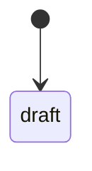
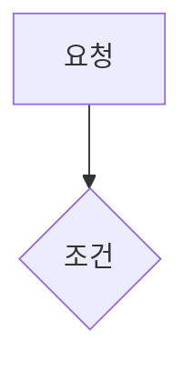
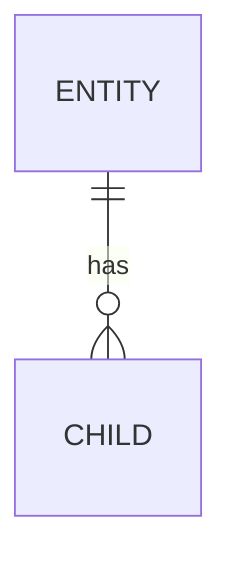

# plan_REQ_{{NN}} · {{TITLE}} v1.0

**대상 시스템** (어느 서비스 · 앱 · 패키지)
**변경점** (무엇이 바뀌는지 한 줄)

> **한 줄 요약** — (쉬운 비유로 이 계획의 핵심을 한 문장)

| 항목 | 값 |
|---|---|
| 버전 | **v1.0** · 기준 마스터플랜 v{{MASTER_VERSION}} |
| 요구 | {{REQ_LINK}} |
| task | [tasks/tasks_REQ_{{NN}}.md](tasks/tasks_REQ_{{NN}}.md) — 진행 상황의 정본 |
| 원칙 | 단계마다 전체 테스트 녹색 · 생성물 원장 sync · 문서 기록 |
| 실행 방식 | (사용자 선택) subagent — superpowers:subagent-driven-development / native — superpowers:executing-plans ([superpowers.md §5](../conventions/superpowers.md)) |
| 문서 ID | plan_REQ_{{NN}} |
| 생성 | {{DATE}} · `{{CMD}}` |
| 위치 | `{{PATH}}` |
| 원천 | (무엇에서 나왔나 — 사용자 원문 · REQ · 리뷰 · 세션 · 커밋) |
| 연결 | (상위 · 하위 · 관련 문서 링크) |

> **진척 ({{DATE}}, tasks 기준)** — 0 / 0

## 0. 영향분석 (착수 전 조회)
```
1) 대상:
2) 직접 영향:
3) 간접 영향:
4) 등급: 작음 / 보통 / 큼 — 이유
5) 갱신 산출물:
6) 대장 조회(docs/registry): 영향받는 화면(screens) · 표/컬럼(db-dictionary) · 권한/역할(permissions) · 이벤트 발행/구독(events)
7) 표준 판정(docs/std): 테넌시 · 도메인 팩(코어인가 팩인가) · AI 자동화 등급 — 해당 없음이면 이유
```

## 1. 설계의 중심축
착수 전 가설:

> **핵심 인사이트** —

### 1.1 대조 증거

## 2. 모델 변경
| 무엇 | 어디서 | 어디로 | 근거 |
|---|---|---|---|

## 3. 선행 관계


## 4. 표면 (화면 · API)
| 지금 | 바뀐 뒤 (목업) |
|---|---|
|  |  |

| 화면 | API | 표 | 권한 |
|---|---|---|---|

### 4.1 UX 점검 ([ux-heuristics](../conventions/ux-heuristics.md) — 화면이 없으면 "해당 없음")
| 원칙 | 이 화면에서 어떻게 지키나 | 남는 위험 (심각도 0~4) |
|---|---|---|
| H1 상태 가시성 | | |
| H2 현실 일치 | | |
| H3 제어 · 자유 | | |
| H4 일관성 | | |
| H5 에러 방지 | | |
| H6 인지 > 기억 | | |
| H7 유연 · 효율 | | |
| H8 미니멀 | | |
| H9 에러 복구 | | |
| H10 도움말 | | |

과업 시나리오(인지적 워크스루): 1) 사용자가 ___ 하려고 ___ 를 누른다 → 무엇을 할지 아는가? 결과를 알아보는가?

## 5. 생애주기


## 6. 핵심 분기

| 실패 지점 | 동작 (닫힘/열림) | 이유 |
|---|---|---|

## 7. 데이터 모델

| 구분 | 표 · 컬럼 |
|---|---|
| 있는 것 | |
| 신설 | |
| 바뀌는 것 | |

## 8. 재사용
새로 만들기 전에 [생성물 원장](../registry/README.md)과 대장([DB 사전](../registry/db-dictionary.md) · [권한](../registry/permissions.md) · [이벤트](../registry/events.md))에서 이미 있는 것을 찾는다.

| 자산 (원장 ID) | 쓰는 법 |
|---|---|

## 9. 범위 밖
| 안 하는 것 | 이유 · 어디서 |
|---|---|

## 10. 테스트 맵
단계 = 검사 묶음 — 같은 테스트를 건드리는 task 는 같은 단계에 두고, 단계 끝 관문이 `quick --stage` 로 모아 돌린다. `slow` = 하위 프로세스 · 저장소 복제 · 실제 DB(`@pytest.mark.slow` — quick 에서 빠지고 전체 test 에서만).

| 단계 | 코드 경로 | 테스트 | slow | 수용 기준 |
|---|---|---|---|---|

## 11. 후속 · 예외

### 11.1 전역 제약 (모든 task 에 적용 — 요구 원문 값 그대로)
| 제약 | 값 · 출처 |
|---|---|
| 언어 | 화면 문구 · 오류 메시지 · 주석은 한국어 (CLAUDE.md 규칙 0) |

### 11.2 검토 초점 (어느 task 의 테스트도 건드리지 않지만 사람이 부딪힐 입력 · 상황 — 많이 부딪힐 순서로 5개)
| 입력 · 상황 | 기대 동작 | 테스트를 넣은 task |
|---|---|---|

### 11.3 자체 점검 (superpowers:writing-plans — 다 쓴 뒤 한 번)
- [ ] 요구 반영 — 요구의 하위 ID 마다 담당 task 가 있다
- [ ] 단계 명확성 — 단계마다 구현자가 할 일이 하나로 정해진다("적절히 처리" 같은 줄 없음)
- [ ] 타입 일관성 — 앞 task 에서 정한 이름 · 시그니처를 뒤 task 가 그대로 쓴다
- [ ] 검토 초점 — 11.2 의 줄마다 테스트를 넣은 task 가 있다
- [ ] 분량 — 계획이 코드를 대신 쓰지 않았다(코드 블록은 시그니처 · 테스트 단언 위주)

## 12. 체크리스트
- [ ] 1단계 ·
- [ ] 2단계 ·

### 12.1 실측으로 정정된 자리

## 13. task 분해
[tasks/tasks_REQ_{{NN}}.md](tasks/tasks_REQ_{{NN}}.md) — 0개

---
관련 문서:

## 변경 이력
- v1.0 · {{DATE}} · 최초 작성

> **다시 한 줄 요약** —
