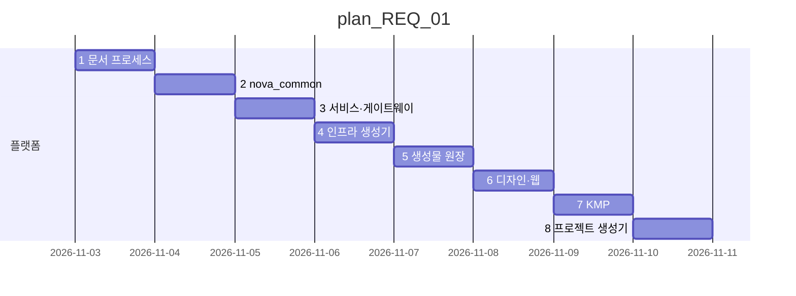

# 마스터플랜 — Nova 공통개발플랫폼

| 항목 | 값 |
|---|---|
| 버전 | **v1.0** |
| 상태 | 보관 (→ v1.1) |
| 채택일 | 2026-11-03 |
| 이전 정식 | - |
| 이력 | [master_plan_changelog.md](master_plan_changelog.md) |

## 이 버전에서 바뀐 것
| 절 | 변경 | 근거 |
|---|---|---|
| 전체 | 최초 작성 | [REQ-261103-01](../requirement/requirement_261103_01.md) · [REQ-261103-02](../requirement/requirement_261103_02.md) · [REQ-261103-03](../requirement/requirement_261103_03.md) |

## 1. 목표
Nova 는 **모든 신규 프로그램의 출발점**이 되는 공통개발플랫폼이다. 새 프로젝트는 Nova 에서 생성(`new_project.py`)되어 같은 디렉터리 구조 · 문서 프로세스 · 공통 라이브러리 · 인프라 생성기 · 디자인 시스템 · 웹/모바일 골격을 가진 채 시작한다. 목표는 **표준화 · 효율화 · 신속한 개발**.

- 표준화: 요구 → 계획 → task → 이력 · git 기록이 모든 프로젝트에서 같다. 코드 구조 · API 오류 형식 · 이벤트 형식 · UI 규칙이 같다
- 효율화: 반복 작업(서비스 추가 · 인프라 매니페스트 · 토큰 · 문서 번호 · 인덱스)은 스크립트가 한다
- 신속성: 생성 직후 `python nova.py test` · `python nova.py run` 이 동작하는 샘플이 들어 있다

## 2. 출발점 — dayroom2 에서 추출
| 층 | 가져온 것 | 버린 것 |
|---|---|---|
| ① 문서 프로세스 | 요구 · 3층 계획 · task · 이력 · git 기록 · 세션 인수인계 · 생성물 원장 | DayRoom 요구 · 계획 내용, 핸드오프 문서 |
| ② 백엔드 | 서비스 팩토리 · 이벤트 버스(Kafka/메모리) · 아웃박스 · 멱등 소비 · DB · JWT · 메트릭 · 서비스 카탈로그 · 게이트웨이 · k3s/helm/compose/관측 생성기 | 룸 · 예약 · 결제 · 원장 · 쿠폰 업무, 업무 메트릭 · 대시보드 |
| ③ 프론트 | DTCG 토큰 → CSS/Kotlin + WCAG 검사 · UI/SDK · KMP 골격 · 목업 캡처 | DayRoom 화면 · 브랜드 · 시드 |

## 3. 구조
README 의 "디렉터리 구조" 절이 정본이다. 단일 원천 파일:
- `nova.project.json` — 프로젝트 메타(이름 · 패키지 · 레지스트리 · 도메인 · 웹 앱)
- `packages/common-py/nova_common/services.json` — 서비스 목록
- `design/tokens/brand.tokens.json` — 디자인 값
- `registry/events.jsonl` — 생성물 원장
- `infra/k3s/base/kafka-topics.txt` — 이벤트 토픽

## 4. 기술 스택 (기본값 — 프로젝트가 ADR 로 바꿀 수 있다)
| 영역 | 선택 |
|---|---|
| 백엔드 | Python 3.12+ (uv 관리 — ADR-002) · FastAPI · SQLAlchemy 2 · Pydantic 2 · httpx |
| 이벤트 | Kafka(KRaft) + 아웃박스 · 멱등 소비 · DLQ, 개발 시 메모리 버스 |
| DB | 서비스별 스키마(MariaDB) · 로컬 SQLite |
| 배포 | Docker · k3s(Kustomize dev/prod) · Helm · docker-compose |
| 관측 | Prometheus(RED · 이벤트 규칙) · Alertmanager · Grafana |
| 웹 | Next.js 15 · React 19 · TypeScript · npm workspaces |
| 모바일 | Kotlin Multiplatform · Compose Multiplatform · Ktor |
| 디자인 | W3C DTCG 토큰 · WCAG 2.2 AA · 닐슨 10대 휴리스틱 |

## 5. 세부 계획
| 순서 | 계획 | 내용 | 선행 | 요구 |
|---|---|---|---|---|
| 1 | [plan_REQ_01](plan_REQ_01.md) | 공통개발플랫폼 구축 8단계 | - | REQ-261103-01 · 02 |

**현재 진행 순서**: plan_REQ_01 1단계 → 8단계

## 6. 원칙
- 서비스는 자기 DB 만 쓴다(교차 조인 금지). 서비스 ↔ 서비스는 이벤트(비동기) 또는 계약 API(동기)
- 이벤트는 아웃박스로 발행하고 `processed_event` 로 멱등 소비한다
- 코드 · 상태값은 설정 API 에서 읽는다(화면 · 서비스 enum 하드코딩 금지)
- 단일 원천에서 생성한다 — 생성물은 손으로 고치지 않고 `--check` 로 지킨다
- 화면은 템플릿 호출 + 데이터 정의만, UX 는 [ux-heuristics](../conventions/ux-heuristics.md)

## 7. 품질 게이트
- [ ] `python nova.py test` 전부 통과
- [ ] `python nova.py lint` (토큰 · 인프라 생성물 · 원장 · 문서 인덱스 · 인프라 검증) 통과
- [ ] 웹 빌드 · KMP shared 테스트 통과
- [ ] `new_project.py` 로 만든 프로젝트에서 test · lint 통과

## 8. 위험
| 위험 | 대응 |
|---|---|
| 플랫폼 변경이 이미 생성된 프로젝트에 전파되지 않음 | `nova_common` 은 버전이 있는 패키지로 유지, 프로젝트는 업그레이드 노트(CHANGELOG)로 따라온다 |
| Windows · Linux 명령 차이 | 모든 작업은 `python nova.py <명령>` (Makefile 은 얇은 별칭) |
| 템플릿이 실제 프로젝트에서 안 맞음 | 프로젝트에서 생긴 공통 개선은 Nova 로 역제안(REQ) — 성장 경로 |

## 9. 문서 규칙
CLAUDE.md "문서 규칙" 절이 정본.
