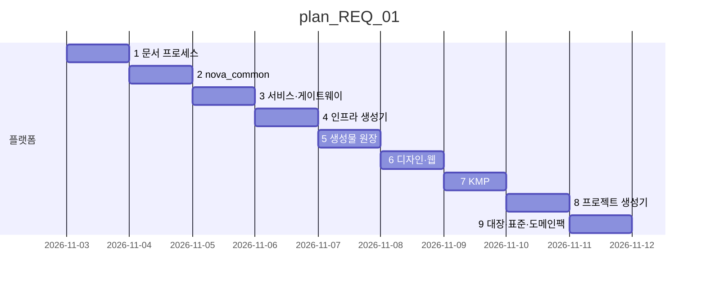

# 마스터플랜 — Nova 공통개발플랫폼

| 항목 | 값 |
|---|---|
| 버전 | **v1.3** |
| 상태 | 정식 |
| 채택일 | 2026-11-04 |
| 이전 정식 | [v1.2](archive/master_plan_v1.2.md) |
| 이력 | [master_plan_changelog.md](master_plan_changelog.md) |

## 이 버전에서 바뀐 것
| 절 | 변경 | 근거 |
|---|---|---|
| 공통 영역 완료 선언 · §5 | 공통 영역을 7항목으로 — **공통 컴포넌트(라이브러리) · 공통 명명 규약 · 개념 원장**을 더하고 화면 공통 모듈(화면 틀 · 디자인 토큰 · 공통 UI 부품 · 템플릿)을 분명히. 모두 끝나기 전에는 worktree 로 갈라 병렬로 가지 않는다(화면 · 이름 · 부품의 통일성). v0.2.0 계획 넷 추가 | 사용자 지시 2026-11-04 · [REQ-261104-10](../requirement/requirement_261104_10.md) · [11](../requirement/requirement_261104_11.md) · [12](../requirement/requirement_261104_12.md) · [16](../requirement/requirement_261104_16.md) |
| 끝 · 종료 조건 · 하지 않는 것 · 공통 영역 완료 선언 · 병렬 묶음 | 판본의 끝을 정하고, 공통 영역이 끝나기 전 병렬 진입을 막는 표 추가 | [REQ-261104-09](../requirement/requirement_261104_09.md) · [ADR-008](../adr/ADR-008-parallel-bus-release.md) |
| §2 · §5 · gantt | 9단계 추가 — psg05 대장 4종(화면 · DB 사전 · 권한 · 이벤트) 원장 통합 · 표준(STD) 3종 채택 · 도메인 팩 | [REQ-261103-04](../requirement/requirement_261103_04.md) |
| §4 | Python 환경 uv | [REQ-261103-03](../requirement/requirement_261103_03.md) · ADR-002 |
| (v1.0) 전체 | 최초 작성 | [REQ-261103-01](../requirement/requirement_261103_01.md) · [REQ-261103-02](../requirement/requirement_261103_02.md) · [REQ-261103-03](../requirement/requirement_261103_03.md) |

## 1. 목표
Nova 는 **모든 신규 프로그램의 출발점**이 되는 공통개발플랫폼이다. 새 프로젝트는 Nova 에서 생성(`new_project.py`)되어 같은 디렉터리 구조 · 문서 프로세스 · 공통 라이브러리 · 인프라 생성기 · 디자인 시스템 · 웹/모바일 골격을 가진 채 시작한다. 목표는 **표준화 · 효율화 · 신속한 개발**.

- 표준화: 요구 → 계획 → task → 이력 · git 기록이 모든 프로젝트에서 같다. 코드 구조 · API 오류 형식 · 이벤트 형식 · UI 규칙이 같다
- 효율화: 반복 작업(서비스 추가 · 인프라 매니페스트 · 토큰 · 문서 번호 · 인덱스)은 스크립트가 한다
- 신속성: 생성 직후 `python nova.py test` · `python nova.py run` 이 동작하는 샘플이 들어 있다

## 2. 출발점 — dayroom2 에서 추출
| 층 | 가져온 것 | 버린 것 |
|---|---|---|
| ① 문서 프로세스 | 요구 · 3층 계획 · task · 이력 · git 기록 · 세션 인수인계 · 생성물 원장 | DayRoom 요구 · 계획 내용, 핸드오프 문서 |
| ② 백엔드 | 서비스 팩토리 · 이벤트 버스(Kafka/메모리) · 아웃박스 · 멱등 소비 · DB · JWT · 메트릭 · 서비스 카탈로그 · 게이트웨이 · k3s/helm/compose/관측 생성기 | 룸 · 예약 · 결제 · 원장 · 쿠폰 업무, 업무 메트릭 · 대시보드 |
| ③ 프론트 | DTCG 토큰 → CSS/Kotlin + WCAG 검사 · UI/SDK · KMP 골격 · 목업 캡처 | DayRoom 화면 · 브랜드 · 시드 |
| ④ project-start-guide-05 | 대장 4종(화면 · DB 사전 · 권한 · 이벤트)과 5대 원칙, 표준 STD-TENANCY · DOMAIN-PACK · AX | MD 표 파서 계약(원천은 JSON · 코드로), 그 저장소 고유 ADR · 스크립트 |

## 3. 구조
README 의 "디렉터리 구조" 절이 정본이다. 단일 원천 파일:
- `nova.project.json` — 프로젝트 메타(이름 · 패키지 · 레지스트리 · 도메인 · 웹 앱)
- `packages/common-py/nova_common/services.json` — 서비스 목록
- `design/tokens/brand.tokens.json` — 디자인 값
- `registry/events.jsonl` — 생성물 원장
- `infra/k3s/base/kafka-topics.txt` — 이벤트 토픽

## 4. 기술 스택 (기본값 — 프로젝트가 ADR 로 바꿀 수 있다)
| 영역 | 선택 |
|---|---|
| 백엔드 | Python 3.12+ (uv 관리 — ADR-002) · FastAPI · SQLAlchemy 2 · Pydantic 2 · httpx |
| 이벤트 | Kafka(KRaft) + 아웃박스 · 멱등 소비 · DLQ, 개발 시 메모리 버스 |
| DB | 서비스별 스키마(MariaDB) · 로컬 SQLite |
| 배포 | Docker · k3s(Kustomize dev/prod) · Helm · docker-compose |
| 관측 | Prometheus(RED · 이벤트 규칙) · Alertmanager · Grafana |
| 웹 | Next.js 15 · React 19 · TypeScript · npm workspaces |
| 모바일 | Kotlin Multiplatform · Compose Multiplatform · Ktor |
| 디자인 | W3C DTCG 토큰 · WCAG 2.2 AA · 닐슨 10대 휴리스틱 |

## 5. 세부 계획
| 순서 | 계획 | 내용 | 선행 | 요구 |
|---|---|---|---|---|
| 1 | [plan_REQ_01](plan_REQ_01.md) | 공통개발플랫폼 구축 9단계 | - | REQ-261103-01 · 02 · 03 · 04 |
| 2 | [plan_REQ_03](plan_REQ_03.md) | 공통 라이브러리 · 계약 보강(마이그레이션 · 데이터 수명 · 재처리 · 추적) | 1 | REQ-261104-11 |
| 3 | [plan_REQ_05](plan_REQ_05.md) | nicomms 갭 — 토큰 5 · 공통 부품 7 · DashboardPage | 1 | REQ-261104-16 |
| 4 | [plan_REQ_04](plan_REQ_04.md) | 화면 · 모바일 · 보안 · 데이터 정리 | 2 · 3(일부 task) | REQ-261104-12 |
| 5 | [plan_REQ_02](plan_REQ_02.md) | 운영 · 인프라 준비 | 1 | REQ-261104-10 |
| 6 | [plan_REQ_06](plan_REQ_06.md) | 도구 호출 전 한국어 검사 훅(작업 도구 — v0.2.0 범위 밖 · 완료) | - | REQ-261105-01 |
| 7 | [plan_REQ_07](plan_REQ_07.md) | 공통개발플랫폼 적합성 보강(전체 분석 반영 — 결정 필요한 갈림길은 5단계) | 2 · 4(파일 겹치는 단계) | REQ-261105-05 |

**현재 진행 순서**: plan_REQ_01 1~9단계 ✅ · v0.2.0 은 **직렬** — 공통 영역(아래)이 모두 완료되기 전이라 병렬 게이트가 닫혀 있다. 2(공통 라이브러리) → 3(화면 공통 부품) → 4 → 5 순서. 계획마다 사용자 판단 포인트를 먼저 정한다

## 6. 원칙
- 서비스는 자기 DB 만 쓴다(교차 조인 금지). 서비스 ↔ 서비스는 이벤트(비동기) 또는 계약 API(동기)
- 이벤트는 아웃박스로 발행하고 `processed_event` 로 멱등 소비한다
- 코드 · 상태값은 설정 API 에서 읽는다(화면 · 서비스 enum 하드코딩 금지)
- 단일 원천에서 생성한다 — 생성물은 손으로 고치지 않고 `--check` 로 지킨다
- 화면은 템플릿 호출 + 데이터 정의만, UX 는 [ux-heuristics](../conventions/ux-heuristics.md)

## 7. 품질 게이트
- [x] `python nova.py test` 전부 통과
- [x] `python nova.py lint` (토큰 · 인프라 생성물 · 원장 · 문서 인덱스 · 인프라 검증) 통과
- [x] 웹 빌드 · KMP shared 테스트 통과
- [x] `new_project.py` 로 만든 프로젝트에서 test · lint 통과

## 8. 위험
| 위험 | 대응 |
|---|---|
| 플랫폼 변경이 이미 생성된 프로젝트에 전파되지 않음 | `nova_common` 은 버전이 있는 패키지로 유지, 프로젝트는 업그레이드 노트(CHANGELOG)로 따라온다 |
| Windows · Linux 명령 차이 | 모든 작업은 `python nova.py <명령>` (Makefile 은 얇은 별칭) |
| 템플릿이 실제 프로젝트에서 안 맞음 | 프로젝트에서 생긴 공통 개선은 Nova 로 역제안(REQ) — 성장 경로 |

## 9. 문서 규칙
CLAUDE.md "문서 규칙" 절이 정본.

## 종료 조건 (exit)
이 판본(v1.3)이 끝나는 조건 — 모두 녹색이면 릴리스 v0.2.0 으로 닫는다. 릴리스의 종료 조건 정본은 판본 원장(`docs/releases/releases.json` — v0.2.0 `masterplan: "v1.3"`), 마스터플랜 1 : 릴리스 N 규칙은 [판본 규약 §7](../conventions/versioning.md).
| ID | 확인 | 기대 | 방식 | 판정 |
|---|---|---|---|---|
| E1 | python nova.py test | 통과 | 명령 | |
| E2 | python nova.py lint | 통과 | 명령 | |
| E3 | 심층 감사 review_261104_01 의 ① 즉시 고침이 처리되고 ② · ⑤ 는 사용자 결정을 받았다 | 처리 | 사람 | |

## 하지 않는 것 (이 판본)
- 실환경 Kafka · docker compose · k3s 실행 확인(T01-4.08) — Linux/WSL 이 생기면 다음 판본
- Android · iOS 실기기 빌드(T01-7.07)
- 심층 감사 ② 기록 · ⑤ 제안 항목의 구현(각각 새 요구로)

## 공통 영역 완료 선언
모든 개발이 같은 것을 쓰게 하는 **표준 · 공통 모듈**이다. 하나라도 끝나기 전에 worktree 로 갈라 병렬로 가면, 묶음마다 서로 다른 화면 구성 · 부품 · 이름이 생겨 통일성이 깨진다. 그래서 전부 완료(+증거)여야 병렬 게이트가 열린다(`python nova.py parallel-gate`). 이 7항목은 판본 검사(lint)가 필수로 본다 — 줄을 지워 게이트를 열 수 없다(`scripts/masterplan.py` REQUIRED_COMMON).
| 항목 | 상태 | 증거 |
|---|---|---|
| CI — test · lint 녹색 | 완료 | `python nova.py check` 녹색(history_261104_14 — test 388 · lint) |
| 인증 · 권한 한 경로 | 완료 | 게이트웨이 JWT · `<모듈>.<행위>` · rbac.json · `services/gateway/tests` |
| DB · 마이그레이션 | 진행 | `create_all` 만 — 마이그레이션 체계는 plan_REQ_03 2단계(REQ-261104-11 R6) |
| 서비스 사이 계약(API · 이벤트) | 완료 | 오류 봉투 · paging · 이벤트 봉투 avsc · 대장 4종 (보강은 plan_REQ_03) |
| 화면 공통 모듈 — 화면 틀 · 디자인 토큰 · 공통 UI 부품 · 템플릿 | 진행 | AppShell · List/Detail/Form/LoginPage · 토큰 WCAG 검사는 있음. 공통 부품 7 · DashboardPage · 토큰 5묶음(plan_REQ_05) · 화면 토큰 정리(plan_REQ_04 5단계) 남음 |
| 공통 컴포넌트(라이브러리) — `nova_common` · `@nova/sdk` · `kr.nova.shared` | 진행 | 서비스 · 아웃박스 · 멱등 · JWT · 팩 포트는 있음. 데이터 수명 · 재처리 · 추적 · 방송 소비(plan_REQ_03) 남음 |
| 공통 명명 규약 · 개념 원장 | 완료 | `docs/conventions/naming.md` · `registry/naming.json`(형식 17) · `registry/entities.json` · lint `naming check`(REQ-261104-14) |
| 실환경 실행(Kafka · compose · k3s) | 진행 | T01-4.08 · plan_REQ_02 |

## 병렬 묶음
(아직 없다 — 공통 영역이 끝나고 기능 묶음을 나눌 때 채운다. 묶음 하나 = worktree 하나, 경로가 겹치면 안 된다)
| 묶음 | 경로 | 담당 REQ |
|---|---|---|
