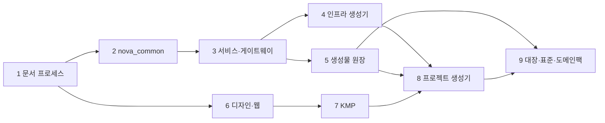
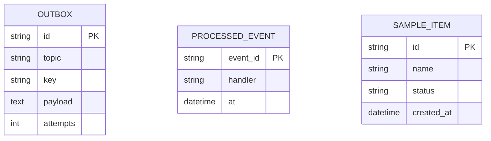

# plan_REQ_01 · 공통개발플랫폼 구축 — dayroom2 공통부 추출 v1.1

**대상 시스템** Nova-dev 저장소 전체 (문서 체계 · `nova_common` · 서비스 골격 · 인프라 생성기 · 생성물 원장 · 디자인 시스템 · 웹 · KMP · 프로젝트 생성기)
**변경점** 빈 저장소 → dayroom2 에서 업무와 무관한 공통부만 골라 일반화한 플랫폼

> **한 줄 요약** — 잘 지어진 집(dayroom2)에서 가구(업무 코드)는 두고 **설계도 · 배관 · 배선 · 공구함**만 떼어 와 어떤 집이든 지을 수 있는 **모델하우스 키트**로 만든다.

| 항목 | 값 |
|---|---|
| 버전 | **v1.1** · 기준 마스터플랜 v1.1 |
| 요구 | [REQ-261103-01](../requirement/requirement_261103_01.md) · [02](../requirement/requirement_261103_02.md) · [03](../requirement/requirement_261103_03.md) · [04](../requirement/requirement_261103_04.md) · [05](../requirement/requirement_261103_05.md) · [06](../requirement/requirement_261103_06.md) |
| task | [tasks/tasks_REQ_01.md](tasks/tasks_REQ_01.md) — 진행 상황의 정본 |
| 원칙 | 단계마다 테스트 녹색 → 커밋 → git 기록 → 푸시 · DayRoom 업무 코드 0 |

> **진척 (2026-11-03, tasks 기준)** — 1~9단계 ✅ — 남은 일: 4.08 실환경 Kafka E2E · 6.10 사람 평가 · 7.07 Android/iOS · 8.07 템플릿 저장소 설정

## 0. 영향분석 (착수 전 조회)
```
1) 대상: 빈 저장소(README 1개) — 기존 코드 영향 없음
2) 직접 영향: 이후 모든 신규 프로젝트의 구조 · 규칙
3) 간접 영향: dayroom2 는 바꾸지 않는다(읽기 전용 원본)
4) 등급: 큼 — 플랫폼의 기초. 결정은 REQ-261103-01 사용자 답변으로 확정
5) 갱신 산출물: 저장소 전체, master_plan v1.0
```

## 1. 설계의 중심축 — 「복사」가 아니라 「일반화」
착수 전 가설은 *"dayroom2 의 공통 폴더를 복사하면 된다"* 였다. 분석(Explore 3갈래)이 바꾼 것:

| 숨은 결합 | 어디서 | 처방 |
|---|---|---|
| 이름이 곳곳에 박혀 있다(`dayroom_` 메트릭 · `DAYROOM_` env · `kr.dayroom` · `@dayroom` · `dr_token` · 레지스트리 · 도메인) | 공통 라이브러리 · 생성기 · 웹 · KMP | `nova.project.json` 하나에서 읽는다 |
| 원장 스캐너가 DayRoom 폴더 구조를 안다 | `registry.py` | 엔진 / 설정(`registry.config.json`) 분리 |
| 문서가 약속한 것이 코드에 없다(`useAction` · `DataTable` · `ListPage` · KMP `uikit` 미빌드) | ui.md vs web/packages/ui | Nova 에서 실제로 구현 |
| 생성기 누락(`ServiceDown` 정규식이 손으로 쓰여 서비스 2개 빠짐) · URL 하드코딩(`git_record.sh`) · CRLF | infra · scripts | 생성 · 원격에서 계산 · `.gitattributes` |
| 이 PC 에 `make` 가 없다 | 환경 | `python nova.py <명령>` 단일 진입점 |

> **핵심 인사이트** — 공통부의 가치는 코드보다 **단일 원천 → 생성 → `--check` 검사**라는 고리에 있다. 이 고리를 지키면 프로젝트마다 이름 · 서비스 · 색이 달라도 플랫폼 규칙이 저절로 지켜진다.

## 2. 모델 변경
| 무엇 | dayroom2 | Nova |
|---|---|---|
| 요구 폴더 | `docs/requement/` | `docs/requirement/` (하위 ID `REQ-YYMMDD-NN-n` 통일) |
| 계획 형식 | 옛 형식 + §4 형식 혼재 | §4 형식 하나 + UX 점검(4.1) |
| ADR | 두 폴더 · 인덱스 없음 | `docs/adr/` + 인덱스 |
| 문서 번호 · 인덱스 | 손으로 | `docs_new.py` · `docs_index.py --check` |
| 공통 라이브러리 | `dayroom_common` | `nova_common` (업무 메트릭 · DEV 기능 목록 제거, 설정화) |
| 서비스 | 업무 서비스 8개 | `gateway` + `sample` + `_template` |
| 명령 | Makefile | `nova.py` (+ Makefile 별칭) |

## 3. 선행 관계

병렬 가능: 4 ↔ 5, 6 은 3 이후 실제 연동만 의존.

## 4. 표면 (API · CLI)
| 표면 | 명령 · 경로 |
|---|---|
| 작업 진입점 | `python nova.py install · test · lint · run · new-service · tokens · web · kmp` |
| 문서 | `uv run python scripts/docs_new.py <req·plan·history·session·review·verify·adr>` · `docs_index.py --check` · `git_record.py` |
| 슬래시 명령 | `/session-start` · `/session-end` · `/req-new` · `/plan-new` · `/history-new` |
| 게이트웨이 | `/v1/auth/login` · `/v1/menu` · `/v1/<서비스 경로>` 프록시 · `/healthz` · `/metrics` |
| 샘플 서비스 | `/v1/sample/items` CRUD · 이벤트 `sample.item.created` |
| 웹 샘플 앱 | 로그인 · 아이템 목록(ListPage) |

### 4.1 UX 점검
6 · 7단계 공통 컴포넌트에서 [자동] 항목(H1 상태 템플릿 · H3 확인 대화상자 · H5 중복 제출 방지 · H9 ErrorState · H10 단축키 도움말)을 구현한다. 샘플 앱 화면 점검은 6단계 task.

## 5. 생애주기
해당 없음 — 플랫폼 구축(상태를 갖는 업무 개체 없음). 문서 생애주기는 README §1(초안 → 정식).

## 6. 핵심 분기
| 실패 지점 | 동작 | 이유 |
|---|---|---|
| prod 에서 기본 JWT 키 · 개발 기능 켜짐 | 기동 거부(닫힘) | 보안 |
| 게이트웨이 RBAC 조회 실패 5분 초과 | 거부(닫힘) | 권한 우회 방지 |
| 생성물이 원천과 다름 | lint 실패 | 손 수정 방지 |

## 7. 데이터 모델

모든 DB 서비스에 `outbox` · `processed_event` 가 자동으로 붙는다(`add_infra_tables`).

## 8. 재사용
dayroom2 원본(읽기 전용): `packages/common-py/dayroom_common/*` · `services/gw-channel` · `services/iam`(모듈형 레이아웃) · `scripts/{gen_k3s,devstack,dev_server,local_db_setup,validate_infra,gen_dashboards,registry,gen_tokens,mockup_shots}.py` · `infra/*` · `docs/plans/README.md` · `.claude/commands/*` · `web/packages/{ui,sdk}` · `apps/kmp`.

## 9. 범위 밖
| 안 하는 것 | 이유 |
|---|---|
| DayRoom 업무(룸 · 예약 · 결제 · 원장 · 쿠폰 · 리뷰) | 업무 코드 — 플랫폼 아님 |
| IAM 전체(레벨 · 그룹 · 직원 계정) | 게이트웨이는 RBAC 조회 인터페이스만, 실제 IAM 은 프로젝트가 서비스로 추가 |
| Android/iOS 실제 빌드 검증 | 이 PC 환경 — JVM 데스크톱 · shared 테스트까지 |
| GitHub 저장소 템플릿 설정 변경 | 외부 설정 — 사용자 확인 후 |

## 10. 테스트 맵
| 코드 경로 | 테스트 | 수용 기준 |
|---|---|---|
| `packages/common-py` | `packages/common-py/tests` | 아웃박스 · 멱등 · DLQ · JWT · prod 안전 |
| `services/*` | `services/<svc>/tests` | CRUD · 이벤트 발행/소비 · 게이트웨이 프록시 |
| 통합 | `tests/integration` | 게이트웨이 경유 로그인 → 아이템 생성 → 이벤트 소비 |
| 생성기 · 원장 · 문서 | `nova.py lint` · `tests/test_registry.py` · `tests/test_docs.py` | `--check` 통과 |
| 웹 · KMP | `npm run build` · `:shared:jvmTest` | 빌드 · 테스트 통과 |
| 생성기 | `tests/test_new_project.py` | 생성 프로젝트에서 test 통과 |
| 대장 · 표준 | `tests/test_registry.py` · `nova.py lint` | 4대장 파생 · 표준 판정 누락 시 실패 |

## 11. 후속 · 예외
- IAM 서비스 템플릿(회원 · 역할 · RBAC)은 다음 계획 후보
- Schema Registry(Avro) 실제 연동은 후속

## 12. 체크리스트
- [x] 1단계 · 저장소 기반 + 문서 프로세스 (`354912f`)
- [x] 2단계 · `nova_common` (+ UUIDv7)
- [x] 3단계 · 서비스 골격 · 게이트웨이 · 스캐폴드
- [x] 4단계 · 인프라 · 관측 생성기
- [x] 5단계 · 생성물 원장
- [x] 6단계 · 디자인 시스템 · 웹
- [x] 7단계 · KMP 골격
- [x] 8단계 · 프로젝트 생성기 · 마무리
- [x] 9단계 · psg05 대장 4종 원장 통합 · 표준(STD) 채택 · 도메인 팩 (REQ-261103-04)

### 12.1 실측으로 정정된 자리
- 1단계 착수 시: 이 PC 에 `make` 없음 → `nova.py` 진입점 추가(계획에 없던 것)
- 1단계 진행 중: 사용자 추가 요구 REQ-261103-02(닐슨 휴리스틱 UX 규칙) → `docs/conventions/ux-heuristics.md`, 계획서 §4.1, 검토 템플릿 반영
- 9단계: 대장 형식은 ADR-004(JSONL · JSON · MD)로, MD 표 파서 방식은 버림. 대장이 restore 권한 분류 오류를 드러냄. 가변점 ②④⑤ 는 규약까지만(🗺)
- 8단계: 플랫폼 라이브러리 이름(nova_common · @nova · kr.nova.uikit)은 바꾸지 않고 프로젝트 고유 값만 바꾸기로(프레임워크처럼 업그레이드 가능하게). 물려받은 ADR 의 근거 링크는 원본 저장소 주소로
- 7단계: dayroom2 스냅샷 크기 결함(픽셀/dp) · uikit 미빌드 · 다크 대비 문제를 바로잡음. Gradle 래퍼를 저장소에 둠
- 6단계: 브라우저 스모크로 접근성(라벨 연결) · 하이드레이션 결함 2건 발견 → 템플릿에서 수정. 스모크를 플랫폼 도구로 남김(계획에 없던 것)
- 4단계: 생성 블록 교체 방식 대신 파일 전체 생성 — 손 관리 파일에서 프로젝트 이름을 없애 새 프로젝트 생성 시 치환이 필요 없게. ServiceDown 정규식 결함 수정
- 2단계: 카탈로그 테스트가 services/ 폴더를 요구 → 2 · 3단계를 한 번에 커밋. 사용자 추가 요구 REQ-261103-05(한국어 규칙) · REQ-261103-06(UUIDv7 → ADR-003)
- 3단계: 게이트웨이 권한 표를 파일 모드(rbac.json) 기본 + 서비스 모드로 일반화 — IAM 없는 프로젝트도 바로 동작. 개발 로그인을 게이트웨이에 내장
- 1단계 진행 중: 사용자 추가 요구 REQ-261103-03(uv) → 루트 `pyproject.toml` 워크스페이스 · `uv.lock` · ADR-002. 시스템 Temp 권한 문제로 pytest 임시 폴더를 `.pytest_tmp/` 로

## 13. task 분해
[tasks/tasks_REQ_01.md](tasks/tasks_REQ_01.md)

---
관련 문서: [master_plan](master_plan.md) · [README](README.md) · [ux-heuristics](../conventions/ux-heuristics.md)

## 변경 이력
- v1.0 · 2026-11-03 · 최초 작성
- v1.1 · 2026-11-03 · 9단계 추가(REQ-261103-04), uv(REQ-261103-03), 기준 마스터플랜 v1.1

> **다시 한 줄 요약** — 업무는 두고 규칙 · 도구 · 골격만 가져와, **새 프로젝트가 첫날부터 같은 방식으로 일하게** 만든다.
