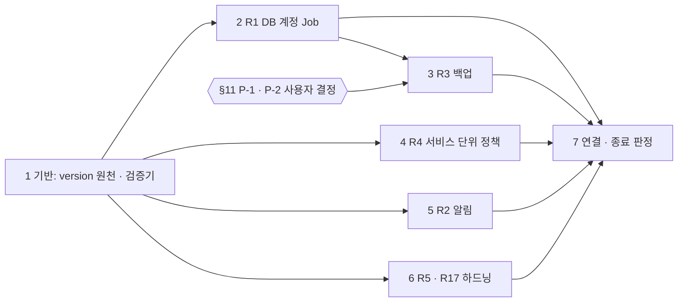
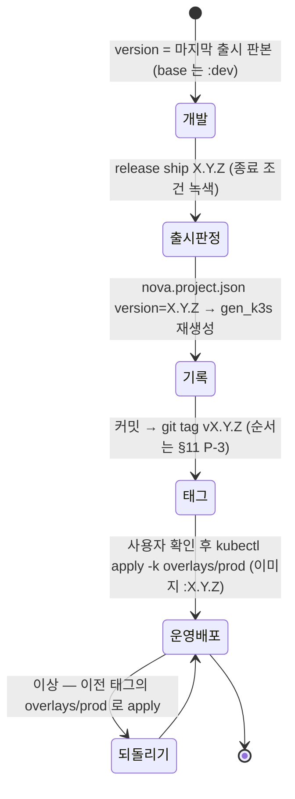
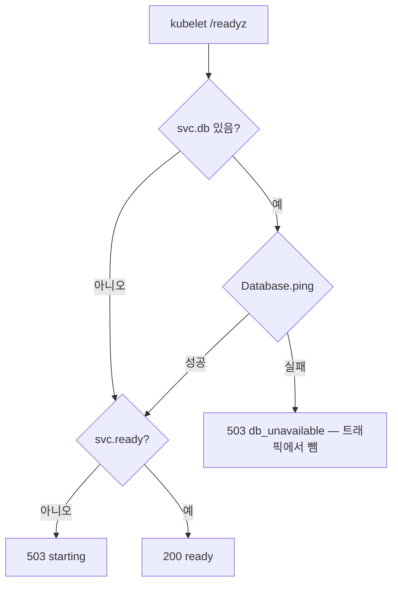

# plan_REQ_02 · 운영 · 인프라 준비 v1.0

**대상 시스템** 인프라 생성기 `scripts/gen_k3s.py` · `infra/k3s/overlays/prod` · `infra/helm/chart` · `infra/observability` · `infra/docker/Dockerfile.web` · `nova_common.service`(준비 확인) · `scripts/validate_infra.py` · `scripts/release.py` · `scripts/new_project.py`
**변경점** 운영 오버레이가 DB 계정 · 백업 · 서비스 단위 격리 · 알림 이중화 · 판본 이미지 태그를 **생성물 기본값**으로 갖는다

> **한 줄 요약** — 새 집 열쇠(DB 계정) · 화재경보 두 곳 연결(알림) · 금고 복사본(백업) · 방마다 잠금(통신 정책) · 이사 전 집으로 돌아가는 길(되돌리기)을 **설계도(gen_k3s)에 그려 넣어**, 어느 집을 지어도 첫날부터 달려 있게 한다.

| 항목 | 값 |
|---|---|
| 버전 | **v1.0** · 기준 마스터플랜 v1.2 |
| 요구 | [REQ-261104-10](../requirement/requirement_261104_10.md) |
| task | [tasks/tasks_REQ_02.md](tasks/tasks_REQ_02.md) — 진행 상황의 정본 |
| 원칙 | 단계마다 전체 테스트 녹색 · 생성물은 gen_k3s 원천에서만 · 문서 기록 |
| 실행 방식 | (사용자 선택) subagent — superpowers:subagent-driven-development / native — superpowers:executing-plans ([superpowers.md §5](../conventions/superpowers.md)). 권고: native — 모든 task 가 `gen_k3s.py` 한 파일을 고쳐 나눠 맡기면 충돌한다 |

> **진척 (2026-11-04, tasks 기준)** — 37 / 46

## 0. 영향분석 (착수 전 조회)
```
1) 대상: 운영 배포 생성물(k3s prod 오버레이 · Helm · 관측) 과 그 원천(gen_k3s.py · services.json · nova.project.json), 준비 확인(nova_common.service /readyz), 인프라 검증기, 릴리스 · 새 프로젝트 스크립트의 version 처리
2) 직접 영향: 원장 1건 API-GW-0006 POST /internal/alertmanager(수신처가 하나 더 붙을 뿐 계약 변화 없음)
   · infra/k3s/base/networkpolicy.yaml(서비스 네임스페이스 공통 허용 → 서비스 단위) · overlays/prod/* 신설 5종 · helm/chart/* · Dockerfile.web
3) 간접 영향: 소스 · 문서 50+57파일(impact 두 번 — 대부분 history · git 기록 · 계획의 언급)
   · new-project 복제본이 version · 정책 · Job 을 물려받는다(test_new_project 가 본다)
   · release ship 이 nova.project.json version 을 바꾸면 인프라 생성물이 낡는다 → lint 빨강(이 계획에서 연결)
4) 등급: 보통 — 추가(Expand) 위주, 의미 변경 1건(서비스 네임스페이스 안 통신 허용 → 게이트웨이 · 허용 목록만). 실제 운영 배포가 없어 마이그레이션 대상 없음 → ADR 불필요. 단 R3 를 관리형 DB 로 정하면 ADR(§11 P-1)
5) 갱신 산출물: gen_k3s 생성물 전부(python nova.py gen) · tests/test_infra.py · packages/common-py/tests/test_hardening.py · docs/conventions/deploy.md(신설) · docs/releases/_template.md 되돌리기 자리표시 · 생성물 원장 sync 해당 없음(원장은 표 · 화면 · API · 토픽 · 부품 · 서비스만 — 서비스 목록 불변)
6) 대장 조회(docs/registry):
   · 화면(screens) — 0줄(impact). 화면 변경 없음
   · DB 사전(db-dictionary) — 표 · 컬럼 변경 없음. 소유 DB 는 sample 하나(item · item_activity + 공통 outbox · processed_event) → 계정 Job · 백업 대상은 services.json db:true 인 sample 하나(지금 기준). 새 서비스는 목록에서 자동 포함
   · 권한(permissions) — 0줄. 역할 · 권한키 변경 없음(NetworkPolicy 는 망 계층, RBAC 와 별개)
   · 이벤트(events) — 0줄. 토픽 변경 없음. Kafka 수신 정책(kafka-from-services)은 그대로
7) 표준 판정(docs/std):
   · STD-TENANCY-001(적용 · M1) — 해당 없음: 테넌트 전파 경로를 바꾸지 않는다. 단 M1 공유 스키마라 백업 · 복원은 DB 전체 단위다 — 테넌트 하나만 되돌리는 복원은 안 된다(deploy.md 에 적는다)
   · STD-DOMAIN-PACK-001(적용) — 코어(플랫폼 인프라). 팩과 무관
   · STD-AX-001(적용 · L1) — 해당 없음: AI 기능 없음. 복원 · 되돌리기는 사람이 실행하는 절차로만 둔다
```

## 1. 설계의 중심축
착수 전 가설: "감사가 짚은 7건은 각각 gen_k3s 에 YAML 몇 줄을 더하면 된다."

> **핵심 인사이트** — 덧붙이는 YAML 보다 **원천 두 곳의 빈칸**이 더 크다. ① `nova.project.json` 에 `version` 이 없고 `release ship` 이 버전을 기록하기도 전에 태그를 만들어서, "판본 = 이미지 태그 = 되돌리기 지점" 사슬이 처음부터 끊겨 있다. ② 운영 비밀번호의 원천이 서비스 쪽 `url` 하나뿐이라 DB 쪽 계정을 만들 방법이 없다. 그래서 1단계(버전 원천 · 검증기)와 2.01(비밀번호 하나 → url 조립)을 먼저 놓는다.

### 1.1 대조 증거
| 가설 | 실측 | 근거 |
|---|---|---|
| 이미지 태그는 version 만 읽게 바꾸면 된다 | `version` 키가 없다. `0.1.0` 이 세 곳(prod images · Chart.yaml · values.yaml)에 박혀 있다 | `nova.project.json`(50줄, version 없음) · `scripts/gen_k3s.py:432` · `:487-488` · `:496` |
| 릴리스가 version 을 관리한다 | `ship()` 이 meta version 을 기록하지만 생성물은 다시 만들지 않는다. 태그는 커밋 전 HEAD 에 붙는다 | `scripts/release.py:97-99` · `:143-146` |
| 프로비저닝 Job 만 더하면 된다 | 운영 DB 시크릿은 서비스 네임스페이스의 `url` 키뿐이다. Job(infra 네임스페이스)은 다른 네임스페이스의 시크릿을 읽지 못한다 | `scripts/gen_k3s.py:409` · `:416` |
| PDB 가 없다(R5) | 서비스는 base 에 이미 PDB 가 있다. 웹 · Helm 에만 없다 | `scripts/gen_k3s.py:139-146` · `:150-184` · `infra/helm/chart/templates/services.yaml` |
| 검증기가 새 리소스를 본다 | CronJob 은 `spec.template` 이 아니라 `spec.jobTemplate.spec.template` 이다 → 참조 · 이미지 검사가 빠진다. ExternalSecret 대상은 Secret 으로 안 친다 | `scripts/validate_infra.py:60` · `:69-70` · `:125` |
| 운영 렌더는 이 PC 에서 못 본다 | Docker Desktop kubectl 로 된다(운영 렌더 52 리소스). helm 만 없다 | `validate_infra.py` 실행 출력 |

## 2. 모델 변경
| 무엇 | 어디서 | 어디로 | 근거 |
|---|---|---|---|
| 판본 버전 | 세 곳에 `"0.1.0"` 고정 | `nova.project.json` `version` → `Ctx.version` → prod images · Chart · values | P6 · REQ-10-6 |
| 운영 DB 비밀번호 원천 | 서비스 시크릿 `url`(원격 property `url`) | 원격 property `password` 하나 → 서비스 쪽은 ExternalSecret `target.template` 로 url 조립 · infra 쪽은 프로비저닝 시크릿 | R1 — 같은 값을 두 번 넣는 운영 실수 방지(§11 P-4) |
| DB 계정 · 권한 | 수동(주석 "후속 과제") | `overlays/prod/db-provision-job.yaml` Job + `db-provision.sh` ConfigMap | R1 · REQ-10-1 |
| 백업 | 없음 | `overlays/prod/mariadb-backup.yaml` PVC + CronJob(권고안 A) | R3 · REQ-10-3(§11 P-1 · P-2) |
| 서비스 통신 허용 | 네임스페이스 단위 `allow-services-and-observability` | 백엔드 서비스마다 `allow-<서비스>`(게이트웨이 파드 · `k8s.allow_from` · observability) | R4 · REQ-10-4 |
| 허용 목록 원천 | 없음 | `services.json` `k8s.allow_from: [서비스 이름…]`(선택, 기본 없음 = 게이트웨이만) | 단일 원천 — 새 서비스도 같은 규칙 |
| 알림 수신처 | 게이트웨이 1곳 · emptyDir | prod 전용 `alertmanager.yml`(게이트웨이 + oncall `url_file`) · 수신처 ExternalSecret · PVC | R2 · REQ-10-2 |
| 준비 확인 | `svc.ready` 만 | DB 서비스는 `Database.ping()` 실패면 503 `db_unavailable` | R5 · REQ-10-5 |
| 웹 · Helm 운영 기본값 | probe 1개 · 보안 컨텍스트 일부 · PDB 없음 | k3s 서비스와 같은 probe 3종 · 보안 컨텍스트 · PDB | R5 |
| 신뢰 홉 | 기본 0(XFF 무시) | prod configmap · Helm values `GW_TRUSTED_HOPS="1"` | R17 · REQ-10-7(§11 P-5) |

설계 결정
- prod 전용 설정은 `mariadb-init` 의 선례대로 `configMapGenerator behavior: replace` + prod 디렉터리 안 생성 파일로 만든다. kustomize 는 오버레이 밖 파일을 읽지 못한다.
- Job 은 `ttlSecondsAfterFinished` 로 끝난 뒤 지워진다. 그래야 다시 apply 해도 불변 필드 오류 없이 새로 만들어진다. SQL 은 `IF NOT EXISTS` · `ALTER USER` 로 멱등이라, 다시 돌면 비밀번호 동기화(교체)가 된다.
- 알림 수신처 시크릿 마운트는 `optional: true` 로 둔다. 시크릿이 아직 없는 첫 배포에서도 Alertmanager 가 뜨고, 게이트웨이 수신은 살아 있다.

## 3. 선행 관계

- 2 · 4 · 5 · 6 은 논리적으로는 서로 기대지 않지만 모두 `gen_k3s.py` · `tests/test_infra.py` 를 고친다 → **직렬**(병렬 게이트도 닫혀 있다 — 마스터플랜 '병렬 묶음' 비어 있음)
- 3단계는 백업 Job 이 2단계 NetworkPolicy(mariadb 허용)를 함께 쓰므로 2 뒤에 둔다

## 4. 표면 (API · CLI 표면 — 화면 없음)
| 지금 | 바뀐 뒤 |
|---|---|
| `python nova.py gen` → 생성물 24개 | +prod 5종(`db-provision-job.yaml` · `db-provision.sh` · `mariadb-backup.yaml` · `alertmanager.yml` · `alertmanager-pvc.yaml` — 이름은 task 에서 확정) |
| `validate_infra.py` → overlay · 운영 렌더 · 규칙 · 대시보드 | +`운영 준비: DB 계정 Job N · 서비스 정책 N/N · PDB N/N` 한 줄. 빠지면 실패(E3) |
| `release ship X.Y.Z` → version 기록 · 태그 | +version 기록 직후 인프라 생성물 재생성(태그 순서는 §11 P-3) |
| `new-project` → base meta 복사 | `version` 을 `"0.1.0"` 으로 되돌림 |
| `GET /readyz` → `svc.ready` | DB 서비스는 DB 응답 없음 → 503 `{"status":"db_unavailable"}`(`/healthz` 는 그대로 200 — 재시작 폭주 방지) |

| 화면 | API | 표 | 권한 |
|---|---|---|---|
| 없음 | `/readyz` 응답 의미 추가(쿠버네티스 전용 · 스키마 밖 `include_in_schema=False`) · `POST /internal/alertmanager`(API-GW-0006) 변화 없음 | 없음 | 없음 |

### 4.1 UX 점검
해당 없음 — 화면이 없다. 사람이 읽는 출력(validate_infra 한 줄 · deploy.md 절차)은 한국어로, 실패 줄에 무엇이 빠졌는지를 쓴다.

## 5. 생애주기
판본 · 이미지 태그 · 되돌리기

| 상태 | 운영 이미지 태그 | 되돌릴 수 있나 |
|---|---|---|
| 개발 | 마지막 출시 판본 | — |
| 운영배포 | X.Y.Z(가변 태그 금지 — validate_infra) | 이미지: 예(이전 태그). DB: 백업 복원으로만(스키마는 `create_all` 추가만 — R6 전) |

## 6. 핵심 분기

| 실패 지점 | 동작 (닫힘/열림) | 이유 |
|---|---|---|
| DB 응답 없음 | readyz 닫힘(503) · healthz 열림(200) | 트래픽만 빼고 재시작 폭주는 막는다 |
| 프로비저닝 Job 실패(MariaDB 미기동 등) | backoffLimit 만큼 재시도 → Failed. 서비스 readyz 503 유지(닫힘) | 계정 없이 받은 요청이 500 으로 새지 않게 |
| 허용 목록에 없는 파드 → 백엔드 | 거부(닫힘) | R4 목적 |
| `allow_from` 에 없는 서비스 이름 | gen_k3s 실패(닫힘) | 오타가 조용히 "아무도 허용 안 함"이 되지 않게 |
| oncall 수신처 시크릿 없음 | Alertmanager 기동 · 게이트웨이 수신은 됨(열림) · oncall 만 발송 오류 | 알림 전체가 꺼지는 것보다 낫다 |
| 백업 CronJob 실패 | Job Failed 로 남음(알림 없음 — §9) | kube-state-metrics 없음 |
| nova.project.json 에 version 없음 | gen_k3s 실패(닫힘) | 기본값을 박으면 다시 같은 결함 |

## 7. 데이터 모델
해당 없음 — 표 · 컬럼 변경 없음(db-dictionary 그대로).
| 구분 | 표 · 컬럼 |
|---|---|
| 있는 것 | sample DB(item · item_activity · outbox · processed_event) |
| 신설 | 없음 — DB **계정** `'<db>'@'%'` · `GRANT ALL PRIVILEGES ON <db>.*` 를 운영에 만든다(개발 `mariadb-init.sql` 과 같은 권한) |
| 바뀌는 것 | 없음 |

## 8. 재사용
| 자산 (원장 ID) | 쓰는 법 |
|---|---|
| `gen_k3s.Ctx` · `put()` · `HDR` | 새 생성물도 같은 틀로. 이름은 `c.slug` · `c.db_secret()` |
| `EXTRA_SECRETS` · `delete-dev-secrets` · `secrets-external` 생성 루프 | 프로비저닝 · 수신처 시크릿을 같은 목록에 더한다(개발 시크릿 지우기 · ExternalSecret 대체를 공짜로 받음) |
| prod `mariadb-init` `behavior: replace` 선례(`gen_k3s.py:440`) | prod 전용 alertmanager 설정 |
| base Deployment 의 probe · 보안 컨텍스트 · PDB(`gen_k3s.py:94-146`) | 웹 · Helm 에 같은 값 |
| `validate_infra.check_prod_render` · `DEV_SECRET_MARKERS` · 가변 태그 검사 | CronJob · Job 도 같은 검사를 받게 경로만 넓힌다 |
| `mariadb:11.4` 이미지(`infra/k3s/base/mariadb.yaml`) | Job · CronJob 클라이언트 — 고정 태그라 검사를 통과한다 |
| `routing.client_ip` · `GW_TRUSTED_HOPS`(`services/gateway/gateway/routing.py:125-128`) | 값만 넣는다. 코드 변경 없음 |
| `release.ship` 의 meta version 기록(`release.py:97-99`) | 그대로 두고 생성물 재생성만 잇는다 |
| `nova.project.json` `timezone` | 백업 CronJob `timeZone`(새 값을 만들지 않는다) |
| `catalog.services()` · `ServiceSpec.db_name` | Job · 백업 · 정책 대상 목록 — 손 목록 금지 |

## 9. 범위 밖
| 안 하는 것 | 이유 · 어디서 |
|---|---|
| 실제 운영 클러스터 배포 · 복원 리허설 | 요구 비목표 · 제약 "운영 실제 배포는 사용자 확인 후" — 판정 불가 목록으로 |
| 관리형 클라우드 DB 전용 기능 | 요구 비목표(§11 P-1 에서 B 를 고르면 ADR 만 쓴다) |
| 서비스 메시 · mTLS | 요구 비목표 |
| egress NetworkPolicy | 이번은 ingress 만(감사 R4 범위). 필요하면 새 요구 |
| 마이그레이션 계정 · 앱 계정 분리(최소 권한) | `create_all` 이 DDL 권한을 요구 — REQ-261104-11 R6(Alembic) 에서 |
| 백업 노드 밖 자동 복사(오브젝트 스토리지) | 의존 추가 — §11 P-2 에서 고르면 새 요구 |
| 백업 실패 알림 | kube-state-metrics 가 없다 — 새 요구 |
| Prometheus 데이터 영속 | R2 는 알림만 |
| compose · dev 오버레이 동작 변경 | 개발 경로는 그대로(신뢰 홉 0 · 알림 1곳 · 백업 없음) |
| `release ship` 태그 순서 수정 | §11 P-3 에서 A 를 고르지 않으면 새 요구 |

## 10. 테스트 맵
| 코드 경로 | 테스트 | 수용 기준 |
|---|---|---|
| `gen_k3s.Ctx.version` · prod images · Chart · values | `tests/test_infra.py::test_image_tag_comes_from_project_version` · `::test_missing_version_fails` | REQ-10-6 |
| `new_project` version 초기화 | `tests/test_new_project.py::test_meta_and_identity`(단언 추가) | REQ-10-6 |
| `release.ship` 생성물 재생성 | `tests/test_parallel.py::test_release_ship_regenerates_infra` | REQ-10-6 |
| `validate_infra.check_refs` · `check_prod_render`(CronJob · ExternalSecret) | `tests/test_infra.py::test_validator_reads_cronjob_and_external_secret` | E3 전제 |
| `validate_infra.check_prod_readiness` | `tests/test_infra.py::test_prod_readiness_check_flags_missing` · `::test_prod_readiness_passes_on_generated` | E3 |
| secrets-external password · url 템플릿 · 프로비저닝 시크릿 | `tests/test_infra.py::test_prod_db_secret_single_password_source` | REQ-10-1 |
| `db-provision.sh` · Job | `tests/test_infra.py::test_prod_has_db_provision_job_for_every_db_service` | REQ-10-1 |
| mariadb 정책 | `tests/test_infra.py::test_mariadb_policy_admits_provision_and_backup` | REQ-10-1 · 3 |
| 백업 CronJob · PVC | `tests/test_infra.py::test_prod_backup_cronjob` | REQ-10-3 |
| 서비스 단위 정책 · `allow_from` | `tests/test_infra.py::test_backend_policy_admits_only_gateway_and_allowlist` · `::test_unknown_allow_from_fails` · `packages/common-py/tests/test_catalog.py::test_allow_from_default_empty` | REQ-10-4 |
| prod alertmanager · 수신처 시크릿 · PVC | `tests/test_infra.py::test_prod_alertmanager_two_receivers_and_volume` | REQ-10-2 |
| `/readyz` DB 확인 | `packages/common-py/tests/test_hardening.py::test_readyz_reports_db_down_but_healthz_ok` | REQ-10-5 |
| 웹 probe · 보안 · PDB | `tests/test_infra.py::test_web_has_probes_security_and_pdb` | REQ-10-5 |
| Helm 동등성 | `tests/test_infra.py::test_helm_template_matches_k3s_hardening` | REQ-10-5 |
| `npm ci` | `tests/test_infra.py::test_web_dockerfile_uses_npm_ci_only` | REQ-10-5 |
| `GW_TRUSTED_HOPS` | `tests/test_infra.py::test_prod_sets_trusted_hops` | REQ-10-7 |

## 11. 후속 · 예외

### 11.1 전역 제약 (모든 task 에 적용 — 요구 원문 값 그대로)
| 제약 | 값 · 출처 |
|---|---|
| 언어 | 화면 문구 · 오류 메시지 · 주석은 한국어 (CLAUDE.md 규칙 0) |
| 생성물 | "생성물은 gen_k3s 원천에서만" — 요구 INTENT 제약. 반목표 "생성물을 손으로 고쳐 맞추는 것 — 다음 gen 에 사라진다" |
| 비밀값 | "비밀값은 문서에 쓰지 않는다" — 요구 제약. 생성물 · deploy.md 에 비밀번호 · URL 실값 금지(validate_infra `DEV_SECRET_MARKERS` · 평문 Secret 금지) |
| 배포 | "운영 실제 배포는 사용자 확인 후" — 요구 제약. 이 계획의 어떤 task 도 클러스터에 apply 하지 않는다 |
| 이미지 | 운영 렌더에 `:dev` · `:latest` · 태그 없음 금지(`validate_infra.py:128`) |
| 손 관리 파일 | `infra/k3s/base/{kafka,mariadb}.yaml` · `observability/k8s/*` · `helm/chart/templates/*` · `infra/docker/*` 는 손으로 고친다(`gen_k3s.py:15-16`). 그 밖 infra 파일은 생성물 |
| 범위 | 종료 조건 E1~E3 밖으로 넓히지 않는다 — 새로 보인 것은 §5 세 갈래(plans README §5) |

### 11.2 검토 초점 (사람이 부딪힐 상황 — 많이 부딪힐 순서로 5개)
| 입력 · 상황 | 기대 동작 | 테스트를 넣은 task |
|---|---|---|
| `new-service` 로 DB 서비스를 하나 더 만든다 | 정책 · 계정 Job · 백업 대상 · 프로비저닝 시크릿에 손대지 않아도 들어간다 | T02-2.03 · T02-3.02 · T02-4.02(카탈로그 전부를 도는 단언) |
| `release ship` 직후 `lint` | 인프라 생성물이 낡지 않아 녹색 | T02-1.04 |
| 운영자가 첫 배포에서 수신처(oncall) 시크릿을 아직 안 만들었다 | Alertmanager 는 뜨고 게이트웨이로는 알림이 간다 | T02-5.03(`optional: true` 단언) |
| 같은 오버레이를 두 번 apply 한다 · 비밀번호를 바꾼 뒤 다시 apply 한다 | Job 불변 필드 오류가 없고, 다시 돌면 계정이 그대로 · 비밀번호가 동기화된다 | T02-2.04(`ttlSecondsAfterFinished` · `IF NOT EXISTS` · `ALTER USER` 단언) |
| DB 가 잠깐 내려간다 | readyz 503 · healthz 200 — 파드가 재시작 폭주하지 않는다 | T02-6.01 |

### 11.3 자체 점검 (superpowers:writing-plans — 다 쓴 뒤 한 번)
- [x] 요구 반영 — REQ-10-1 → 2단계 · -2 → 5단계 · -3 → 3단계 · -4 → 4단계 · -5 → 6.01~6.04 · -6 → 1.01~1.04 · 7.02 · -7 → 6.05~6.06
- [x] 단계 명확성 — task 마다 파일 · 이름 · 끝난 기준이 하나다. 남은 열린 결정은 §11.4 판단 포인트로 뺐다
- [x] 타입 일관성 — `Ctx.version` · `ServiceSpec.allow_from` · `Database.ping()` · `check_prod_readiness(docs)` 를 앞 task 에서 정하고 뒤 task 가 같은 이름을 쓴다
- [x] 검토 초점 — 11.2 의 5줄 모두 담당 task 가 있다
- [x] 분량 — 코드 블록은 상태도 · 흐름도뿐

### 11.4 판단 포인트 — 사용자 몫 (되돌리기 어려움 · 범위 결정)
| ID | 질문 | 선택지 · 대가 | 권고 |
|---|---|---|---|
| P-1 | R3 백업 방식(요구 '미해결') | **A** 덤프 CronJob(생성물 기본값 — 어느 클러스터에서나 동작 · 노드 로컬 MariaDB 단일은 그대로) / **B** "운영 DB 는 관리형"으로 ADR 만(코드 없음 — 관리형이 없는 고객 현장은 무방비) / **C** A 를 기본으로 두고 관리형이면 끄는 스위치(`nova.project.json` 키 하나 추가) | **A** — 비목표 "관리형 클라우드 전용 기능"과 맞고, 되돌리기 쉽다(생성물). 관리형을 쓰는 프로젝트는 그 프로젝트에서 ADR |
| P-2 | 백업 보관 위치 | **A** 같은 노드 `local-path` PVC + 노드 밖 복사는 deploy.md 절차(노드가 죽으면 백업도 같이 잃음) / **B** S3 호환 저장소 업로드(의존 · 비밀 하나 추가 · 이 PC 에서 판정 불가) | **A**. 노드 밖 복사 자동화는 새 요구. ISMS-P 2.9.3(백업 및 복구관리) 관점에서 "보관 장소 분리"는 운영 절차로 남는다 |
| P-3 | `release ship` 이 커밋 전에 태그를 만든다(새로 찾은 결함) | **A** 이번에 고침 — ship 은 기록 · 재생성만, 태그는 커밋 뒤(`/release` 절차가 바뀜 → 승인 필요, task 1개 추가) / **B** 새 요구로 — v0.2.0 첫 출시 태그가 0.1.0 이미지를 가리킨 채 나간다 | **A** — P6 의 "되돌리기 절과 이어진다"가 이 순서에 걸려 있다. 명령 절차 변경이라 사용자 승인 몫 |
| P-4 | 운영 DB 비밀번호 원천 | **A** 원격 property `password` 하나 + url 은 ExternalSecret 템플릿으로 조립(External Secrets Operator 템플릿 기능에 기댐) / **B** url · password 를 각각 넣는다(운영자가 두 번 맞춰 넣어야 함) | **A** — 실제 운영 데이터가 없는 지금이 원격 키 계약을 바꿀 가장 싼 때 |
| P-5 | `GW_TRUSTED_HOPS` 운영 값 | **1** k3s Traefik 단독 / **2** 앞에 클라우드 L7 LB. 잘못 넣으면 사용자별 레이트리밋이 틀린다(위조 허용 또는 모두 같은 IP) | **1**(k3s 기본 구성). 프로젝트마다 다르면 다음 판본에서 `nova.project.json` 키로 |
| P-6 | 웹 `readOnlyRootFilesystem` 실기동 확인 | Docker 로 이미지를 빌드해 `--read-only` 로 띄워 본다(이 PC 에서 되지만 **5분 넘게** 걸림) / 생략하고 판정 불가로 남긴다 | 확인 — Next.js 가 `.next/cache` 에 쓰므로 막히면 운영 첫날 웹이 안 뜬다 |

### 11.5 판정 불가 — 필요한 것
| 확인 | 필요한 것 |
|---|---|
| NetworkPolicy 가 실제로 막는가(sample 파드를 직접 부르면 거부) | k3s(kube-router 정책 컨트롤러) — `kubectl run` 으로 `curl sample.core:8000` |
| 프로비저닝 Job 이 계정을 만들고 서비스가 접속하는가 | k3s + External Secrets Operator + ClusterSecretStore |
| 백업 → 복원 리허설 | k3s + MariaDB 실데이터 |
| oncall 수신처로 실제 발송 · 재시작 뒤 침묵(silence) 유지 | k3s + 수신 웹훅 |
| Helm 렌더(`helm template`) | helm 바이너리(없음 — 텍스트 검사로 대체, `validate_infra.check_helm_render` 는 있으면 돈다) |
| Traefik 뒤 XFF 홉 수 | k3s 인그레스 실제 요청(`externalTrafficPolicy` 에 따라 클라이언트 IP 가 노드 IP 로 바뀔 수 있음) |
| Alertmanager v0.27 `webhook_configs.url_file` 지원 | 공식 문서 확인(T02-5.01) — 없으면 설정 파일 전체를 시크릿으로 |

### 11.6 감수하는 위험
- 서비스 네임스페이스 공통 허용을 없애면 지금 문서에 없는 서비스 간 직접 호출이 운영에서 막힌다. 지금 서비스는 sample 과 gateway 둘뿐이고 sample 을 부르는 것은 gateway 뿐이다(`services.json`). 웹 SSR 이 게이트웨이를 부르는지는 T02-4.03 에서 코드로 확인한다.
- 백업 데이터에는 개인정보가 들어간다. PVC 접근 권한 · 암호화는 클러스터 저장소 설정 몫이라 deploy.md 에 주의로만 남긴다.

### 11.9 사용자 결정 (2026-11-04 — 권고 채택)
- P-1 백업 방식 — A 덤프 CronJob(생성물 기본값)
- P-2 보관 위치 — A 같은 노드 PVC + 노드 밖 복사는 deploy.md 절차
- P-3 release ship 태그 순서 — 이번에 고친다(/release 절차 변경 승인 — T02-1.07 🆕)
- P-4 운영 DB 비밀번호 원천 — A password 하나 + url 은 ExternalSecret 템플릿
- P-5 GW_TRUSTED_HOPS — 1(k3s Traefik 단독)
- P-6 웹 readOnlyRootFilesystem — Docker 로 실기동 확인(5분 이상)

## 12. 체크리스트
- [x] 1단계 · 기반 — version 원천 · 검증기 확장
- [x] 2단계 · R1 운영 DB 계정 프로비저닝 Job
- [ ] 3단계 · R3 운영 MariaDB 백업 · 복원 절차(P-1 · P-2 결정 후)
- [ ] 4단계 · R4 서비스 단위 NetworkPolicy
- [ ] 5단계 · R2 알림 수신처 이중화 · 영속
- [x] 6단계 · R5 준비 확인 · 웹 · Helm · npm ci + R17 신뢰 홉
- [x] 7단계 · 연결 · 되돌리기 문서 · 종료 판정(E1~E3)

### 12.1 실측으로 정정된 자리
- (착수 전) "PDB 없음"은 웹 · Helm 에만 해당 — 서비스는 base 에 이미 있다(`gen_k3s.py:139-146`)
- (착수 전) `nova.project.json` 에 `version` 이 없다 — P6 의 전제가 비어 있었다
- (착수 전) kubectl 운영 렌더는 이 PC 에서 된다(Docker Desktop) — E3 를 여기서 판정할 수 있다
- (1단계) `release ship` 이 직접 커밋한다 — `docs/releases/` 밖에 커밋 안 한 변경이 있거나 같은 태그가 있으면 기록 전에 멈춘다. 재생성은 shipped 기록보다 먼저(실패하면 draft 로 남아 다시 ship)
- (2단계) 계정 Job 스크립트가 서비스마다 `CREATE DATABASE IF NOT EXISTS` 도 한다 — prod `mariadb-init.sql` 은 데이터 폴더가 처음 만들어질 때만 돌아 나중에 더한 DB 서비스는 스키마가 없다
- (2단계) url 템플릿에 `urlquery` — 비밀번호의 `@` · `/` 대비. 공백 든 비밀번호는 `+` 로 바뀌어 지원하지 않는다(판정 불가: ESO 의 urlquery 지원은 k3s + ESO 에서)
- (2단계) DB 서비스가 모두 빠지면 prod 의 Job · 스크립트를 옛 생성물로 지운다(`gen_k3s.py:880`)
- (3단계) 백업 CronJob 에 계획 밖 설정: `startingDeadlineSeconds: 3600` · 성공/실패 기록 각 3 · `backoffLimit: 2` · `TZ`(파일 이름 날짜). PVC 용량 10Gi 도 상수 `BACKUP` 에. `timezone` 이 없으면 gen 이 멈춘다(닫힘)
- (3단계) 덤프에 `--add-drop-database` 를 넣지 않는다 — 복원 절차가 `DROP DATABASE` 를 명시로 한다(잘못 흘린 덤프가 DB 를 통째로 지우지 않게). T02-3.03 은 문서를 테스트보다 먼저 써서, 문서를 치우고 RED 를 확인했다
- (4단계) 웹 SSR 은 게이트웨이를 부르지 않는다 — 화면 7개 · shell 이 모두 `"use client"`, 서버 컴포넌트는 layout 하나(API 호출 없음), route handler · middleware · rewrites 없음, sdk 는 브라우저에서 `NEXT_PUBLIC_API_BASE`(인그레스 경유). 그래서 웹 → 게이트웨이 허용은 넣지 않았다
- (4단계) 게이트웨이 · 웹 파드의 kube-system 허용에 포트 제한(8000 · 3000)이 새로 붙었다. `allow-ingress-controller` 는 웹 파드만 고르고 웹 앱이 없으면 만들지 않는다. kafka · mariadb 정책을 웹 조건 밖으로 분리(웹 앱 없는 프로젝트에서 사라지던 결함 — 계획 밖 테스트 test_netpols_without_web_apps)
- (4단계) 판정 불가 덧붙임: k3s 에서 Traefik 요청 출처가 kube-system 파드 IP 로 보이는지(svclb · externalTrafficPolicy 에 따라 노드 IP) — T02-4.06
- (5단계) 5.01 판정: Alertmanager `webhook_configs.url_file` **지원**(0.26.0 부터 — CHANGELOG #3223 · v0.27.0 `docs/configuration.md` · `config/notifiers.go`). **단 v0.27.0 결함**: url_file 웹훅이 2xx 아닌 응답을 받으면 panic(#3798 · 수정 PR #3800 · 0.28.0) → 🆕 T02-8.05. 시크릿 파일이 없을 때는 오류만 내고 panic 없음 — §6 '시크릿 없음 → 게이트웨이만' 분기는 맞다. 운영 설정은 `amtool check-config`(v0.27.0) 'SUCCESS — 2 receivers'
- (5단계) `alertmanager-receivers` 는 `EXTRA_SECRETS` 가 아니라 `PROD_ONLY_SECRETS` — EXTRA 는 delete-dev-secrets 에도 들어가는데 개발 base 에 이 시크릿이 없어 kustomize 가 실패(db-provision 과 같은 이유). PVC 1Gi(`AM_DATA`) · severity 없는 알림은 gateway 로만 · Deployment 전략은 기본(RollingUpdate — 필요하면 Recreate 후속)
- (6단계) readyz 는 오류 봉투가 아니라 기존 `{"status":…}` 형식(`starting` 과 같은 결) — DB 에 못 닿으면 503 `{"status":"db_unavailable"}`. '업무 표가 있나' 판정을 `Service.uses_db` 로 꺼내 기동과 readyz 가 같이 쓴다(외부 계약 변화 없음). `NOVA_SKIP_LIFESPAN=1` 에서도 readyz 가 DB 를 확인한다. 게이트웨이 운영 화면은 readyz 를 읽지 않아 영향 없음
- (6단계) 웹 · Helm 강화 값은 base `svc-<게이트웨이>` 생성물에서 읽어 대조한다(새 값 없음). 웹 `.next/cache` emptyDir `sizeLimit: 64Mi` 는 서비스 `/tmp` 값을 그대로 — `next/image` 를 쓰는 프로젝트는 늘려야 한다(넘으면 파드 축출). Helm 템플릿 env `GW_TRUSTED_HOPS` 기본값 "0" · values `trustedHops: "1"`. 운영 준비 검사 남은 2건은 observability PDB(🆕 T02-8.04). helm 이 이 PC 에 없어 Helm 렌더는 판정 불가(텍스트 · 구조 검사만)
- (T02-8.05) Alertmanager 를 개발 · 운영 모두 v0.27.0 → v0.28.1(사용자 결정 (A) 2026-11-04) — url_file panic(#3798) 해소. 0.28 은 로그 형식(slog) 등이 바뀐다. 운영 · 개발 설정 3개를 amtool v0.28.1 로 검사 SUCCESS. 판본 하한은 test_alertmanager_image_has_url_file_fix 가 지킨다

## 13. task 분해
[tasks/tasks_REQ_02.md](tasks/tasks_REQ_02.md) — 37개

---
관련 문서: [REQ-261104-10](../requirement/requirement_261104_10.md) · [review_261104_01 §2 ② · ⑤](../reviews/review_261104_01.md) · [plans README §3 · §4 · §5](README.md) · [backend.md](../conventions/backend.md) · [ADR-008](../adr/ADR-008-parallel-bus-release.md) · [releases README](../releases/README.md)

## 변경 이력
- v1.0 · 2026-11-04 · 최초 작성

> **다시 한 줄 요약** — 운영 첫날 사고 5종을 막는 장치를 손이 아니라 **설계도(gen_k3s)**에 그려 넣고, "판본 = 이미지 태그 = 되돌아갈 자리"를 하나로 묶는다.
