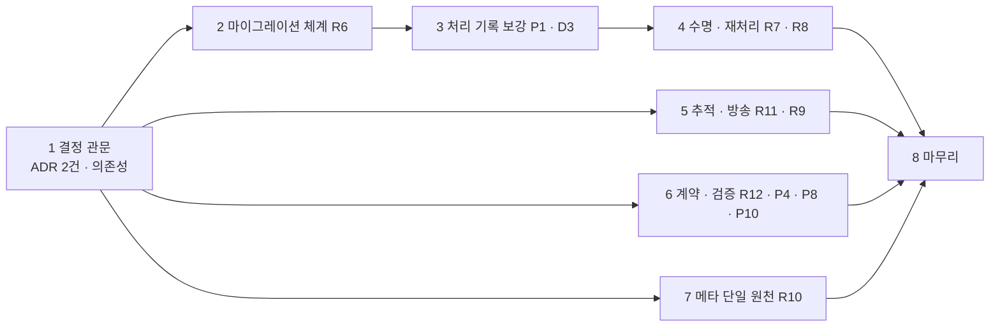
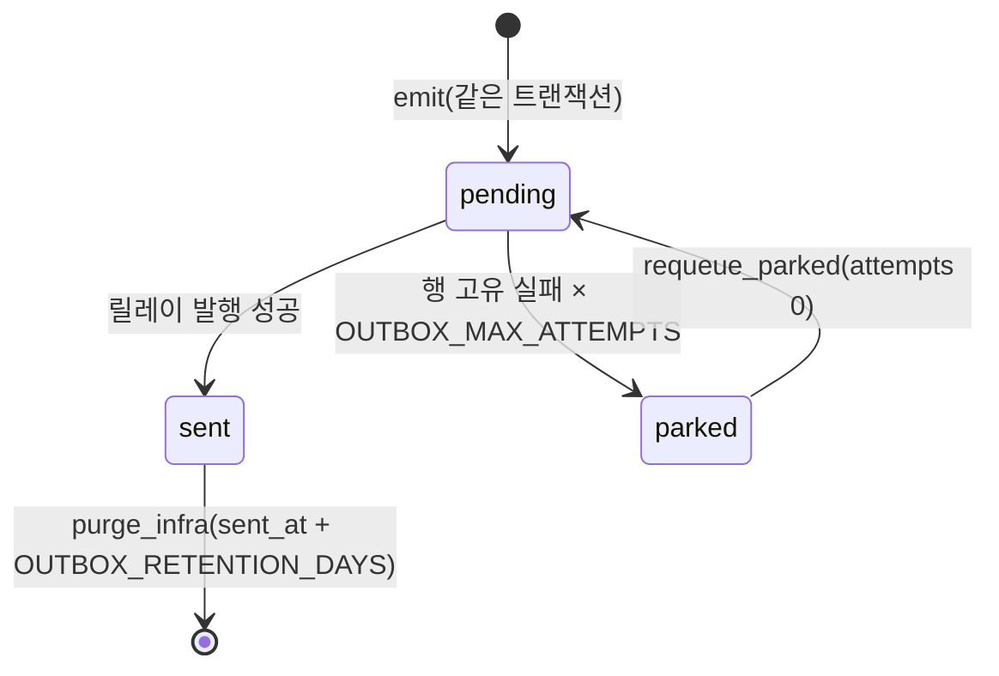
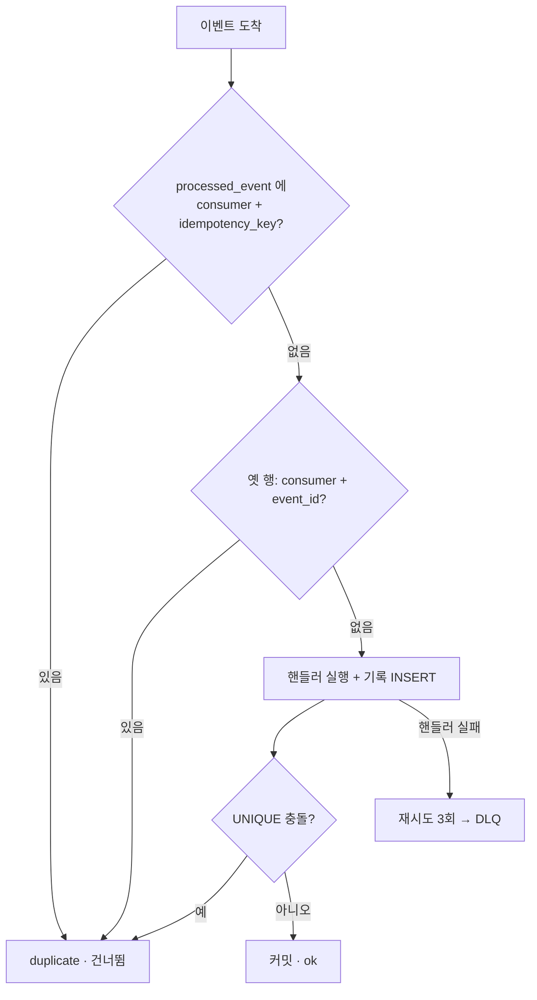
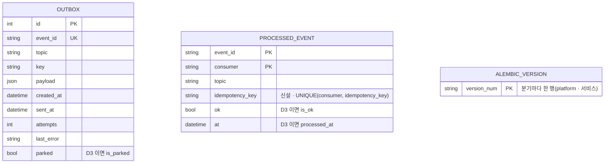

# plan_REQ_03 · 공통 라이브러리 · 계약 보강 v1.0

**대상 시스템** packages/common-py/nova_common · services/gateway · services/_template · services/sample · scripts/gen_k3s.py · scripts/devstack.py · web/packages(sdk · ui) · apps/kmp/shared · docs/conventions/backend.md
**변경점** 공통 라이브러리가 마이그레이션 · 데이터 수명(정리) · 격리 행 재처리 · 추적 ID 전달 · 방송 소비 · 중복 제거 키 · 경로 ID 검증을 기본으로 제공하고, 계약(AI 쓰기 · 503 · 라우트 접두어)을 문서와 같게 맞춘다

> **한 줄 요약** — 서비스마다 손으로 만들던 '배관'(마이그레이션 · 청소 · 재처리 · 추적)을 공통 라이브러리 한 곳에 넣고, 문서와 다르게 동작하던 계약 네 곳을 문서대로 맞춘다

| 항목 | 값 |
|---|---|
| 버전 | **v1.0** · 기준 마스터플랜 v1.2 |
| 요구 | [REQ-261104-11](../requirement/requirement_261104_11.md) |
| task | [tasks/tasks_REQ_03.md](tasks/tasks_REQ_03.md) — 진행 상황의 정본 |
| 원칙 | 단계마다 전체 테스트 녹색 · 생성물 원장 sync · 문서 기록 |
| 실행 방식 | (사용자 선택) subagent — superpowers:subagent-driven-development / native — superpowers:executing-plans ([superpowers.md §5](../conventions/superpowers.md)) |

> **진척 (2026-11-04, tasks 기준)** — 62 / 71

## 목표 · 종료 조건 · 하지 않는 것
- **목표**: 공통 라이브러리가 데이터 수명 · 재처리 · 추적 · 계약 4가지를 기본으로 제공한다(요구 원문)
- **종료 조건**: 요구의 E1~E4 그대로(`python nova.py exit-check REQ-261104-11`). 이 계획은 종료 조건을 더하지 않는다
- **하지 않는 것**: §9

## 0. 영향분석 (착수 전 조회)
```
1) 대상: nova_common(db · outbox · events · service · context · clients · ids · runtime) · 게이트웨이(routing · main) · 서비스 템플릿 · 샘플 · gen_k3s · devstack · 웹 sdk/ui · KMP ApiClient
2) 직접 영향: DB 15줄(outbox 10칸 · processed_event 5칸 — 모든 DB 서비스 스키마) · 원장 3건(TBL-SAMPLE-0003 outbox · TBL-SAMPLE-0004 processed_event · EVT-KAFKA-0005 platform.rbac.changed) · 개념 원장 2건(outbox · processed_event, platform 층)
3) 간접 영향: 소스 · 문서 46 + 21파일(impact 두 번 실행, 겹침 포함). 응답 계약 변경 2건: rbac_unavailable 403→503(웹 · KMP), AI 행위자 쓰기 거절(샘플 · 템플릿)
4) 등급: 큼(L3) — 모든 서비스 스키마의 플랫폼 표 칸 추가(P1) · 상태 코드 계약(P10) · 마이그레이션 체계 도입(R6, 의존성 추가). 나머지(R7 · R8 · R9 · R11 · R12 · P8 · R10)는 추가(Expand)라 L2. P4 는 쓰기 권한을 좁히는 것이라 L2
5) 갱신 산출물: ADR 2건 · 플랫폼/서비스 마이그레이션 · 생성물(alert_rules · configmap-common · compose · web-app/ingress · sdk project.gen.ts) · registry sync · ledgers · backend.md §3 · §4 · §8 · packages/common-py/README · naming baseline(D3 일 때)
6) 대장 조회(docs/registry):
   - 화면(screens): 0 — 화면 구조는 바뀌지 않는다. 오류 상태 부품(feedback.tsx ErrorState · Forbidden)의 문구 분기만 바뀐다
   - 표/컬럼(db-dictionary): outbox(id · event_id · topic · key · payload · created_at · sent_at · attempts · last_error · parked) · processed_event(event_id · consumer · topic · ok · at) — 신설 칸 processed_event.idempotency_key
   - 권한/역할(permissions): 0 — 권한키 변화 없음. P4 는 권한이 아니라 행위자(actor_type) 검사다
   - 이벤트(events): platform.rbac.changed · platform.feature.changed — 발행자 아직 없음, 구독자 gateway(복제본 2 · 최대 6). sample.item.* 3토픽 보존일 7
7) 표준 판정(docs/std):
   - 테넌시(STD-TENANCY-001 적용 M1): 추적 ID 는 테넌트와 같은 경로(context → 헤더 → 봉투)로 흐른다. 정리 · 재처리는 테넌트 칸 없는 플랫폼 표를 대상으로 하는 운영 작업이다(테넌트 필터 해당 없음). 경로 ID 검증 뒤에도 '다른 테넌트면 404' 는 그대로 둔다
   - 도메인 팩(STD-DOMAIN-PACK-001): 전부 코어(nova_common · 템플릿). 팩 가변점 없음
   - AI 자동화 등급(STD-AX-001 기본 L1): P4 가 L1 을 지금보다 정확하게 강제한다 — L1 은 'AI 는 초안까지, 저장은 사람'이므로 샘플 · 템플릿의 모든 쓰기에 require_human. 재처리 명령은 운영자(사람)가 셸에서 실행하며 AI 경로가 아니다
```

## 1. 설계의 중심축
착수 전 가설: "공통 라이브러리에 함수 몇 개(정리 · 재처리 · 추적)를 더하면 끝난다."

실측이 바꾼 것:
- **마이그레이션이 먼저다** — P1(칸 추가)과 baseline 칸 이름(D3)은 '모든 DB 서비스 스키마'를 바꾼다. create_all 은 이미 있는 표에 칸을 더하지 않으므로, 개발자 PC 의 `data/sample.db` 는 P1 코드로 기동하는 순간 깨진다. 그래서 R6 은 독립 항목이 아니라 P1 · D3 의 선행 조건이다
- **플랫폼 표는 플랫폼이 마이그레이션한다** — outbox · processed_event 는 모든 서비스 Base 에 add_infra_tables 로 들어간다. 서비스마다 같은 칸 추가 마이그레이션을 복제하면 반목표('서비스마다 같은 코드 복제')를 어긴다 → nova_common 이 **플랫폼 분기**(version_locations)를 갖고, 서비스는 자기 분기만 쓴다
- **기본 중복 제거 키는 지금 그대로 쓰면 위험하다** — `outbox.py:31` 의 기본값 `{source}:{topic}:{key}` 는 집계마다 같다. P1 을 그대로 적용하면 같은 집계의 두 번째 이벤트가 '중복'으로 버려진다(예: 키를 고정해 내는 platform.rbac.changed → 첫 무효화 뒤로는 무효화가 되지 않음). 기본값에 이벤트 id 를 넣고, 업무 키는 명시할 때만 의미를 갖게 한다(D2)
- **R9 는 지금 이미 결함이다** — gateway 복제본이 2(최대 6)인데 소비자 그룹이 서비스 이름 하나라 권한 무효화가 복제본 하나에만 닿는다

> **핵심 인사이트** — '배관'은 표 구조를 건드리는 순간 마이그레이션 체계 없이는 안전하게 바꿀 수 없다. 그래서 순서는 ADR → 마이그레이션 → 표 보강 → 나머지다. 플랫폼 표의 변경은 플랫폼 분기 하나로 모든 서비스에 간다

### 1.1 대조 증거
| 주장 | 증거 |
|---|---|
| create_all 만 있다 | `nova_common/db.py:69` |
| 소비 중복 판정이 event_id | `nova_common/service.py:198` |
| 기본 키가 집계 단위 | `nova_common/outbox.py:31` |
| 격리 행이 pending 에 섞인다 | `nova_common/service.py:285`(sent_at IS NULL 만 셈) |
| 소비자 그룹 = 서비스 이름 | `nova_common/events.py:145` · services.json gateway replicas 2 |
| 추적 ID 를 채우는 곳 없음 | `nova_common/events.py:40` · `outbox.py:22-30`(trace_id 미지정) |
| 403 rbac_unavailable | `services/gateway/gateway/routing.py:233` · `web/packages/ui/src/components/feedback.tsx:24,41` |
| 메타 값 복제 | `runtime.py:49,54` · `sdk/src/index.ts:118-119` · `gen_k3s.py:170,183,244,325` · `web/apps/app/package.json:6` |

## 2. 모델 변경
| 무엇 | 어디서 | 어디로 | 근거 |
|---|---|---|---|
| 스키마 생성 | `Database.create_all` | `nova_common.migrate.upgrade` — 플랫폼 분기(`nova_common/migrations/versions`) + 서비스 분기(`services/<svc>/migrations/versions`), heads 까지. 서비스에 migrations 폴더가 없으면(게이트웨이 메모리 DB) create_all 을 유지 | R6 · ADR(마이그레이션) |
| 제약 이름 | 없음(DB 가 임의로 지음) | `db.NAMING_CONVENTION`(ix · uq · ck · fk · pk) + `db.NovaBase`(MetaData 에 적용) — 모든 서비스 Base 가 상속 | R6 |
| 기존 DB | create_all 로 만든 DB | alembic_version 이 없고 표가 있으면 baseline 으로 stamp 한 뒤 upgrade | 기존 서비스 호환(요구 제약) |
| 소비 중복 판정 | (event_id, consumer) | (consumer, idempotency_key) — 칸이 빈 옛 행은 event_id 로 대체 판정(Contract 전까지) | P1 · L3 Expand → Migrate |
| 기본 idempotency_key | `{source}:{topic}:{key}` | `{source}:{topic}:{key}:{event_id}` — 업무 중복 제거가 필요하면 emit 에 명시 | P1 · D2 |
| 정리 | 없음 | `Service.purge_infra()` + 배경 작업(NOVA_PURGE_INTERVAL) | R7 |
| 격리 재처리 | 없음 | `Service.parked_rows()` · `Service.requeue_parked()` · `python -m nova_common.outbox_admin` | R8 |
| 지표 | pending 에 격리 행 포함 | `nova_outbox_pending`(격리 제외) + `nova_outbox_quarantined` | R8 |
| 소비자 그룹 | 서비스 이름 하나 | 일반 = 서비스 이름, 방송(`@svc.on(topic, broadcast=True)`) = `<service>.<instance>` | R9 |
| 추적 ID | 게이트웨이 → 업스트림 한 번 | context(`current_trace_id`) → 응답 · `clients.call` 헤더 `x-request-id` · 봉투 `trace_id` · Kafka 헤더 `trace_id` → 소비 scope | R11 |
| 경로 ID | 형식 검사 없음 | `ids.require_uuid7(value, code=, message=)` → 404 | R12 |
| AI 쓰기 | 영구 삭제만 사람 | 샘플 · 템플릿의 모든 쓰기에 사람 | P4 · STD-AX L1 |
| rbac_unavailable | 403 | 503 + `Retry-After` | P10 · L3 |
| 메타 키 | 코드 기본값 · 하드코딩 | 생성(configmap · compose · sdk `project.gen.ts` · 웹 포트) + devstack setdefault + 복제 검사 테스트 | R10 |

설계 결정과 근거:
- 재처리는 **HTTP 내부 API 가 아니라 명령(CLI)**으로 만든다. 지금 NetworkPolicy 는 네임스페이스 단위(R4, REQ-261104-10)라 `/internal` 쓰기 API 를 열면 같은 네임스페이스의 아무 파드나 부를 수 있다. 명령은 `kubectl exec` 권한이 있는 사람만 쓴다
- 방송 소비자는 `auto_offset_reset="latest"` 로 둔다. 새 파드는 기동할 때 권한 표를 처음부터 받으므로 지난 무효화를 다시 읽을 필요가 없다
- 추적 헤더 이름은 이미 쓰는 `x-request-id` 를 그대로 둔다. W3C `traceparent` 는 추적 백엔드와 함께 정한다(비목표 · §9)
- 처리 기록 보관 기간 기본값 14일 ≥ 토픽 최대 보존일 7일. 보존 중인 메시지가 다시 전달될 때 처리 기록이 이미 지워져 있으면 중복 처리되기 때문이다 — 테스트로 묶는다

## 3. 선행 관계

- 2 → 3 → 4 는 반드시 직렬(같은 표 · 같은 service.py)
- 5 · 6 · 7 은 논리적으로 독립이다. 다만 5 와 2~4 가 `service.py` · `events.py` 를 함께 고치고, 마스터플랜 병렬 게이트도 이 요구용으로 열려 있지 않다 → **직렬 실행이 기본**. 7(gen_k3s · devstack · sdk)만 경로가 겹치지 않는다

## 4. 표면 (API · CLI)
화면이 없는 계획(라이브러리)이다 — 화면 목업은 해당 없음. 오류 상태 부품의 문구 분기만 바뀐다.

| 표면 | 지금 | 바뀐 뒤 | 요구 |
|---|---|---|---|
| `nova_common.migrate.upgrade(db, base, service_dir)` | 없음 | 플랫폼 + 서비스 분기 heads 까지 · 옛 DB stamp | R6 |
| `python nova.py migrate <svc> new "<설명>" \| up \| status` | 없음 | 서비스 분기 마이그레이션 생성(autogenerate) · 적용 · 상태 | R6 |
| `Service.purge_infra(now=None, batch=1000) -> dict[str, int]` | 없음 | `{"outbox": n, "processed_event": m}` | R7 |
| 환경 변수 `OUTBOX_RETENTION_DAYS`(7) · `PROCESSED_EVENT_RETENTION_DAYS`(14) · `NOVA_PURGE_INTERVAL`(3600) | 없음 | 정리 기간 · 주기 | R7 |
| `Service.parked_rows(limit=100) -> list[dict]` · `Service.requeue_parked(ids: list[int] \| None) -> int` | 없음 | 격리 목록 · 해제(attempts 0, last_error 보존) | R8 |
| `python -m nova_common.outbox_admin <svc> parked \| requeue (--id N … \| --all)` · `python nova.py outbox …` | 없음 | 재처리 명령 | R8 |
| 지표 `nova_outbox_quarantined{service}` · 알림 `OutboxQuarantined` | 없음 | 격리 행 수 > 0 이 5분 → warning | R8 |
| `@svc.on(topic, broadcast=False)` · `EventBus.subscribe(topic, handler, *, broadcast=False)` | broadcast 없음 | 방송 토픽은 인스턴스마다 받음 | R9 |
| 환경 변수 `KAFKA_INSTANCE_ID` | 없음 | 방송 그룹 접미사(없으면 HOSTNAME → 임의) | R9 |
| `context.current_trace_id()` · `context.scope(tenant, actor_type=None, *, trace_id=None)` · `context.trace_from_header(value) -> str` | 없음 | 추적 ID 컨텍스트 | R11 |
| 서비스 응답 헤더 `x-request-id` · `clients.call` 요청 헤더 `x-request-id` · 봉투 `trace_id` · Kafka 헤더 `trace_id` | 게이트웨이만 | 모든 서비스 · 이벤트 | R11 |
| `ids.require_uuid7(value, *, code="not_found", message=...) -> str` | 없음 | 아니면 ApiError 404 | R12 |
| 샘플 POST/PATCH `/sample/items…` · `/archive` · `/restore`, 템플릿 POST `/records` | AI 허용 | AI 면 403 `human_only` | P4 |
| 게이트웨이 `rbac_unavailable` | 403 | 503 + `Retry-After: <GW_RBAC_RETRY>` | P10 |
| 생성물 `web/packages/sdk/src/project.gen.ts` · configmap `NOVA_SUPER_ROLE` · `NOVA_TZ_OFFSET_HOURS` | 없음 | nova.project.json 에서 생성 | R10 |

| 화면 | API | 표 | 권한 |
|---|---|---|---|
| (부품) ErrorState · Forbidden | 게이트웨이 프록시 전 권한 검사 | — | 권한키 변화 없음 |
| 샘플 목록 · 상세(변화 없음) | `/v1/sample/items/{id}` 404 범위 넓어짐 | item | sample.read |

### 4.1 UX 점검 ([ux-heuristics](../conventions/ux-heuristics.md))
화면 구조는 바뀌지 않는다. 대상은 P10 의 오류 상태 부품 하나뿐이다.

| 원칙 | 이 화면에서 어떻게 지키나 | 남는 위험 (심각도 0~4) |
|---|---|---|
| H1 상태 가시성 | 권한 원천 장애를 '권한 없음'(🔒)이 아니라 '잠시 확인할 수 없음'으로 보여 준다 | 0 |
| H2 현실 일치 | "권한 정보를 잠시 확인할 수 없습니다" — 서버 문구를 그대로 쓴다 | 0 |
| H3 제어 · 자유 | '다시 시도' 단추(onRetry) | 1 — onRetry 를 넘기지 않는 화면은 단추가 없다 |
| H4 일관성 | 점검 중(maintenance 503)과 같은 EmptyState 형태 | 0 |
| H5 에러 방지 | 해당 없음 — 입력 없음 | 0 |
| H6 인지 > 기억 | 해당 없음 | 0 |
| H7 유연 · 효율 | 해당 없음 | 0 |
| H8 미니멀 | 오류 코드 줄은 기존 ErrorState 그대로 | 0 |
| H9 에러 복구 | 무엇(권한 확인 실패) · 왜(일시 장애) · 무엇을(잠시 뒤 다시 시도) 3요소 | 0 |
| H10 도움말 | 해당 없음 | 0 |

과업 시나리오: 1) 사용자가 항목 목록을 열려고 메뉴를 누른다 → 권한 원천이 장애다 → '권한이 없다'가 아니라 '잠시 뒤 다시 시도'를 보고 다시 시도를 누른다 → 회복되면 목록이 열린다.

## 5. 생애주기

| 표 · 상태 | 정의 | 누가 바꾸나 | 지워지나 |
|---|---|---|---|
| outbox pending | sent_at NULL · parked 거짓 | 릴레이 | 아니오 |
| outbox parked | parked 참 | 릴레이(격리) · 재처리 명령(해제) | 아니오 — 사람이 판단 |
| outbox sent | sent_at 있음 | 릴레이 | 보관 기간 뒤 정리 |
| processed_event | 처리 기록 | 소비 | 보관 기간(≥ 토픽 보존일) 뒤 정리 |

## 6. 핵심 분기

| 실패 지점 | 동작 (닫힘/열림) | 이유 |
|---|---|---|
| 마이그레이션 실패(기동 중) | 닫힘 — 기동 거부, readyz 503 | 반쯤 바뀐 스키마로 쓰기 시작하면 복구가 더 어렵다 |
| 권한 원천 장애(stale 지남) | 닫힘 — 503 rbac_unavailable | fail-closed 는 유지하고 상태 코드만 의미대로(권한 없음이 아니라 일시 장애) |
| 정리 작업 실패 | 열림 — 로그 후 다음 주기 | 정리 지연은 저장 공간 문제일 뿐 정합성 문제가 아니다 |
| 재처리한 행이 또 실패 | 닫힘 — 한계에서 다시 격리 | 무한 재시도로 뒤 행이 막히지 않게 |
| 방송 소비 루프 사망 | 닫힘 — healthz 503 → 파드 재시작 | 무효화를 못 받는 게이트웨이가 낡은 권한으로 계속 응답하지 않게 |
| 경로 ID 가 UUIDv7 아님 | 닫힘 — 404 | DB 조회 전에 끊는다(형식 오류 = 없는 것) |
| 추적 ID 헤더 형식 밖 | 열림 — 새 ID 생성 | 추적 실패가 요청 실패가 되면 안 된다 |

## 7. 데이터 모델

| 구분 | 표 · 칸 |
|---|---|
| 있는 것 | outbox 10칸 · processed_event 5칸(모든 DB 서비스 스키마, 원장 TBL-SAMPLE-0003 · 0004) |
| 신설 | processed_event.idempotency_key(VARCHAR(200) NULL, comment "중복 제거 키(봉투 idempotency_key)") · 제약 uq_processed_event_consumer_idempotency_key · alembic_version(도구 표) |
| 바뀌는 것 | 모든 제약 · 인덱스 이름이 규칙대로(새 DB 기준, 옛 DB 는 stamp 뒤 유지) · (D3) outbox.parked → is_parked · processed_event.ok → is_ok · processed_event.at → processed_at |

## 8. 재사용
| 자산 (원장 ID) | 쓰는 법 |
|---|---|
| outbox 표 (TBL-SAMPLE-0003) · processed_event 표 (TBL-SAMPLE-0004) | 새 표를 만들지 않는다 — 칸 · 제약만 더한다(naming lookup 결과 '정확') |
| platform.rbac.changed (EVT-KAFKA-0005) · platform.feature.changed | 새 토픽 없음 — 구독 방식만 방송으로 |
| `context.scope` · `context.headers` · `clients.call` | 테넌트 · 행위자 전파 경로에 trace_id 를 같은 방식으로 얹는다 |
| `ids.is_uuid7` | require_uuid7 이 감싼다 |
| `Principal.require_human` | P4 에 그대로 쓴다(새 검사 함수를 만들지 않는다) |
| `monitoring.THRESHOLDS` → gen_k3s alert_rules | 격리 임계값을 같은 원천에 더한다 |
| devstack 의 nova.project.json → NOVA_PACKS 패턴 (`scripts/devstack.py:42-48`) | super_role · tz 도 같은 방식으로 |
| `catalog.routes()` | 라우터 접두어 검사의 기준 |
| `clients.override(service, transport)` | 프록시 502/504 테스트에 httpx.MockTransport 를 꽂는다 |
| test_common · test_hardening 의 InMemoryBroker 고정물 | 방송 · 중복 제거 테스트 |

## 9. 범위 밖
| 안 하는 것 | 이유 · 어디서 |
|---|---|
| 분산 추적 백엔드(Tempo · Jaeger) · W3C traceparent | 요구 비목표 — 추적 백엔드 도입 요구에서 |
| 메시지 브로커 교체 | 요구 비목표 |
| 로그 한 줄에 trace_id 넣기(로그 형식 변경) | Loki 파싱 · 대시보드에 영향 — 새 요구 |
| Grafana 격리 패널 | 수용 기준은 지표 · 알림까지 — 다음 판본 backlog |
| P1 Contract(옛 행 event_id 대체 판정 제거 · NOT NULL) | 옛 처리 기록이 보관 기간(14일) 지나 다 지워진 뒤에야 안전 — 다음 판본(§11.4) |
| outbox · processed_event 기본키 변경(baseline pk 2건) | 발행 순서 · 멱등성 설계와 묶여 있음 — D3 에서 처분만 정한다 |
| 재처리 HTTP 내부 API | NetworkPolicy 가 네임스페이스 단위(R4, REQ-261104-10)인 동안 열지 않는다 |
| 샘플 item_activity 구조(P2) · ref_column(P5) | REQ-261104-12 |
| 비어 남은 소비자 그룹 정리 | Kafka 가 offsets.retention.minutes(기본 7일) 뒤 지운다 — 운영 문서 한 줄로만 |
| 게이트웨이 마이그레이션 | 상태 없는 메모리 DB — create_all 유지 |

## 10. 테스트 맵
| 코드 경로 | 테스트 | 수용 기준 |
|---|---|---|
| `nova_common/db.py` NAMING_CONVENTION · NovaBase | `packages/common-py/tests/test_migrations.py::test_constraint_names_follow_convention` · `tests/test_constraint_names.py::test_all_service_constraints_named` | -1 제약 이름 규칙 테스트 |
| `nova_common/migrate.py` | `test_migrations.py::test_upgrade_empty_db` · `::test_upgrade_stamps_legacy_create_all_db` · `::test_platform_migration_matches_models` | -1 |
| `services/_template/migrations` · `services/sample/migrations` | `tests/test_new_service.py` · `services/sample/tests/test_migrations.py::test_sample_migration_matches_models` | -1 템플릿 첫 마이그레이션 |
| `service.py` _consume · `outbox.py` emit | `packages/common-py/tests/test_idempotency.py`(5건) | -8 같은 키 한 번 |
| `service.py` purge_infra | `packages/common-py/tests/test_lifecycle.py::test_purge_*`(3건) · `::test_processed_retention_covers_topic_retention` | -2 |
| `service.py` requeue · `outbox_admin.py` · 지표 | `test_lifecycle.py::test_requeue_*` · `::test_quarantined_gauge_counts_parked` · `::test_pending_excludes_parked` · `::test_outbox_admin_cli_requeue` | -3 |
| alert_rules 생성 | `tests/test_infra.py::test_outbox_quarantined_alert_rule` · lint gen --check | -3 알림 규칙 |
| `events.py` broadcast · KafkaBus 그룹 | `packages/common-py/tests/test_broadcast.py`(4건) · `services/gateway/tests/test_gateway.py::test_rbac_changed_event_invalidates_every_replica` | -4 |
| devstack · gen_k3s · sdk 생성 | `tests/test_project_meta.py`(복제 검사) | -5 |
| `context.py` trace · `clients.py` · 미들웨어 | `packages/common-py/tests/test_trace.py`(5건) · `tests/integration/test_trace_flow.py` | -6 통합 테스트 |
| `ids.require_uuid7` · 샘플 _get · 템플릿 | `test_ids.py::test_require_uuid7_404_envelope` · `test_items.py::test_non_uuid7_path_is_404` · 템플릿 테스트 | -7 |
| 샘플 · 템플릿 쓰기 | `test_items.py::test_ai_actor_write_rejected` · `tests/test_ax_guard.py` | -9 |
| 라우터 접두어 · 프록시 | `tests/test_route_prefixes.py` · `test_gateway.py::test_proxy_timeout_is_504` · `::test_proxy_connect_error_is_502` | -10 |
| routing rbac.check · 웹 ErrorState · KMP | `test_gateway.py::test_rbac_service_mode_fail_closed`(503 로) · `::test_rbac_unavailable_has_retry_after` · `python nova.py web-build` · `kmp-test` | -11 |

## 11. 후속 · 예외

### 11.1 전역 제약 (모든 task 에 적용 — 요구 원문 값 그대로)
| 제약 | 값 · 출처 |
|---|---|
| 언어 | 화면 문구 · 오류 메시지 · 주석은 한국어 (CLAUDE.md 규칙 0) |
| 결정 기록 | "DB 구조 · 상태 코드 계약 변경은 ADR 로 남긴다 · 기존 서비스 호환(되돌리기 경로)" — 요구 의도 표 '제약' |
| 비목표 | "분산 추적 백엔드(Tempo · Jaeger) 설치 · 메시지 브로커 교체" — 요구 |
| 반목표 | "서비스마다 같은 정리 · 재처리 코드를 복제하는 것" — 요구 → 정리 · 재처리 · 플랫폼 표 마이그레이션은 nova_common 에만 둔다 |
| 식별자 | DB 기본키 · 이벤트 ID 는 UUIDv7(ADR-003) — 새 표 없음, outbox.id INTEGER 는 baseline |
| 생성물 | alert_rules · configmap · compose · web-app/ingress · sdk project.gen.ts 는 손으로 고치지 않는다 → `python nova.py gen` |
| 원장 | 표 칸이 바뀌면 `registry.py sync --by <이름> --note <사유>` · `ledgers.py` |
| 의존성 | `uv add` 만 — `pip install` 금지(ADR-002), 추가는 사용자 확인 뒤(SOUL 되돌림 원칙) |
| 계약 변경 순서 | P1 · P10 은 Expand → Migrate → Contract([naming.md §4](../conventions/naming.md)) |

### 11.2 검토 초점 (사람이 부딪힐 입력 · 상황 — 많이 부딪힐 순서로 5개)
| 입력 · 상황 | 기대 동작 | 테스트를 넣은 task |
|---|---|---|
| 개발자 PC 에 create_all 로 만든 `data/sample.db` 가 있는 채로 새 코드 기동 | baseline stamp → 이후 마이그레이션만 적용, 기존 행 보존 | T03-2.03 |
| 같은 집계에 키를 명시하지 않은 이벤트가 두 번(예: key 고정 rbac.changed 두 번) | 둘 다 처리(기본 키에 이벤트 id) | T03-3.03 · T03-5.09 |
| 웹 주소창에 복사한 대문자 · 하이픈 없는 UUID 로 상세 열기 | 404 `item_not_found`(500 아님) | T03-6.02 |
| 권한 원천 장애 중 목록 화면 | 503 · '잠시 뒤 다시 시도' 화면(🔒 권한 없음 아님) · Retry-After | T03-6.08 · T03-6.09 |
| 게이트웨이 파드 재시작 직후 무효화 이벤트 | 새 그룹은 latest 부터, 시작 때 표를 새로 받아 무해 · 두 복제본 모두 무효화 | T03-5.08 |

### 11.3 자체 점검 (superpowers:writing-plans — 다 쓴 뒤 한 번)
- [x] 요구 반영 — 하위 ID 11개마다 담당 task 가 있다(-1: 2.01~2.09 · -2: 4.01~4.03 · -3: 4.04~4.08 · -4: 5.07~5.09 · -5: 7.01~7.05 · -6: 5.01~5.06 · -7: 6.01~6.02 · -8: 3.01~3.05 · -9: 6.03~6.05 · -10: 6.06~6.07 · -11: 6.08~6.10). E4 는 1.03
- [x] 단계 명확성 — 조건부 task 는 3.06(D3) 하나이고, 조건과 취소 처리를 적었다
- [x] 타입 일관성 — purge_infra · requeue_parked · require_uuid7 · trace_from_header · broadcast 를 정의한 task 의 이름을 뒤 task 가 그대로 쓴다
- [x] 검토 초점 — 11.2 의 5줄마다 담당 task 가 있다
- [x] 분량 — 코드 블록 없음(시그니처는 §4 표에만)

### 11.4 되돌리기 경로 (요구 제약 '기존 서비스 호환')
| 변경 | 되돌리기 |
|---|---|
| 마이그레이션 도입 | 각 마이그레이션 downgrade 작성 필수 · migrations 폴더가 없으면 create_all 로 동작(예전 방식) |
| P1 Expand · Migrate | 칸은 nullable 이고 옛 행 대체 판정이 남아 있으므로, 코드를 되돌려도 event_id 판정으로 그대로 동작 |
| P1 Contract | **다음 판본** — 조건: 배포 뒤 PROCESSED_EVENT_RETENTION_DAYS(14일)가 지나 칸이 빈 행이 0. 확인 `SELECT count(*) FROM processed_event WHERE idempotency_key IS NULL` = 0 |
| P10 | Expand(클라이언트가 두 상태 모두 처리)를 먼저 하므로, 게이트웨이만 되돌려도 화면이 깨지지 않는다 · KMP 는 이미 배포된 앱 때문에 Contract 를 하지 않는다 |
| P4 | 샘플 · 템플릿 코드 되돌리기(데이터 영향 없음) |
| R9 방송 | broadcast=False 로 되돌리면 예전 그룹 |

### 11.5 감수하는 위험
- Alembic 은 의존성 1개(+ Mako)를 더한다 — D1
- 비어 남은 방송 소비자 그룹이 파드 재시작마다 생긴다(Kafka 가 7일 뒤 정리)
- require_uuid7 이 들어가면 대문자 UUID 를 보내는 외부 클라이언트는 404 를 받는다(지금 웹 · KMP 는 서버가 준 소문자 그대로 쓴다)

### 11.9 사용자 결정 (2026-11-04 — 권고 채택)
- D1 마이그레이션 도구 — Alembic(플랫폼 · 서비스 분기) 도입 · 의존성 추가 승인
- D2 기본 idempotency_key — `{source}:{topic}:{key}:{event_id}`(이벤트 id 포함), 업무 중복 제거는 명시할 때만
- D3 naming baseline — 칸 이름 3건(outbox.parked → is_parked · processed_event.ok → is_ok · at → processed_at)을 이번에 바꾼다(하위 ID REQ-261104-11-12 추가), 기본키 2건은 설계 의도로 '의도한 예외'
- D4 릴리스 표기 — v0.2.0 초안 판본에 묶음(releases.json)
- D5 P4 범위 — 보관 해제(restore)도 사람만(STD-AX L1)

## 12. 체크리스트
- [ ] 1단계 · 결정 관문 — ADR 2건 채택 · Alembic 추가(T03-1.01~1.04)
- [x] 2단계 · 마이그레이션 체계 R6(T03-2.01~2.09)
- [x] 3단계 · 처리 기록 보강 · 중복 제거 키 P1(+D3)(T03-3.01~3.07)
- [x] 4단계 · 데이터 수명 · 격리 재처리 R7 · R8(T03-4.01~4.08)
- [x] 5단계 · 추적 ID · 방송 소비 R11 · R9(T03-5.01~5.09)
- [x] 6단계 · 계약 · 검증 R12 · P4 · P8 · P10(T03-6.01~6.10)
- [x] 7단계 · 프로젝트 메타 단일 원천 R10(T03-7.01~7.05)
- [x] 8단계 · 마무리 · 종료 조건(T03-8.01~8.05)

### 12.1 실측으로 정정된 자리
- (착수 전) R6 은 독립 항목이 아니라 P1 · D3 의 선행 조건이다 — create_all 은 기존 표에 칸을 더하지 않는다
- (착수 전) 기본 idempotency_key(`outbox.py:31`)가 집계 단위라, P1 을 그대로 적용하면 이벤트가 사라진다 → D2
- (착수 전) `nova_outbox_pending` 에 격리 행이 섞여 OutboxBacklog 경보가 풀리지 않는다(`service.py:285`) → T03-4.04 에서 나눈다
- (착수 전) gen_k3s 의 웹 포트 3000 고정은 4곳(170 · 183 · 244 · 325)이다. 348 · 717 은 grafana 라 건드리지 않는다
- (착수 전) naming.md baseline 은 플랫폼 표 5건을 '별도 요구로'라고 적었다 → 이 요구에서 처분하려면 요구에 하위 ID 를 더해야 한다(D3)
- (2단계) 리비전 ID 는 플랫폼 `p000N`(분기 `platform`) · 서비스 `s000N`(분기 `service`) — `alembic_version` 칸 32자. 리비전 틀(script.py.mako)은 플랫폼 폴더에만, 서비스 env.py 는 `run_env()` 한 줄. NovaBase 가 SQLAlchemy 내부 `_sa_registry` 를 쓴다(🆕 T03-2.11)
- (3단계) 옛 DB 의 이름 없는 UNIQUE(outbox.event_id) — SQLite batch 표 복사가 이름 없이 옮겨 drift 1건 → p0003 batch 에 `naming_convention` 을 주어 `uq_outbox_event_id` 로. MariaDB 옛 DB 는 batch 를 하지 않아 DB 가 지은 이름으로 남는다(§7 '옛 DB 는 stamp 뒤 유지'와 같음)
- (3단계) p0003 이 `nova_common.db.NAMING_CONVENTION` 을 가져다 쓴다 — 규칙을 바꾸면 옛 리비전 동작도 바뀐다. `naming check` 는 대장을 읽으므로 `ledgers.py` 를 먼저 돌려야 낡은 baseline 을 잡는다
- (3단계) `idempotency_key` VARCHAR(200) 이 기본 키 최대 길이(소비자 80 + 토픽 120 + 키 80 + UUID 36 + 구분자 3 = 319)보다 짧았다 → 사용자 결정 (A) 2026-11-04 · p0004 로 320(255 는 모자라 320). UNIQUE 는 utf8mb4 1,600 바이트로 InnoDB 상한 안. 최신 리비전 이름은 `migrate.platform_head()` 로 — 샘플 · CLI 테스트가 손으로 적지 않는다
- (4단계) 재처리 명령은 `python nova.py parked <svc> list | requeue (--id N … | --all)`(모듈 `python -m nova_common.outbox_admin`) — 계획 §4 의 `nova.py outbox … parked` 는 T03-2.10 결정으로 이렇게 바뀜. 계획서의 `parked` 하위 명령도 같은 뜻으로 받는다
- (4단계) `NOVA_PURGE_INTERVAL` 0 이하이면 정리 배경 작업을 켜지 않는다(외부 잡으로 정리할 때) · `requeue_parked([])` 는 0(빈 목록이 '전부'가 되지 않게 — 전부는 None) · 명령은 스키마를 만들지 않고 `outbox` 표가 없으면 종료 1 + `migrate up` 안내
- (4단계) 명령이 `migrate._open_service`(밑줄 내부 함수)를 재사용한다 — 공용으로 올릴지는 5단계 이후 정리 후보. `purge_infra` 는 이벤트 루프 안 동기 실행(릴레이와 같은 방식) — 큰 표에서 한 주기 동안 루프를 붙잡을 위험
- (4단계) 게이트웨이 운영 화면의 Prometheus 모드에도 격리 수 조회(`max by`)를 넣었다 — 두 모드가 같은 `evaluate_alerts` 를 쓰므로 없으면 Prometheus 모드에서 경보가 안 울린다. 요약 · 대시보드에는 격리 수를 넣지 않았다(후속 후보). `test_infra` 가 생성기 · 게이트웨이 두 임계값 표를 겹치는 키 전부 대조
- (5단계) 방송 소비의 처리 기록 소비자 이름은 `<서비스>.<인스턴스>`(`_consumer_name`) — 서비스 이름 하나면 DB 를 함께 쓰는 복제본의 두 번째가 '중복'으로 건너뛴다(test_broadcast_on_shared_db_is_not_deduped_across_instances). 대가: 재시작하면 인스턴스 이름이 바뀌어 지난 기록과 이어지지 않음(latest 시작이라 무해) · 80자 넘침 위험 → 🆕 T03-9.06
- (5단계) 게이트웨이 `new_request_id` 가 정한 ID 를 요청 헤더에 다시 심는다 — 안 하면 안쪽 공통 미들웨어가 새 ID 를 또 만들어 권한 · 플래그 원천 호출이 응답과 다른 ID 로 나간다. 새 ID 는 UUIDv7(`trace_from_header` — 형식 `[A-Za-z0-9-]{8,64}` 밖이면 새로)
- (5단계) `scope()` 에 `trace_id` 를 주지 않으면 그 블록의 trace 는 None — 바깥 값을 물려받지 않는다(테넌트와 같은 방식). 한 토픽에 방송 · 일반 구독을 섞으면 ValueError
- (5단계) 계획 밖: `scripts/ledgers.py` 의 구독 정규식이 `broadcast=True` 키워드를 못 읽어 대장에서 게이트웨이 구독자가 빠지던 것을 고침(대장 내용 변화 없음). 실제 Kafka 그룹 · latest · 리밸런스는 판정 불가(e2e-kafka)
- (6단계 Expand) 웹 `ErrorState` 는 `rbac_unavailable` 분기를 403 분기보다 앞에 두어 상태와 무관하게 '권한 정보를 잠시 확인할 수 없습니다 · 다시 시도'. KMP 는 `ApiException.retryable` · 고정 문구(서버 문구 대신) — 그래서 6.09 에서 서버 message 를 바꿔도 이 두 화면에는 안 보인다(웹 Forbidden 경로 · useAction 알림은 6.10 전까지 서버 문구). 웹은 단위 테스트 틀이 없어 코드 판독으로만 확인(T04-9.10)
- (6단계) 6.02 의 404 는 SQLite 에서 고치기 전부터 나왔다(대소문자를 가려 못 찾음) — 실제 위험은 MariaDB 대소문자 무시 정렬에서 대문자 ID 가 같은 행을 찾는 것. 테스트는 '조회하지 않음'(Session.get 호출 0)을 단언한다(공허한 초록 방지)
- (6단계) 6.05 감시는 템플릿 자리표시 때문에 AST 로 읽는다 — 대상은 게이트웨이를 뺀 모든 서비스, `/internal` 쓰기는 대상 밖(서비스 간 호출의 행위자는 system). 웹은 사람 행위자(개발 토큰에 actor_type 없음 → human · 클라이언트 x-actor-type 은 지워짐). 6.07 은 처리 코드가 이미 있어 테스트만 — RED 는 변이 시험으로 대신
- (6단계) 9.06 소비자 이름이 칸 길이(ProcessedEvent 정의에서 읽음)를 넘으면 앞부분 + `~` + sha256 10자(결정적). Kafka 그룹 이름은 그대로
- (7단계) 새 생성물 `web/packages/sdk/src/project.gen.ts`(LOCALE · TIMEZONE) — gen_k3s OUT 이라 `--check` 대상 · 복제본에서도 자동 생성. sdk 는 `process.env.NEXT_PUBLIC_… || META_…`(글자 그대로 참조 유지 — 번들에 지정 시간대 1 · 기본값 0 확인). 웹 포트 고정 4곳(Deployment · Service · NetworkPolicy · Ingress)을 web_apps[].port 로, grafana 3000 은 그대로. 계획 밖 테스트 2건(웹 앱마다 다른 포트 · 옛 복제본 메타에 키가 없으면 안내하고 멈춤 — 기본값을 두면 또 하나의 복제). 감사 C-F1 · C-F10 의 sdk 기본값은 🆕 T03-9.10

## 13. task 분해
[tasks/tasks_REQ_03.md](tasks/tasks_REQ_03.md) — 57개

---
관련 문서: [REQ-261104-11](../requirement/requirement_261104_11.md) · [review_261104_01](../reviews/review_261104_01.md) §2 ②·⑤ · [backend.md](../conventions/backend.md) · [naming.md](../conventions/naming.md) §4 · baseline · [ADR-003](../adr/ADR-003-uuid-v7-ids.md) · [STD-AX-001](../std/STD-AX-001.md)

## 변경 이력
- v1.0 · 2026-11-04 · 최초 작성 — 8단계 · task 57개

> **다시 한 줄 요약** — 마이그레이션 체계를 먼저 세우고, 그 위에서 플랫폼 표 · 수명 · 재처리 · 추적 · 계약을 공통 라이브러리 한 곳에서 문서대로 맞춘다
