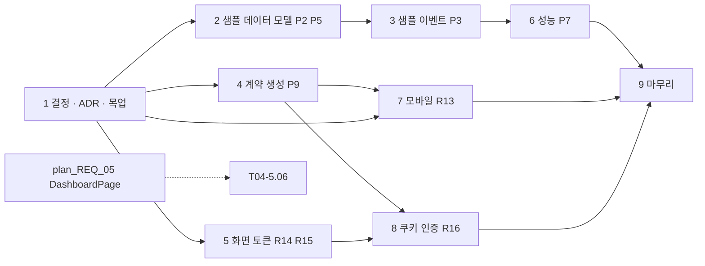
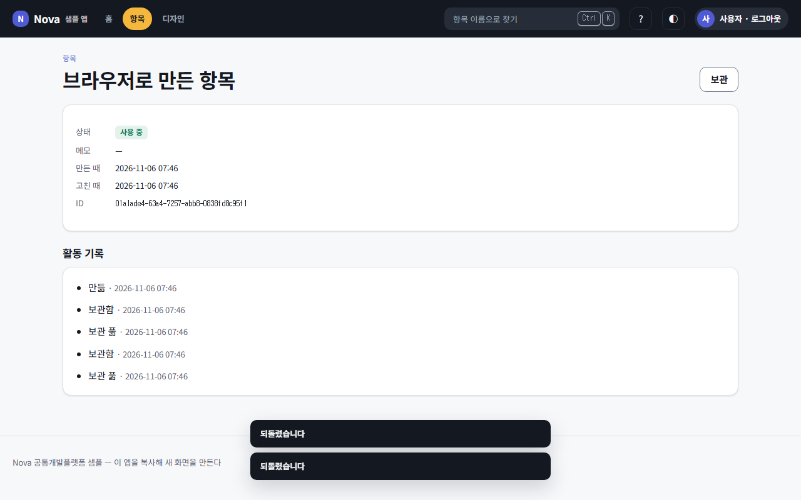
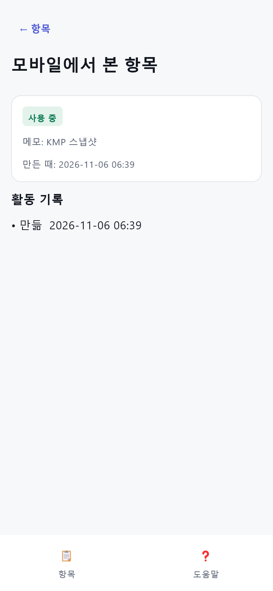
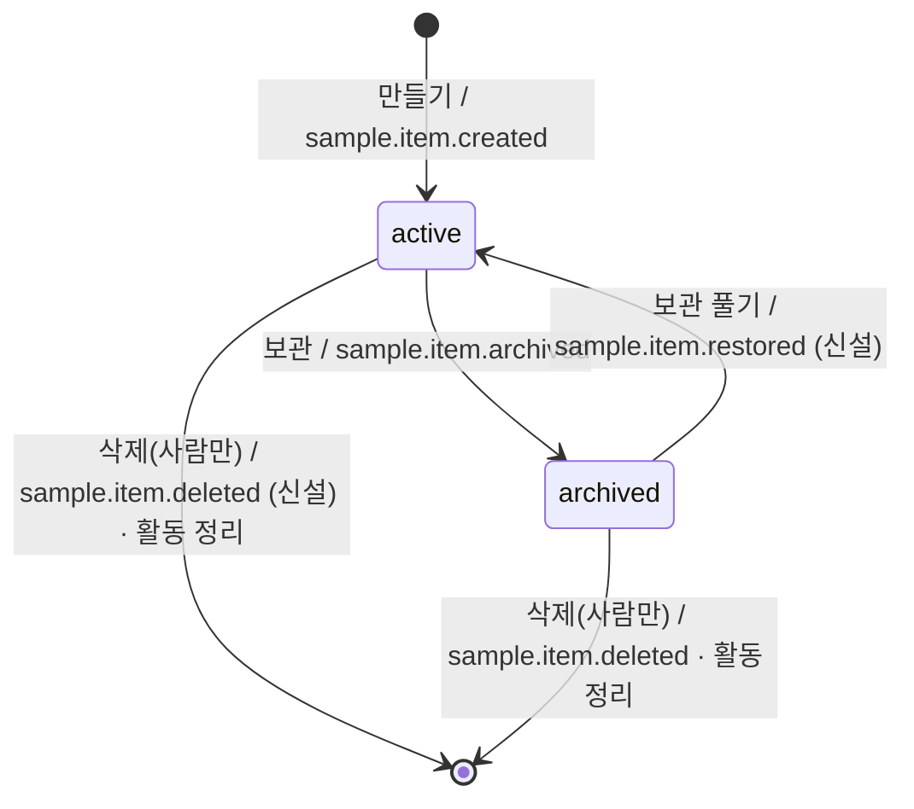
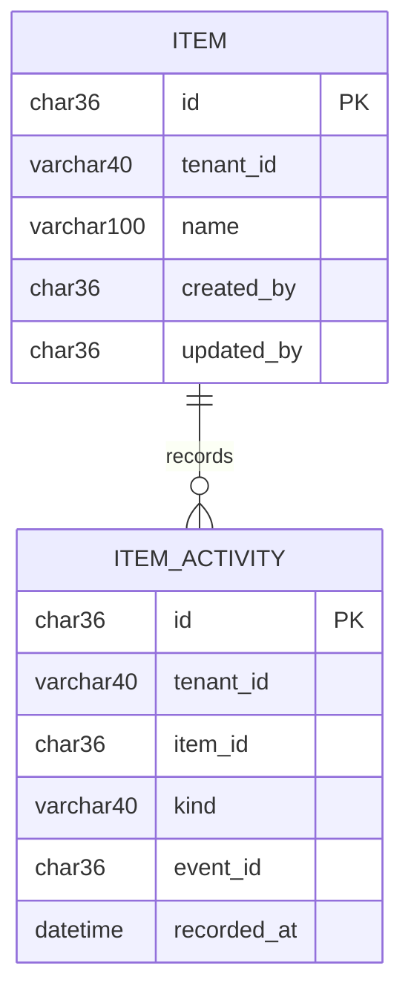

# plan_REQ_04 · 화면 · 모바일 · 보안 · 데이터 정리 v1.0

**대상 시스템** web/packages/ui · web/packages/sdk · web/apps/app · apps/kmp(shared · uikit · composeApp) · services/sample · services/_template · services/gateway · nova_common(clients · 새 validate) · scripts(warehouse · 새 ui_check · gen_contract · perf_probe) · design/tokens · kafka-topics.txt · registry/naming.json
**변경점** 화면 · 모바일 · 샘플을 Nova 규칙(토큰 · 템플릿 · 테넌트 · UUIDv7 · ref_column · 계약 생성 · httpOnly 쿠키)의 모범 예로 바로잡는다

> **한 줄 요약** — 복제본이 물려받는 '견본집'의 틀린 견본을 고쳐 끼운다. 견본이 틀리면 모든 새 프로젝트가 같은 틀림을 베끼기 때문이다.

| 항목 | 값 |
|---|---|
| 버전 | **v1.0** · 기준 마스터플랜 v1.2 |
| 요구 | [REQ-261104-12](../requirement/requirement_261104_12.md) |
| task | [tasks/tasks_REQ_04.md](tasks/tasks_REQ_04.md) — 진행 상황의 정본 |
| 원칙 | 단계마다 전체 테스트 녹색 · 생성물 원장 sync · 문서 기록 |
| 실행 방식 | (사용자 선택) subagent — superpowers:subagent-driven-development / native — superpowers:executing-plans ([superpowers.md §5](../conventions/superpowers.md)) |

> **진척 (2026-11-05, tasks 기준)** — 57 / 73

## 0. 영향분석 (착수 전 조회)
```
1) 대상: 위 '대상 시스템' — 요구 하위 9개(REQ-261104-12-1~9)
2) 직접 영향(impact 실측): 화면 3(SCR-WAPP-0003 상세 · 0004 만들기 · 0005 목록) + 운영 0007 + 로그인 · DB 5(item · item_activity 칸) · 이벤트 3(sample.item.created · updated · archived) + 신설 2 · 원장 4 · 개념 1(item_activity)
3) 간접 영향: item_activity · sample.item 낱말 30파일(SampleApi.kt · e2e_check.py · tests/integration/test_sample_flow.py · test_topic_catalog …), token · cookie · localStorage 낱말 89파일
4) 등급: 큼 — L3 두 곳(표 구조 P2 · P5 = 저장 데이터 구조, 인증 계약 R16 = 쿠키 발급 · CSRF 거부), 나머지는 L1~L2(추가 · 내부 정리)
5) 갱신 산출물: 화면 머리 주석 · DB 모델 comment= · kafka-topics.txt → gen · 이벤트 페이로드 · registry.py sync · ledgers.py · naming.json(baseline 2건 삭제 + 참조 칸 형식) · 토큰 원천(brand.tokens.json) → tokens.css/DesignTokens.kt · 계약 생성물(새) · warehouse 출고본 · ADR 2건 · docs/verification(P7 전후 수치)
6) 대장 조회(docs/registry):
   - 화면(screens.md:11·12·13·15): 상세 · 만들기 · 목록이 item · item_activity 를 쓴다, 운영(0007)은 표 없음
   - DB 사전(db-dictionary.md:19-23): item_activity.id INTEGER(PK) · at DATETIME — 바뀜, item_id · event_id 는 이미 VARCHAR(36)
   - 권한(permissions.md): sample.read · create · update · delete 그대로 — 새 권한 없음. 로그아웃은 권한 없는 게이트웨이 자체 API
   - 이벤트(events.md:9-11): created · archived 는 sample 이 구독, updated 는 구독자 없음 → restored(구독 sample) · deleted(구독자 없음) 신설
7) 표준 판정(docs/std):
   - STD-TENANCY-001 적용(M1) — P2 가 item_activity 에 ①(tenant 칸)을 채운다, 소비자는 봉투 tenant(④)를 쓴다, 상세 조회는 tenant_filter(③)
   - STD-DOMAIN-PACK-001 — 모두 코어. 포트 sample.normalize_name 은 그대로
   - STD-AX-001(L1) — 영구 삭제는 require_human 유지(items.py:144), 새 이벤트의 actor_type 은 봉투가 자동으로 넣는다. 쿠키 인증에도 actor_type 검사(routing.py) 그대로
```

## 1. 설계의 중심축
착수 전 가설: 아홉 항목은 서로 다른 일로 보이지만 뿌리는 하나다 — **규칙의 원천이 한 곳에 있지 않고 화면 · 샘플에 사본으로 흩어져 있다**(색 · px 사본, 길이 상한 숫자 사본, 시각 자르기 사본, 토큰 보관 사본).

> **핵심 인사이트** — 고치는 방법도 하나다. **원천 하나 → 생성 또는 검사 → 사본 0.** 색은 토큰 원천 + ui_check, 길이 · 이메일은 서버 계약 + gen_contract, 시각은 fmtAt 한 곳, 인증 토큰은 서버가 쥔 httpOnly 쿠키 한 곳. 화면마다 예외 코드를 늘리는 방식(반목표)은 쓰지 않는다.

### 1.1 대조 증거 (계획 시점 실측)
| 가설 | 실측 | 근거 |
|---|---|---|
| 참조 칸이 손으로 쓰였다 | item_activity.item_id · event_id 는 **이미 ref_column**. 손으로 쓴 칸은 created_by · updated_by(샘플 · 템플릿 4칸, String(40)) | models.py:26·28 · _template models.py:24·26 |
| 기본키 · 시각 칸 위반 | naming baseline 2건(pk INTEGER · 맨 at)이 P2 를 가리킨다 | registry/naming.json:128-129 |
| 게이트웨이가 쿠키를 모른다 | **이미 쿠키(nova_token)를 읽는다**. 발급 · 로그아웃 · CSRF 방어가 없다 | routing.py:37·139 |
| 웹 토큰 저장 | localStorage `<접두어>_token` + Bearer 헤더 | sdk/index.ts:59-62·75 |
| 토큰 수명 | 7일 | nova_common/auth.py:29 |
| KMP 시각 | `take(16).replace("T"," ")` 3곳 — UTC 그대로 | Screens.kt:107·129·133 |
| KMP 시간대 라이브러리 | kotlinx-datetime 0.6.1 이 버전 목록에 **있지만 어느 모듈도 안 쓴다** | libs.versions.toml:9·23 · shared/build.gradle.kts |
| KMP 뒤로 가기 | `back()` 은 화면 버튼에서만 부른다. 시스템 뒤로 가기는 연결되지 않았다 | App.kt:76 · MainActivity.kt |
| 입력 오류 접근성 | 감사 ① K 에서 칸 단위 semantics.error 로 일부 고쳤다 — 남은 것은 폼 단위 알림과 기기 확인 | Components.kt:126-131 · review_261104_01 §3 K |
| 운영 화면 | 상태 → 색 삼항식 3곳, 로딩 · 오류를 화면이 직접 그린다 | ops/page.tsx:11-12·20·22·28 |
| 토큰 밖 값 | 템플릿 · 화면의 인라인 px 약 20곳, rgba 1, themeColor hex 1 | styles.css:155 · layout.tsx:6 · pages.tsx:35·37·91·93·100 |
| 출고 HTML 색 | hex 12개 하드코딩 | warehouse.py:523-524 |
| 성능 | Prometheus 질의 3개는 gather, 6개는 순차. 호출마다 AsyncClient 를 새로 만든다. menu.json 을 요청마다 파일로 읽는다 | monitoring.py:31·228-235 · clients.py:50·65-68 · routing.py:40-41·288 |
| 이벤트 | restore 는 이벤트를 내지 않는다. delete 는 활동 기록을 남긴다 | items.py:133·144·154 |

## 2. 모델 변경
| 무엇 | 어디서 | 어디로 | 근거 |
|---|---|---|---|
| item_activity.id | INTEGER 자동 증가 | `id_column()` UUIDv7 CHAR(36) | ADR-003 · naming baseline 128 · P2 |
| item_activity.tenant_id | 없음 | `tenant_column()` + 봉투 tenant 저장 | STD-TENANCY ① · P2 |
| item_activity.at | `at` | `recorded_at` + API 키도 `recorded_at` | naming column_datetime · baseline 129 · "API 응답 키 = 칸 이름" |
| item · record .created_by/updated_by | String(40) 손 선언 | `ref_column(nullable=True, index=False)` | P5 |
| 참조 칸 형식 | 검사 없음 | naming.json `column_ref`(_id · _by → VARCHAR(36)) | P5 수용 기준 "손으로 쓴 참조 칸 0" |
| 토픽 | 3개 | + sample.item.restored · sample.item.deleted | P3 |
| 상세 응답 | 활동 전부 | 최근 50건 + `activity_truncated` | P7 (추가 칸 — L2) |
| 길이 상한 · 이메일 | 화면 숫자 · 검사 없음 | 서버 계약 → 생성물(웹 · KMP) · `nova_common.validate.EMAIL_PATTERN` | P9 |
| 웹 인증 | localStorage 토큰 + Bearer | httpOnly 쿠키(SameSite=Lax · Path=/v1 · 운영 Secure) + Origin 검사 | R16 · ADR(쿠키 인증) |
| 모바일 인증 | Bearer | Bearer 그대로(본문 token 유지) | 쿠키 저장소가 없다 — 범위 밖 |

설계 결정:
- **삭제 시 활동 정리**는 삭제와 같은 트랜잭션에서 한다(자기 DB). 늦게 도착한 이벤트에 대비해 소비자는 '항목 없음'이면 건너뛴다. deleted 이벤트는 바깥 구독자를 위한 사실 통지다.
- **R16 은 Expand → Migrate → Contract 순서**로 간다. 게이트웨이가 쿠키 · Bearer 를 둘 다 받게 열고(Expand), 웹을 쿠키로 옮긴 뒤(Migrate), 옛 localStorage 토큰 지우기 코드는 다음 판본에서 걷는다(Contract — 기록만).
- **KMP 시각은 기기 시간대**로 보인다. 프로젝트 시간대 주입은 R10(REQ-261104-11)이 nova.project.json 을 읽게 한 뒤로 미룬다. 함수 시그니처는 `tz` 인자를 열어 둔다.

## 3. 선행 관계

- 병렬로 할 수 있는 것: 2·3(services/sample) · 5(web/packages/ui · scripts/warehouse) · 7(apps/kmp)은 경로가 겹치지 않는다. 단, 번호가 붙는 기록은 main 만 쓴다(ADR-008).
- **다른 계획과 경로가 겹친다**:
  - `nova_common/clients.py`(T04-6.05)는 REQ-261104-11 R11(추적 ID 전파)과 같은 파일이다 → 한쪽을 먼저 병합하고 다른 쪽이 이어받는다.
  - `web/packages/ui` · `brand.tokens.json`(5단계)은 plan_REQ_05(토큰 5 · 부품 7)와 겹친다 → 5단계는 REQ_05 토큰 추가 뒤 또는 앞에 **직렬**로 한다.
  - T04-5.06 은 REQ_05 의 DashboardPage 가 있어야 한다.
- 8단계는 마지막에 둔다. ui-smoke 전 흐름(로그인)을 바꾸므로 다른 화면 변경이 먼저 녹색이어야 원인을 가를 수 있다.

## 4. 표면 (화면 · API)
| 지금 | 바뀐 뒤 (목업) |
|---|---|
|  | (1단계에서 생성) `mockups/REQ_04/app-item-detail.png` — 활동 상한 안내 · '보관 풂' 기록 (T04-1.05) |
| (로그인 캡처 없음 — ui-smoke 1단계) | (1단계에서 생성) `mockups/REQ_04/app-login.png` — 이메일 형식 오류 칸 표시 (T04-1.06) |
| (운영 캡처 없음 — 권한 없음 화면만) | (1단계에서 생성) `mockups/REQ_04/app-ops.png` — 상태 배지 매핑 · 템플릿 로딩 (T04-1.07) |
|  | kmp-snapshots 로 같은 구도 재촬영(현지 시각) — T04-7.06 |

| 화면 | API | 표 | 권한 |
|---|---|---|---|
| 항목 상세 SCR-WAPP-0003 | GET /sample/items/{id} (+activity_truncated · recorded_at) · archive · restore | item · item_activity | sample.read · update |
| 항목 목록 SCR-WAPP-0005 | DELETE /sample/items/{id} (+deleted 이벤트 · 활동 정리) | item · item_activity | sample.delete(사람만) |
| 항목 만들기 SCR-WAPP-0004 | POST /sample/items (상한 = 생성물) | item | sample.create |
| 로그인 | POST /v1/auth/login (+Set-Cookie · 이메일 422) · **신설** POST /v1/auth/logout · GET /v1/me | — | 없음(공개) |
| 운영 모니터링 SCR-WAPP-0007 | GET /ops/monitoring/overview (응답 그대로) | — | ops.read |
| KMP 목록 · 상세 · 로그인 | 위와 같음(Bearer) | — | 같음 |

### 4.1 UX 점검 ([ux-heuristics](../conventions/ux-heuristics.md))
| 원칙 | 이 화면에서 어떻게 지키나 | 남는 위험 (심각도 0~4) |
|---|---|---|
| H1 상태 가시성 | 운영: 상태를 StatusBadge 라벨 + 색으로(색만으로 전달하지 않음), 로딩은 템플릿 스켈레톤. 상세: "최근 50건만 보입니다" | 5초 갱신 중 깜빡임 — 템플릿이 이전 데이터 유지 (1) |
| H2 현실 일치 | KMP 시각을 현지 시각으로(UTC 노출 제거), 활동 라벨 '보관 풂' 추가 | 기기 시간대 ≠ 프로젝트 시간대인 사용자(해외 출장) (1) |
| H3 제어 · 자유 | Android 시스템 뒤로 가기가 화면 스택을 한 칸 되돌린다. 첫 화면에서는 시스템 기본(앱 닫힘) | 로그인 화면에서 뒤로 → 앱 닫힘(기대와 같음) (0) |
| H4 일관성 | 웹 · KMP 같은 매핑 · 같은 상한(생성물 하나) · 같은 시각 형식 "YYYY-MM-DD HH:mm" | — (0) |
| H5 에러 방지 | 길이 상한을 입력 단계에서 막는다(maxLength = 서버 값). 이메일 형식은 보내기 전에 확인 | 서버 상한이 바뀌었는데 gen 을 안 돌림 → lint 가 잡는다 (0) |
| H6 인지 > 기억 | 상태 라벨을 글자로 함께 보인다 | — (0) |
| H7 유연 · 효율 | 새로고침 · 새 탭에서도 로그인 유지(쿠키) | 다른 사이트 배포 시 쿠키가 안 붙는다 → 배포 안내(T04-8.10) (2) |
| H8 미니멀 | 디자인 개편 없음(비목표) — 값만 토큰으로 | — (0) |
| H9 에러 복구 | 이메일 오류 "이메일 형식이 아닙니다. 예: name@example.com", CSRF 거부 "다른 사이트에서 온 요청이라 막았습니다. 이 화면에서 다시 시도하세요", 로그인 만료 시 로그인으로 | CSRF 문구를 일반 사용자가 볼 일은 드물다 (1) |
| H10 도움말 | 상한 안내 문구가 "전체 기록은 …" 같은 다음 행동을 알려 준다(전체 보기 화면은 만들지 않는다 — 비목표) | 전체 기록을 볼 길이 없다 (2 — 새 요구 후보) |

과업 시나리오(인지적 워크스루):
1) 사용자가 항목을 보관한 뒤 보관을 풀려고 상세에서 '보관 풀기'를 누른다 → 버튼이 보인다 · 활동 기록에 '보관 풂'이 생겨 결과를 알아본다.
2) 사용자가 로그인 후 새 탭에서 /items 를 연다 → 다시 로그인하지 않아도 목록이 보인다.
3) 모바일 사용자가 상세에서 기기 뒤로 가기를 누른다 → 목록으로 돌아간다(앱이 닫히지 않는다).
4) 운영자가 /ops 를 연다 → 첫 로딩은 스켈레톤, 서비스 중단은 '중단' 빨간 배지로 알아본다.

## 5. 생애주기

| 상태 | 활동 기록 | 이벤트 |
|---|---|---|
| active | created · restored | created · updated · restored |
| archived | archived | archived |
| (삭제됨) | 같은 트랜잭션에서 지움 · 늦은 이벤트는 건너뜀 | deleted |

웹 세션: 비로그인 → (로그인 · Set-Cookie) → 로그인 → (만료 401 · 로그아웃 Max-Age=0) → 비로그인

## 6. 핵심 분기
```mermaid
flowchart TD
  S[/v1 요청] --> B{Authorization: Bearer?}
  B -- 예 --> V[토큰 검사 · CSRF 면제(모바일 · 서버)]
  B -- 아니오 --> C{nova_token 쿠키?}
  C -- 아니오 --> A[비로그인 Caller]
  C -- 예 --> M{쓰기 메서드?}
  M -- 아니오 --> V
  M -- 예 --> O{Origin ∈ GW_CORS_ORIGINS?}
  O -- 예 --> V
  O -- 아니오/없음 --> X[403 csrf_origin]
  V -- 실패 --> U[401 invalid_token]
```
| 실패 지점 | 동작 (닫힘/열림) | 이유 |
|---|---|---|
| 쿠키 인증 + 쓰기 + Origin 없음 · 다른 출처 | 닫힘 403 csrf_origin | SameSite=Lax 에 더한 두 번째 방어. Origin 없는 구형 도구는 Bearer 를 쓰면 된다 |
| 쿠키 모드 + GW_CORS_ORIGINS 에 `*` | 닫힘 — 기동 거부 | 자격 증명 + 와일드카드는 아무 사이트나 쿠키로 부를 수 있다 |
| 토큰 만료 · 위조 | 닫힘 401, 웹은 표시용 사용자를 비우고 로그인으로 | 기존 동작 유지 |
| 소비자 — 항목 없음(삭제 뒤 늦은 이벤트) | 열림 — 건너뛰고 처리 기록은 남김 | 고아 활동을 만들지 않고, 재시도해도 결과가 같다 |
| 공유 HTTP 연결 실패 | 기존 504 · 502 그대로 | 연결 재사용은 오류 의미를 바꾸지 않는다 |
| Prometheus 질의 일부 실패 | 기존 폴백 그대로(바꾸지 않는다) | 병렬화만 한다 |
| gen_contract — 서비스 import · OpenAPI 실패 | 닫힘 — gen · lint 실패 | 상한을 추측해 생성하지 않는다 |
| ui_check 위반 | 닫힘 — lint 실패, 예외는 web/ui-check.json 에 이유와 함께 | naming baseline 과 같은 방식 |

## 7. 데이터 모델

| 구분 | 표 · 컬럼 |
|---|---|
| 있는 것 | item(id · tenant_id · name · memo · status · created_at · updated_at), item_activity(item_id · kind · event_id) |
| 신설 | item_activity.tenant_id |
| 바뀌는 것 | item_activity.id INTEGER → CHAR(36) UUIDv7 · item_activity.at → recorded_at · item/record.created_by · updated_by String(40) → CHAR(36) ref_column · kind comment 에 restored 추가 |

표 구조는 **개발 DB 재생성**으로 바꾼다(마이그레이션 도구는 R6 · REQ-261104-11 몫, 운영 데이터 없음). 메모리 · sqlite 는 자동이고, 개발 MariaDB 는 sample 스키마 표를 지우고 다시 만든다(T04-2.08 — 데이터 삭제라 사용자 확인).

## 8. 재사용
| 자산 (원장 ID) | 쓰는 법 |
|---|---|
| `id_column` · `ref_column` · `new_id` (nova_common/ids.py:54·75·80) | 기본키 · 참조 칸 |
| `tenant_column` · `tenant_filter` · `current_tenant` (context.py) | 활동 테넌트 · 조회 거르기 |
| `svc.emit(..., idempotency_key=)` · `@svc.on` (TBL-SAMPLE-0002 소비 예) | restored · deleted 발행 · 소비 |
| `StatusBadge` + 매핑 상수(lib/app.ts ITEM_STATUS 방식) | 운영 상태 배지 |
| DashboardPage (plan_REQ_05) | 운영 화면 로딩 · 오류 |
| `fmtAt` (sdk/index.ts — 규칙 쌍) | KMP fmtAt 의 형식 · Z 없음 처리 그대로 |
| gen_tokens.py `load` · `value_of` · `kebab` | warehouse 출고 CSS 를 토큰 값으로 |
| naming.py 타입 검사(pk `type: VARCHAR(36)`) | column_ref 형식 |
| clients.py `override`(ASGI 트랜스포트) | 공유 클라이언트에서도 시험 주입 유지 |
| kotlinx-datetime 0.6.1 (libs.versions.toml:23 — 이미 목록에 있음) | KMP 시간대(결정 A일 때) |
| ui_smoke.py · mockup_shots.py · kmp-snapshots | 화면 회귀 · 목업 · 모바일 PNG |

## 9. 범위 밖
| 안 하는 것 | 이유 · 어디서 |
|---|---|
| tenant_column 길이 40 → 36 | 모든 서비스 표가 바뀐다 — 새 요구(column_ref 예외에 이유로 남김) |
| outbox · processed_event 의 event_id String(40) · 정수 기본키 | 플랫폼 공통 표, 전 서비스 마이그레이션 — 기존 baseline · REQ-261104-11(R7 · P1) |
| 마이그레이션 도구(Alembic 등) | R6 · REQ-261104-11 |
| 체크리스트 폼 HTML 의 hex 색(template.html 14 · tree.json 22) | R15 는 출고 HTML 만 다룬다 — 새 요구 후보(세 갈래 3) |
| 토큰 수명 단축 · 갱신 토큰 · 서버 측 세션 폐기 | 세션 정책 결정 — 새 요구(ISMS-P 세션 타임아웃 관점) |
| 다른 사이트 배포(SameSite=None + CSRF 토큰) | 지금 배포는 같은 사이트 전제 — 배포 안내만(T04-8.10) |
| KMP 토큰의 안전한 저장(Keystore · Keychain) | 모바일 보안 저장 — 새 요구 |
| 프로젝트 시간대를 KMP 에 주입 | R10 · REQ-261104-11 |
| 활동 전체 보기 화면 · 페이지 | 새 업무 화면(비목표) |
| 디자인 개편 | 비목표 |

## 10. 테스트 맵
| 코드 경로 | 테스트 | 수용 기준 |
|---|---|---|
| sample/models.py · items.py (P2) | test_items.py::test_activity_pk_is_uuid7 · test_activity_records_event_tenant · test_activity_tenant_isolation · test_activity_order_recorded_at | 12-5 DB 사전 · 테넌트 격리 |
| sample · _template models (P5) | test_naming.py::test_column_ref_* · `naming check` · test_new_service(템플릿) | 12-7 손 참조 칸 0 |
| items.py restore · delete · 소비자 (P3) | test_restore_emits_restored_once · test_consumer_records_restored · test_delete_removes_activity_and_emits_deleted · test_late_event_after_delete_is_skipped · test_topic_catalog · integration/test_sample_flow | 12-6 |
| nova_common/validate.py · gateway 로그인 (P9) | common tests/test_validate.py · test_gateway::test_login_rejects_malformed_email | 12-9 이메일 한 곳 |
| scripts/gen_contract.py (P9) | tests/test_gen_contract.py(생성 · --check 불일치 검출) | 12-9 화면 상한 = 서버 상한 |
| scripts/ui_check.py (R14) | tests/test_ui_check.py(hex · rgb · 인라인 px 검출 · 예외 이유 필수) | 12-2 토큰 밖 색 0 |
| scripts/warehouse.py (R15) | tests/test_warehouse.py::test_outbound_css_uses_tokens · test_check_detects_token_change | 12-3 |
| 상세 상한 · clients · monitoring · menu (P7) | test_items::test_detail_activity_capped · common test_clients_pooled · test_gateway::test_prom_queries_concurrent · test_menu_cache_reload_on_mtime + scripts/perf_probe.py 전후 수치 | 12-8 |
| KMP Format · BackStack · Contract (R13 · P9) | shared commonTest FormatTest.kt · BackStackTest.kt · ValidateTest.kt (`kmp-test`) + Android 에뮬레이터(사람) | 12-1 |
| 게이트웨이 쿠키 · 로그아웃 · CSRF (R16) | test_gateway::test_login_sets_httponly_cookie · test_proxied_login_sets_cookie · test_logout_clears_cookie · test_cookie_write_requires_allowed_origin · test_bearer_exempt_from_origin · test_cookie_mode_refuses_wildcard_cors | 12-4 |
| 웹 sdk · providers · AppShell (R16) | `python nova.py web-build`(타입) + ui_smoke(토큰을 스크립트로 못 읽음 · 새로고침 유지 · 로그아웃 후 401) | 12-4 · E3 |

## 11. 후속 · 예외
- **감수하는 위험**: androidMain 코드(BackHandler)는 이 PC 에 Android SDK 가 없어 컴파일 · 실행 확인을 못 한다 → expect/actual 을 최소로 두고 E4(사람 판정)를 Android SDK 가 있는 환경에서 한다.
- **사용자 몫(되돌리기 어려움 — 착수 전 확인, 아래는 권고)**
  1. R16 전환 시점 — 요구 미해결 칸. 8단계는 1~7단계가 녹색인 뒤를 권한다.
  2. 토큰 수명 — 지금 7일(auth.py:29). 이번에는 그대로 두고 쿠키 Max-Age 만 같게 맞추기를 권한다.
  3. KMP 시간대 의존성 — A kotlinx-datetime 0.6.1(권장 — 이미 버전 목록에 있음, iOS 까지 한 코드) / B expect·actual(java.time + NSDateFormatter, 의존성 없음 · iOS 코드는 이 PC 에서 시험 불가).
  4. 개발 MariaDB 의 sample 표 삭제 · 재생성(T04-2.08).
  5. T04-5.06 은 plan_REQ_05 DashboardPage 뒤 — REQ_05 를 먼저 하기를 권한다.
  6. 형제 계획과 겹치는 경로(clients.py · web/packages/ui · 토큰 원천)는 직렬로 — 순서만 정한다.
- **ADR 두 건 먼저**(감사 ⑤ "P2 · P5 는 착수 시 ADR"): 샘플 표 구조 정정 · 웹 인증 쿠키 단일화.
- **Contract 단계 미룸**: 옛 localStorage `_token` 키를 지우는 코드는 v0.2.0 뒤 판본에서 걷는다 — 릴리스 노트 '알려진 것'에 적는다.

### 11.1 전역 제약 (모든 task 에 적용 — 요구 원문 값 그대로)
| 제약 | 값 · 출처 |
|---|---|
| 언어 | 화면 문구 · 오류 메시지 · 주석은 한국어 (CLAUDE.md 규칙 0) |
| 색 · 간격 | "색 · 간격은 토큰 원천에서만" — brand.tokens.json → `python nova.py tokens` (요구 제약) |
| 토픽 | "새 토픽은 kafka-topics.txt 원천" → `python nova.py gen` (요구 제약) |
| 표 구조 | "샘플 표 구조 변경은 개발 DB 재생성으로" (요구 제약) |
| 반목표 | "규칙을 지키려고 화면마다 예외 코드를 늘리는 것" 금지 — 예외는 선언 파일에 이유와 함께만 |
| 비목표 | 새 업무 화면 추가 · 디자인 개편 없음 |
| 식별자 | DB 기본키 · 이벤트 ID 는 UUIDv7(ADR-003), enum · 색 하드코딩 금지(backend.md · ui.md 규칙 6) |
| 생성물 | 손으로 고치지 않는다 — tokens.css · DesignTokens.kt · 계약 생성물 · 출고본 · 대장 |
| 원장 | 표 · 토픽 · 화면 · API 를 바꾸면 `registry.py sync --by <이름> --note <사유>` → `ledgers.py` |

### 11.2 검토 초점 (사람이 많이 부딪힐 순서로 5개)
| 입력 · 상황 | 기대 동작 | 테스트를 넣은 task |
|---|---|---|
| 로그인 뒤 새로고침 · 새 탭 | 다시 로그인하지 않는다, `document.cookie` 에 토큰이 없다 | T04-8.09 |
| 대문자 · 앞뒤 공백이 있는 이메일(" User@Nova.dev ") | 형식 통과 · 정규화 뒤 로그인 성공, "user@" 는 422 칸 오류 | T04-4.01 · T04-4.02 |
| Android 상세 화면에서 기기 뒤로 가기 / 첫 화면에서 뒤로 가기 | 목록으로 / 앱 닫힘(시스템 기본) | T04-7.04 (BackStackTest) · T04-7.07 |
| 활동이 50건 넘는 항목 상세 | 최신 50건 + "최근 50건만 보입니다" | T04-6.03 · T04-6.04 |
| 삭제 직후 늦게 도착한 보관 이벤트 | 활동이 다시 생기지 않는다 | T04-3.05 |

### 11.3 자체 점검 (superpowers:writing-plans — 다 쓴 뒤 한 번)
- [x] 요구 반영 — 12-1→7단계, 12-2→5.01~5.07, 12-3→5.08~5.09, 12-4→8단계, 12-5→2.01~2.05·2.08, 12-6→3단계, 12-7→2.06~2.07, 12-8→6단계, 12-9→4단계
- [x] 단계 명확성 — task 마다 파일 · 테스트 이름 · 끝난 기준
- [x] 타입 일관성 — `recorded_at` · `activity_truncated` · `ACTIVITY_LIMIT=50` · `EMAIL_PATTERN` · `clients.pooled()` · `PlatformBackHandler` · `BackStack<T>` · `fmtAt(iso, tz)` 를 정의한 task 이후 그대로 쓴다
- [x] 검토 초점 — 11.2 의 5줄 모두 담당 task 가 있다
- [x] 분량 — 코드 블록은 분기도 · 시그니처만

### 11.9 사용자 결정 (2026-11-04 — 권고 채택)
- R16 쿠키 전환 시점 — 1~7단계가 녹색인 뒤 8단계 · 토큰 수명 7일 유지(수명 단축은 새 요구)
- KMP 시간대 — kotlinx-datetime 0.6.1(버전 목록에 이미 있음 — 모듈 의존 연결)
- 개발 MariaDB sample 표 삭제 · 재생성(T04-2.08) — 실행 직전에 다시 확인
- 형제 계획과 겹치는 경로는 직렬 — plan_REQ_03 · 05 다음에 착수

## 12. 체크리스트
- [ ] 1단계 · 결정 · ADR · 목업 (T04-1.01~1.08)
- [ ] 2단계 · 샘플 데이터 모델 P2 · P5 (T04-2.01~2.09)
- [ ] 3단계 · 샘플 이벤트 P3 (T04-3.01~3.07)
- [ ] 4단계 · 서버 계약에서 생성 P9 (T04-4.01~4.07)
- [ ] 5단계 · 화면 토큰 정리 R14 · R15 (T04-5.01~5.10)
- [ ] 6단계 · 성능 P7 — 측정 → 고침 → 측정 (T04-6.01~6.09)
- [ ] 7단계 · 모바일 R13 (T04-7.01~7.07)
- [ ] 8단계 · 웹 인증 쿠키 R16 (T04-8.01~8.11)
- [ ] 9단계 · 마무리 · 종료 조건 (T04-9.01~9.05)

### 12.1 실측으로 정정된 자리
- (계획 시점) P5 대상은 item_activity 참조 칸이 아니라 created_by · updated_by 4칸이었다(§1.1).
- (계획 시점) 게이트웨이는 이미 쿠키를 읽는다 — R16 의 서버 일은 '읽기'가 아니라 '발급 · 지우기 · CSRF'다.
- (계획 시점) R13 입력 오류 접근성은 감사 ① K 에서 칸 단위로 일부 고쳤다 — 남은 것은 폼 단위 알림과 기기 확인이다.
- (계획 시점) kotlinx-datetime 은 버전 목록에 이미 있다(미사용) — '새 라이브러리 도입'이 아니라 '모듈 의존 연결'이다.
- (9 감사 후속) T04-9.03 은 issues 쪽에서 막았다 — release 는 결함 원장을 보지 않고 `/hotfix` 가 열린 P0 상태로 패치 릴리스를 내야 하므로. P0 를 deferred 로 바꾸려면 `--approved-by` 필수(set · check 둘 다). `release ship` 이 열린 P0 를 막을지는 🆕 T04-9.07
- (9 감사 후속) 형제를 같이 고침: `handoff.unread` 전체 판정 · `--to a,b` 여럿 수신 archive · `handoff.observe` · `parallel.sync` 의 rename 새 경로만 보던 diff. `template_init` 은 git 저장소 루트가 아니면 거부, 추적 목록을 못 읽으면 아무것도 지우지 않는다
- (9 감사 후속) T04-9.05 는 `Button` 한 곳에서 고쳐 `loading` 버튼 6곳이 함께 바뀜 — 진행 중에는 native `disabled` 대신 `aria-disabled` + 클릭 · Enter · Space 막기, 기존 `aria-busy` · `.btn[aria-disabled]` 모양 재사용(새 토큰 없음). 형제: 행 안 버튼의 Enter 가 표 행까지 반응해 상세로 넘어가던 결함(`DataTable.tsx:55`)도 고침. 화면 읽기 프로그램 실청취(NVDA · 내레이터)는 판정 불가
- (2026-11-05 1차 병렬 4묶음 — 샘플 · 공통/게이트웨이 · KMP · 웹) 표 변경은 '개발 DB 재생성'이 아니라 ADR-011 마이그레이션 s0002(옛 행 보존 · 정수 순서대로 UUIDv7 · 테넌트는 item 에서 채움 · DROP 없음 · downgrade 있음)로 — 이 PC 의 MariaDB 에 Nova 스키마가 없어 T04-2.08 의 DROP 은 불필요. `column_ref` 의 tenant_id 제외는 baseline 이 아니라 형식 정규식으로. 6.03 '최신순'은 최신 50건을 고르되 보이는 순서는 오래된 것부터(웹 · 통합 테스트와 맞춤)
- (같은 날) T04-6.07 Prometheus 질의는 9개가 아니라 16개(서비스별 10 + up 1 + 토픽 · 업무 5) — 테스트는 `len(PROM_Q) + 6`. `aclose_all` 은 게이트웨이 수명주기에 걸었다(다른 서비스가 `pooled` 를 쓰면 `Service.shutdown` 으로 옮길 것). 개발 로그인은 이메일 형식 오류 · JSON 아님에 401 대신 422
- (같은 날) perf_probe 전후(동시 부하 있음 — 절대값은 비교용): 프록시 p50 138 → 25ms · 메뉴 66 → 7ms · 운영 개요 3170 → 1080ms · 상세는 활동 상한(500 → 50건)이 함께 들어가 비교 불가. 기록은 [verify_261105_01](../verification/verify_261105_01.md)
- (같은 날) `python nova.py gen` 이 끝에 `registry.py sync`(--by 작업자)와 `ledgers.py` 를 돌려 담당 에이전트가 원장에 기록을 남겼다(EVT-KAFKA-0006 · 0007) — 단일 기록자 규칙과 부딪힌다, 다음 판본 후보
- (같은 날) T04-5.03 themeColor 의 대조 토큰은 `color.bg.canvas`(dark)가 아니라 `color.bg.inverse`(상단바 색)가 실제 값. ui_check 는 css 의 `var()` 대체값 안 색까지 위반으로 잡는다(계획 문구보다 넓음). quick 의 LINT_RULES 에 ui_check 가 없어 웹 변경에서 quick 이 잡지 못한다 — 다음 판본 후보. KMP `NovaButton` 은 진행 중에도 비활성 대신 누름 무시(T04-9.08 함께 처리)
- (같은 날) 활동 순서: 서버 · 웹은 오래된 것부터, 목업은 최신부터 — T04-5.10 비교 때 목업을 서버 순서에 맞춘다(Claude 판단)

## 13. task 분해
[tasks/tasks_REQ_04.md](tasks/tasks_REQ_04.md) — 73개

---
관련 문서: [REQ-261104-12](../requirement/requirement_261104_12.md) · [감사 review_261104_01 §2 ②·⑤](../reviews/review_261104_01.md) · [ui.md](../conventions/ui.md) · [ux-heuristics.md](../conventions/ux-heuristics.md) · [naming.md](../conventions/naming.md) · [backend.md](../conventions/backend.md) · [ADR-003](../adr/ADR-003-uuid-v7-ids.md) · [ADR-008](../adr/ADR-008-parallel-bus-release.md) · 형제 계획 [plan_REQ_03](plan_REQ_03.md) · [plan_REQ_05](plan_REQ_05.md)

## 변경 이력
- v1.0 · 2026-11-04 · 최초 작성

> **다시 한 줄 요약** — 색 · 상한 · 시각 · 토큰의 사본을 지우고 원천 하나에서 생성하거나 검사하게 해, 복제한 프로젝트가 첫날부터 바른 견본을 물려받게 한다.
