# plan_REQ_05 · nicomms 갭 — 토큰 5 · 부품 7 · DashboardPage v1.0

**대상 시스템** design/tokens(원천) · scripts/gen_tokens.py(생성 · 검사) · web/packages/ui(@nova/ui) · apps/kmp/uikit(kr.nova.uikit) · web/apps/app 디자인 갤러리 · scripts/ui_smoke.py · ui.md · nicomms-screen 갭 표
**변경점** 운영 콘솔(관제 · 모니터링)에 필요한 의미 토큰 5묶음과 부품 7 · DashboardPage 를 3층(토큰 → 부품 → 템플릿)으로 더하고, 새 색 쌍마다 WCAG 검사와 "상태색 ≠ 도메인 식별색" 분리 검사를 lint 에 건다

> **한 줄 요약** — 물감(토큰)을 먼저 섞어 검사표에 올리고, 그 물감으로만 붓(부품)과 밑그림(템플릿)을 만든 뒤, 전시장(갤러리)에 걸어 로봇(ui-smoke)이 한 바퀴 돈다.

| 항목 | 값 |
|---|---|
| 버전 | **v1.0** · 기준 마스터플랜 v1.2 |
| 요구 | [REQ-261104-16](../requirement/requirement_261104_16.md) |
| task | [tasks/tasks_REQ_05.md](tasks/tasks_REQ_05.md) — 진행 상황의 정본 |
| 원칙 | 단계마다 전체 테스트 녹색 · 생성물 원장 sync · 문서 기록 |
| 실행 방식 | (사용자 선택) subagent — superpowers:subagent-driven-development / native — superpowers:executing-plans ([superpowers.md §5](../conventions/superpowers.md)) |

> **진척 (2026-11-05, tasks 기준)** — 44 / 54

## 목표 · 종료 조건 · 하지 않는 것
- **목표**: nicomms 운영 콘솔 형태를 Nova 토큰 · 부품만으로 조립한다(요구 원문 목표 그대로)
- **종료 조건**: 요구의 E1~E4 를 그대로 쓴다 — `python nova.py exit-check REQ-261104-16`

| ID | 확인 | 기대 | 방식 | 담당 task |
|---|---|---|---|---|
| E1 | python nova.py test | 통과 | 명령 | T05-6.01 |
| E2 | python nova.py lint | 통과(새 토큰 쌍 WCAG AA 포함) | 명령 | T05-6.02 |
| E3 | python nova.py ui-smoke | 통과(새 부품 화면 포함) | 명령 | T05-6.03 |
| E4 | 디자인 갤러리에서 새 부품 · DashboardPage 를 라이트 · 다크로 열어 본다 | 깨짐 없음 | 사람 | T05-6.05 |

- **하지 않는 것**: §9

## 0. 영향분석 (착수 전 조회)
```
1) 대상: 토큰 원천 brand.tokens.json(의미 색 5묶음 + 원시 팔레트 3종) · gen_tokens.py(대비 쌍 · 분리 검사) · @nova/ui 부품 · 템플릿 · kr.nova.uikit 부품 · 갤러리 · ui-smoke
2) 직접 영향: 생성물 tokens.css · DesignTokens.kt(ColorTokens 에 속성 추가 — 생성기가 semantic.color 전부를 싣는다, gen_tokens.py:130~) · AppShell(AppConfig 에 navTone · header 추가, AppShell.tsx:18) · ListPage(export 추가, pages.tsx:53) · LoginPage(설정 추가, pages.tsx:16) · Column 타입(pii 추가, DataTable.tsx:8) · Badge/StatusBadge(solid, basic.tsx:60~68)
3) 간접 영향: 모든 앱의 생성 CSS 변수 수 증가(이름 충돌 없음 — 신규 접두사 --color-ai-* · --color-domain-* · --color-chart-* · --color-bg-nav*) · new-project 복제본이 새 토큰 · 부품을 물려받는다 · nicomms-screen 스킬 갭 표가 "대응"으로 바뀐다
4) 등급: 큼 — 토큰 원천(되돌리기 어려움 쪽: 이름이 퍼지면 폐기에 한 릴리스 유지 규칙이 걸린다, 디자인 시스템 README §1-10) · 공개 부품 API 추가(추가만, 기존 시그니처는 그대로)
5) 갱신 산출물: tokens.css · DesignTokens.kt(생성) · registry(CMP-UI 신규 · SCR-WAPP 신규 갤러리 화면) · docs/registry/screens.md(ledgers 생성) · ui.md §3 · §5 · design-system README · nicomms-screen references/style-map.md 갭 표 · docs/screenshots/app-design*.png
6) 대장 조회(docs/registry): 화면 — 영향받는 기존 화면은 SCR-WAPP-0001 디자인 갤러리(/design)뿐, 새 갤러리 하위 화면 3개 신설 · 표/컬럼 — 없음(DB 변경 없음) · 권한/역할 — 새 권한키 없음, 목록 내보내기는 그 목록의 read 권한을 그대로 탄다(서버가 진실) · 이벤트 — 없음
7) 표준 판정(docs/std):
   - STD-TENANCY-001(적용 · M1): 테넌트 전환 부품은 표시 · 요청 슬롯만 둔다. 테넌트는 JWT 클레임 → 게이트웨이가 정하고 클라이언트 x-tenant 는 믿지 않는다(STD-TENANCY §③). 전환은 앱이 넘긴 onSwitch(서버 재발급)로만 하고, 부품이 헤더 · 로컬 저장소로 테넌트를 바꾸지 않는다
   - STD-DOMAIN-PACK-001(적용): 코어 — 도메인 식별색은 번호 슬롯(1~6)만 코어에 두고, 모듈 → 번호 매핑은 프로젝트 · 팩의 데이터로 둔다(코어에 업종 이름을 넣지 않는다)
   - STD-AX-001(적용 · 기본 L1): AI 표식은 L1(초안)에, AI 실행 확인 카드는 L2(승인 후 실행)에 쓴다. 카드는 파라미터를 숨기지 않고 · 취소가 항상 있고 · 렌더만으로 실행하지 않는다. 승인 API 는 서버 principal(request).require_human(…) 이 짝(service.py:109 · 선례 services/sample/sample/items.py:146)
```

## 1. 설계의 중심축
착수 전 가설: 요구가 적은 토큰 이름(style-map G2 · G4 · G5 · G6 · G7) 그대로 넣고, 대비 쌍만 등록하면 된다.

> **핵심 인사이트** — 토큰 하나는 혼자서 통과하지 않는다. **어디에 놓이는가(쌍)**가 토큰의 정의다. 그래서 이름보다 대비 쌍 표를 먼저 정하고, 쌍이 실패하면 토큰을 늘리거나 모드별 값을 둔다. 상태색과 도메인색의 분리도 같은 방식으로 "쌍이 아니라 금지 짝"으로 검사표에 올린다.

### 1.1 대조 증거 (gen_tokens.ratio 로 계산, 2026-11-04)
| 후보 | 결과 | 계획에 준 영향 |
|---|---|---|
| G4 남색 사이드바 #1E2366 위 n.50 글자 / n.400 흐린 글자 | 13.29 / 5.50 | text.onNav · onNavMuted 통과 |
| 같은 바탕 위 활성 배경 · 포커스 링 brand.600 | **2.55 < 3.0** | **bg.navActive · text.onNavActive · border.focusOnNav 3개 추가**(brand.300 = 6.54, 그 위 n.900 글자 8.23) |
| G2 솔리드(green.700 · red.700 · brand.600 · n.600) 위 흰 잉크 | 5.33 ~ 6.24 | 두 모드 같은 값으로 통과 |
| 같은 솔리드 대 다크 표면 #1A1F29 | **2.65 ~ 3.10** · 경고 솔리드 대 라이트 표면 1.78 | 솔리드-대-표면 쌍은 등록하지 않는다(타일의 정보는 글자가 진다 — §11 판단 B) |
| G5 violet.700 on violet.100 / 다크 violet.300 on dark100 | 5.74 / 6.49 | ai.fg · ai.bg 모드별 값 |
| G7 라이트 후보 6색 대 흰 표면 | 4.14 ~ 5.60 | 통과 |
| 같은 색 대 다크 표면 | 2.95 ~ 3.99(일부 미달) | **차트 · 도메인 색은 모드별 값**(다크는 밝은 단계 6.43 ~ 8.94) |
| 저장소 하드코딩 색 | styles.css:155 `rgba(13,16,22,.45)` · app/layout.tsx:6 themeColor | 새 "토큰 밖 색" 검사는 이 2곳을 허용 목록으로 시작 |

## 2. 모델 변경
| 무엇 | 어디서 | 어디로 | 근거 |
|---|---|---|---|
| 원시 팔레트 violet(700 · 300 · 100 · dark100) · brand.900 · chart/domain 용 6색 × 2단계 | — | `primitive.color.*` | 의미 토큰은 원시만 참조(README §1-2) |
| G2 `status.{success,warning,danger,info,neutral}Solid` · `status.onSolid` · `status.onWarningSolid` | — | `semantic.color.status` | style-map G2 · 경고 반전 잉크 |
| G4 `bg.nav` · `bg.navActive` · `text.onNav` · `text.onNavMuted` · `text.onNavActive` · `border.focusOnNav` | — | `semantic.color.bg/text/border` | style-map G4 + §1.1 실측 3개 |
| G5 `ai.fg` · `ai.bg` · `ai.border` | — | `semantic.color.ai` | style-map G5(그라데이션 제외 — G3 와 같은 이유) |
| G6 `domain.{1..6}.mark` · `domain.{1..6}.text` | — | `semantic.color.domain` | style-map G6 — 이름은 번호 슬롯(§11 판단 A) |
| G7 `chart.1` ~ `chart.6` | — | `semantic.color.chart` | style-map G7 |
| 대비 쌍 | `contrast.$value` 25쌍 | + 새 쌍(약 34) | 새 색 쌍마다 등록 — gen_tokens.py:95 |
| 분리 규칙 | — | 최상위 `separation.$value: [["status","domain"]]` + `check_separation()` · `scan_usage()` | 상태색과 도메인색을 섞지 않는다(요구 제약) |
| AppShell 사이드바 | AppShell.tsx:82~90 안쪽 JSX | 내보내는 부품 `Sidebar({links, current, tone})` | 갤러리에서 딥 톤을 같은 부품으로 보여 주기 위해(동작 보존 리팩터) |

설계 결정
- **이름은 역할 이름**: `nav` · `onNav` · `ai` · `chart.n` · `domain.n` — 값 이름(violet · navy) 금지(README §1-3)
- **도메인 매핑은 데이터**: `DomainTag` 는 `StatusBadge` 처럼 `map: Record<string,{label, slot: 1..6}>` 을 받는다(enum · 색 하드코딩 금지, ui.md 규칙 6)
- **웹 · 모바일 같은 이름**: CSS `--color-domain-1-mark` ↔ Kotlin `domain1Mark`(생성기 kebab/camel 규칙 그대로, gen_tokens.py:74 · 78)

## 3. 선행 관계
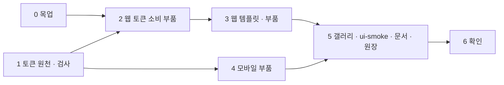
- 병렬 가능: 0 ↔ 1, 2·3(웹) ↔ 4(모바일) — 경로가 겹치지 않는다. 다만 마스터플랜 병렬 게이트가 닫혀 있으면 직렬로 간다
- 3단계 안의 C1 · C3 · C4 · C5 · C7 · C8 · C9 는 서로 독립(파일만 겹치는 곳: pages.tsx — ListPage · LoginPage 는 순서대로)

## 4. 표면 (화면 · API)
| 지금 | 바뀐 뒤 (목업 — 라이트 · 다크, 원본 `docs/plans/mockups/REQ_05/*.html`) |
|---|---|
| 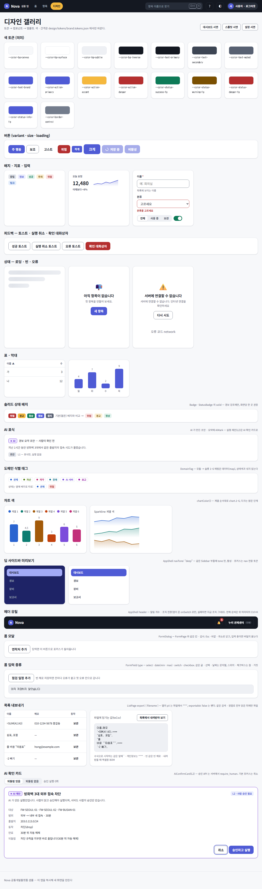 | 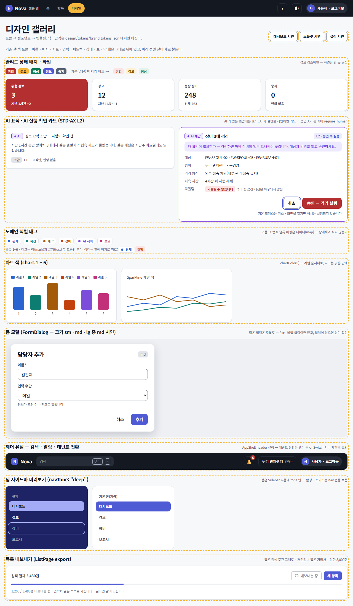 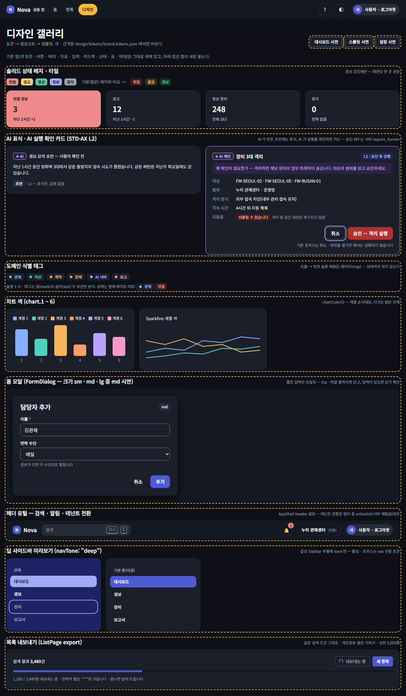 |
| (없음) | 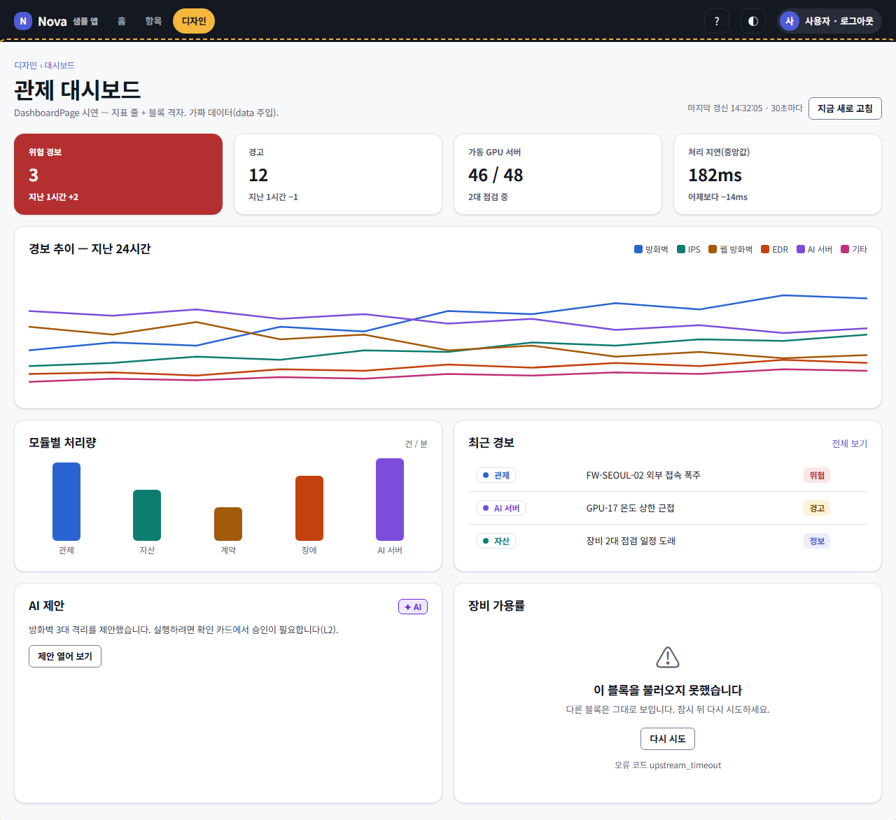 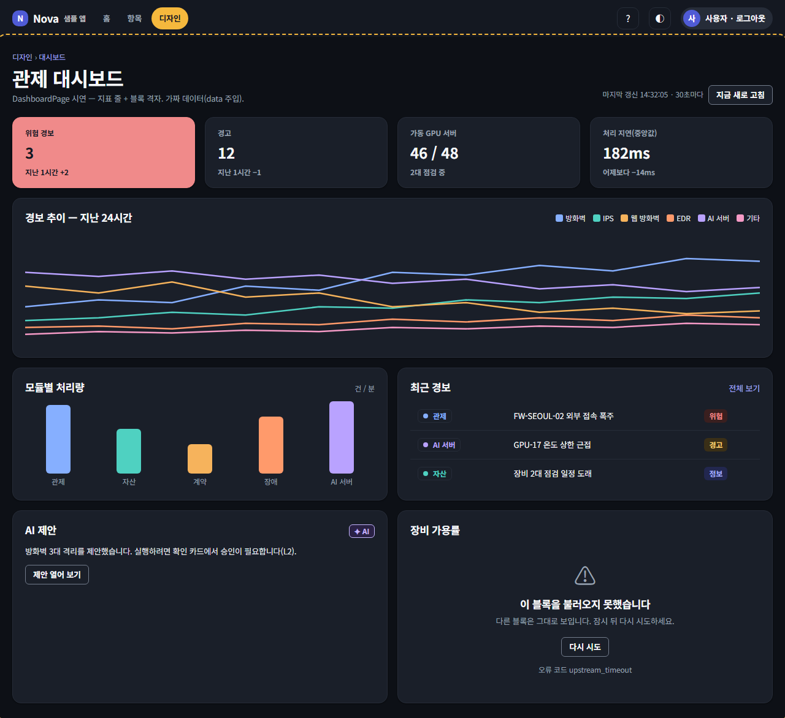 |
| (없음) | 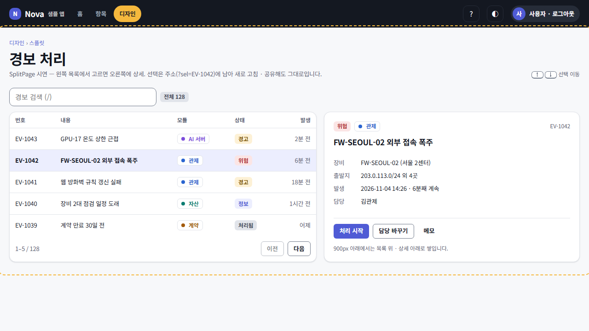 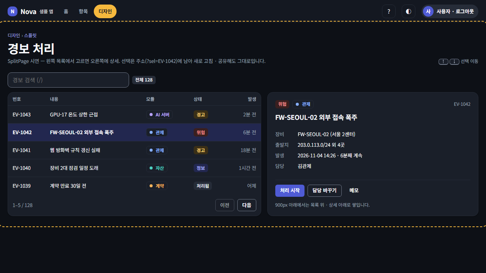 |
| (없음) | 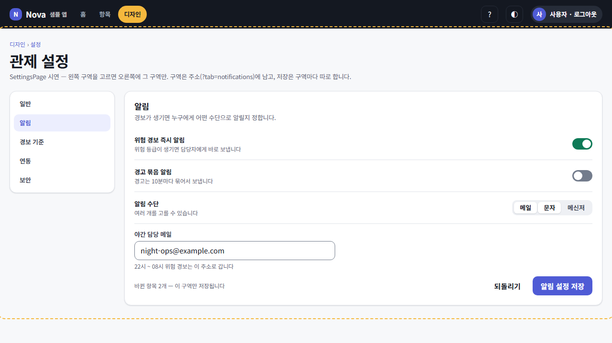 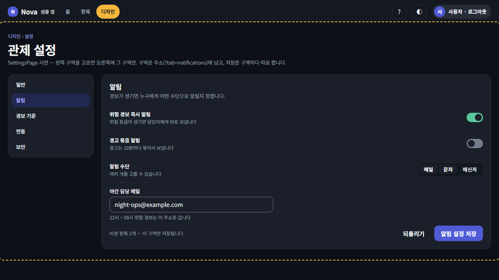 |
| (없음 — 사이드바는 흰 표면) | 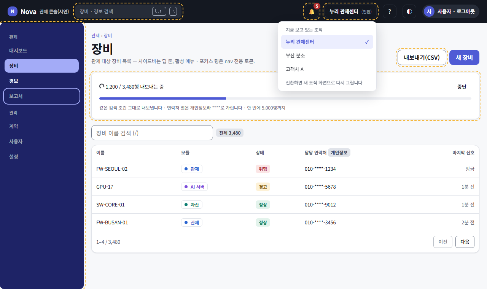 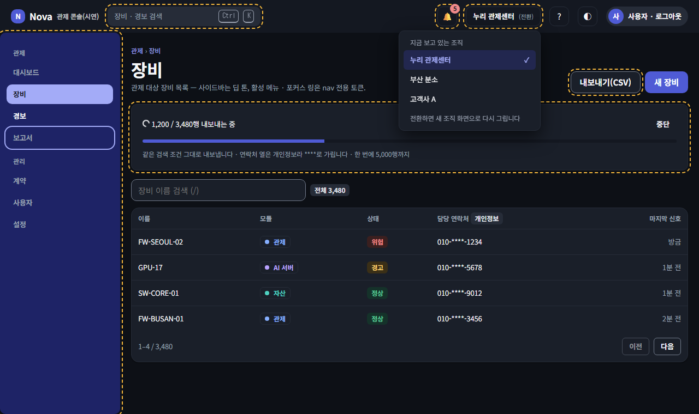 |
| 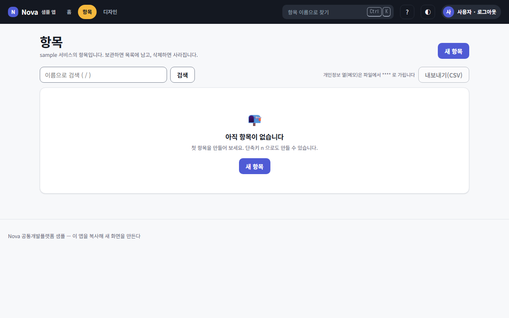 로그인 직전 | 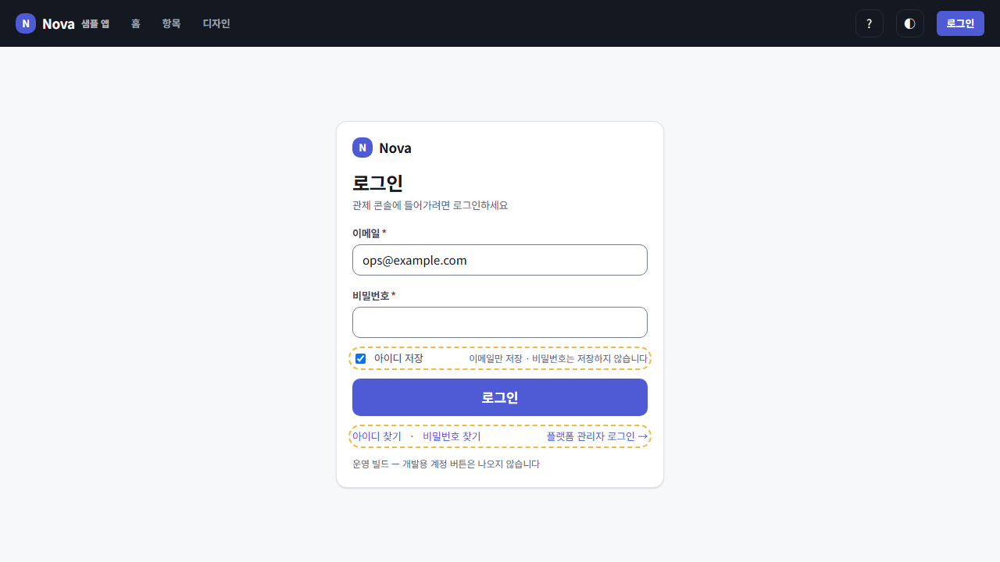 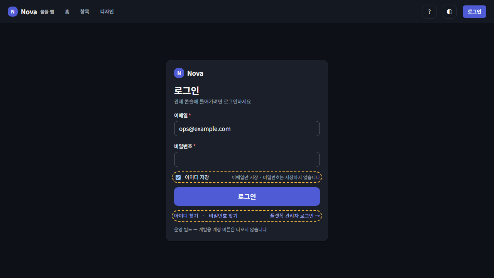 |

| 화면 | API | 표 | 권한 |
|---|---|---|---|
| /design (갤러리 — 새 절: 솔리드 배지 · AI 표식 · AI 확인 카드 · 도메인 태그 · 차트 색 · 폼 모달 · 헤더 유틸 · 딥 사이드바 미리보기 · 목록 내보내기) | 없음(가짜 데이터 · 가짜 행동) | — | 없음(공개) |
| /design/dashboard (DashboardPage 시연) | 없음(`data` 로 주입) | — | 없음 |
| /design/split (SplitPage 시연) | 없음 | — | 없음 |
| /design/settings (SettingsPage 시연) | 없음 | — | 없음 |
| /login (아이디 저장 · 찾기 · 전환 링크) | POST 로그인(기존) | — | 없음 |
| 템플릿 계약 — DashboardPage `source`(선택) | 소비 앱의 GET(목록 계약 밖 개요 API, 예: GET /ops/monitoring/overview) | — | 그 API 의 read |
| ListPage 내보내기 | 같은 `source` 의 GET(size=100 쪽 순회) | — | 그 목록의 read(서버 검사) |

### 4.1 UX 점검 ([ux-heuristics](../conventions/ux-heuristics.md))
| 원칙 | 이 화면에서 어떻게 지키나 | 남는 위험 (심각도 0~4) |
|---|---|---|
| H1 상태 가시성 | DashboardPage 는 마지막 갱신 시각 · 갱신 중 표시, 내보내기는 "n / 전체 행 내보내는 중" 진행 · 끝나면 토스트 | 대량 내보내기 중 화면 이동 시 중단 — 1 |
| H2 현실 일치 | 문구는 업무 말("내보내기(CSV)", "AI 제안", "되돌릴 수 없습니다") · 솔리드 색은 경보 강조에만 | 0 |
| H3 제어 · 자유 | AI 확인 카드 취소 항상 · FormDialog Esc · 바깥 클릭 닫기 · 입력이 있으면 닫기 확인 | 0 |
| H4 일관성 | 새 부품은 기존 variant · size · Tone 이름 그대로, 웹 · 모바일 같은 이름 | 0 |
| H5 에러 방지 | AI 카드: 렌더만으로 실행 안 함 · 기본 포커스 취소 · 되돌림 불가면 danger 버튼 · 파라미터 전부 노출 / 내보내기: PII 열 가림 · CSV 수식 주입 방지 | 서버 require_human 누락은 부품이 막지 못한다 — 2(§11 판단 D) |
| H6 인지 > 기억 | SettingsPage · SplitPage 선택이 주소(?tab · ?sel)에 남아 새로고침 · 공유 가능 · 아이디 저장 | 0 |
| H7 유연 · 효율 | 헤더 검색 `/` 와 충돌 없게 `Ctrl+K`, SplitPage ↑↓ 로 선택 이동 | 단축키 충돌 — 1(검토 초점) |
| H8 미니멀 | DashboardPage 는 Stat 줄 + 블록 격자만, 솔리드 색은 화면당 강조 한 곳 권장(규칙 문구) | 솔리드 남용 — 1 |
| H9 에러 복구 | 블록별 ErrorState + 다시 시도(한 블록 실패가 화면 전체를 지우지 않음), 내보내기 실패 시 사람 말 토스트 | 0 |
| H10 도움말 | 갤러리 각 절에 쓰는 법 한 줄 · ui.md §3 · §5 행 · AI 카드 "왜 확인이 필요한가" 한 줄 | 0 |

과업 시나리오(인지적 워크스루)
1) 관제 담당자가 위험 경보만 빨리 보려고 대시보드를 연다 → 솔리드 위험 타일이 한눈에 보이는가? 숫자 옆 갱신 시각으로 최신인지 아는가?
2) 담당자가 AI 가 제안한 "장비 3대 격리"를 실행하려고 카드의 [승인]을 누른다 → 대상 · 범위 · 되돌림 방법을 누르기 전에 읽었는가? 취소가 기본 포커스인가?
3) 관리자가 감사용으로 목록을 내보내려고 [내보내기(CSV)]를 누른다 → 개인정보 열이 가려진다는 안내를 보는가? 엑셀에서 한글이 깨지지 않는가?
4) 다른 조직을 보려고 헤더의 테넌트 전환을 누른다 → 지금 어느 조직인지 아는가? 전환 뒤 화면이 새 조직 데이터로 다시 그려지는가?

## 5. 생애주기
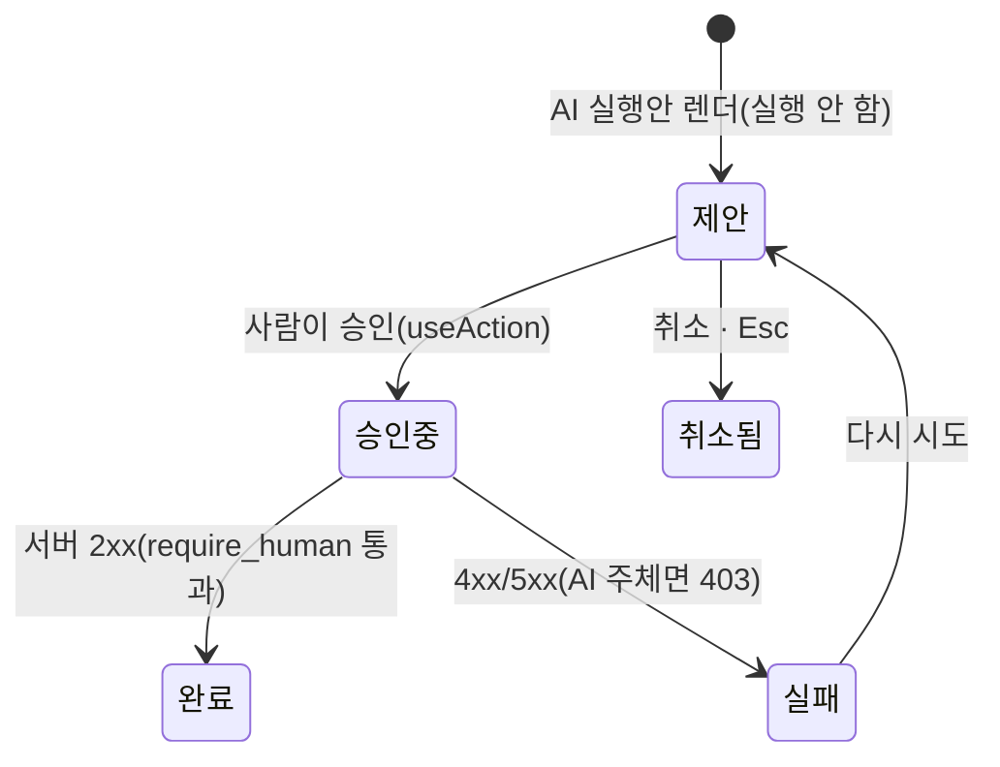
| 상태 | 카드 표시 | 버튼 |
|---|---|---|
| 제안 | AI 표식 · 대상 · 범위 · 파라미터 · 되돌림 | 승인 · 취소(기본 포커스) |
| 승인중 | 진행 표시 | 둘 다 잠김 |
| 완료 | 성공 토스트(되돌릴 수 있으면 실행 취소) | 없음 |
| 실패 | ErrorState 문구(서버 말) | 다시 시도 · 취소 |
| 취소됨 | 카드 닫힘 | — |

## 6. 핵심 분기
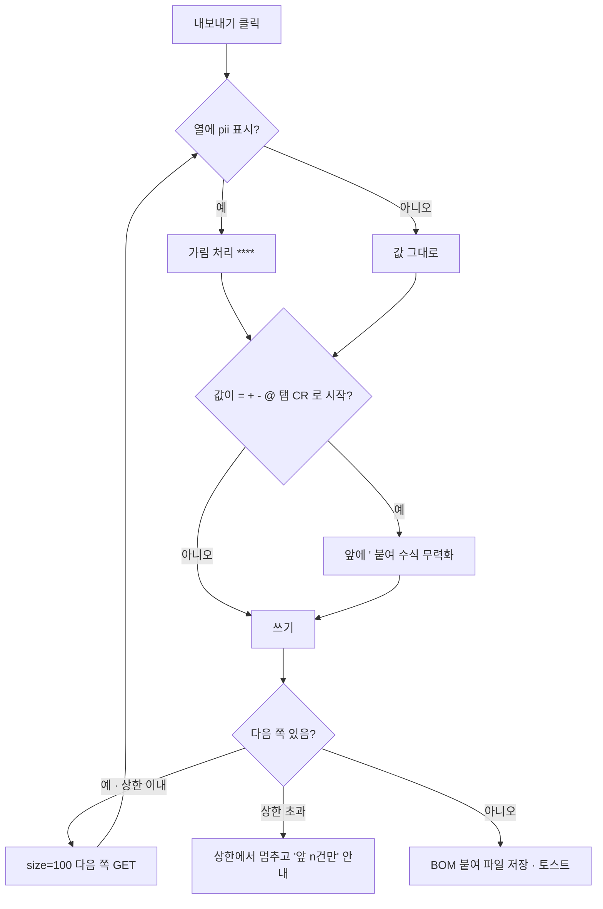
| 실패 지점 | 동작 (닫힘/열림) | 이유 |
|---|---|---|
| 내보내기 중 403 | 닫힘 — 파일 만들지 않고 권한 문구 | 일부만 담긴 파일이 완전한 것처럼 보이면 안 된다 |
| 내보내기 중 네트워크 오류 | 닫힘 — 파일 없음 · 다시 시도 | 같은 이유 |
| 분리 규칙 위반(토큰) | 닫힘 — lint 실패 | 상태 의미가 흐려지면 경보를 놓친다 |
| 새 대비 쌍 미달 | 닫힘 — lint 실패 | WCAG AA |
| DashboardPage 블록 하나 실패 | 열림 — 그 블록만 ErrorState | 관제 화면이 통째로 사라지면 더 위험 |
| 테넌트 전환 onSwitch 실패 | 닫힘 — 현재 테넌트 유지 · 오류 토스트 | 반쯤 바뀐 상태 금지 |
| 아이디 저장소 접근 예외(사생활 모드) | 열림 — 저장 없이 로그인 진행 | 편의 기능이 로그인을 막으면 안 된다 |

## 7. 데이터 모델
해당 없음 — DB · 이벤트 변경 없음. 토큰 원천의 구조 변경은 §2 표.
| 구분 | 표 · 컬럼 |
|---|---|
| 있는 것 | — |
| 신설 | — |
| 바뀌는 것 | — |

## 8. 재사용
| 자산 (원장 ID) | 쓰는 법 |
|---|---|
| gen_tokens.py `check_contrast` · `ratio` · `value_of` | 새 쌍은 데이터만 추가, 분리 검사는 `value_of` 로 모드별 실값 비교 |
| CMP-UI-0029 AppShell | `navTone` · `header` 설정만 추가, 사이드바는 `Sidebar` 로 뽑아 재사용 |
| CMP-UI-0031 LoginPage · CMP-UI-0032 ListPage | 선택 props 추가(기본값이면 지금과 같은 화면) |
| FormPage 의 필드 그리기 · `FormField` | FormDialog 가 같은 필드 렌더를 쓴다(내부 함수로 뽑기) |
| `useDialogFocus` (hooks/dialog.ts) | FormDialog 포커스 가두기 · Esc · 복귀 |
| `useConfirm` · `ConfirmDialog` | FormDialog 입력 중 닫기 확인 |
| `useAction` | AI 카드 승인 · 내보내기 · 테넌트 전환 |
| `useQueryState` | SplitPage ?sel · SettingsPage ?tab |
| `Stat` · `Card` · `Section` · `Sparkline` · `Bars` · `ErrorState` · `Skeleton` | DashboardPage 블록 |
| `KeyValue` | AI 카드 파라미터 표 |
| `Badge` · `Tone` (웹 basic.tsx:7 · 모바일 Components.kt:44) | solid 변형 |
| `Principal.require_human` (service.py:109) · 테스트 test_context_packs.py:97 | AI 카드의 서버 짝 |
| mockup_shots.py `--themes light,dark` | 목업 두 모드 PNG |

## 9. 범위 밖
| 안 하는 것 | 이유 · 어디서 |
|---|---|
| G1 형 축(neo · glendale) | ADR 감 · 소비 프로젝트 둘 이상일 때(요구 비목표) |
| G3 브랜드 그라데이션 · AI 그라데이션 | 대비 검사 쌍을 정의할 수 없다(요구 비목표) — AI 표식도 단색 |
| G8 제목 글꼴 | 한국어 라이선스 확인 먼저(요구 비목표) |
| C2 MDI 탭 · C6 밀러 칼럼 · 트리 | 요구 비목표 |
| 테넌트 전환 서버 API(토큰 재발급) | API 계약 신설 — 새 요구. 이번에는 슬롯 + onSwitch 계약만(§11 판단 C) |
| 알림 서버 API · 실시간 푸시 | 소비 서비스 없음 — 부품은 `source` 경로 · 개수만 받는다 |
| 서버 쪽 내보내기 API(스트리밍 · 비동기 작업) | 대량은 다음 요구 — 이번에는 클라이언트 쪽 순회 + 상한 |
| 로그인 분할 레이아웃(C8 의 분할) | 요구 원문 16-10 은 아이디 저장 · 찾기 · 전환 링크만 |
| /ops 를 DashboardPage 로 옮기기 | 이번 일을 넓히지 않는다 — 다음 요구 후보 |
| 모바일 SplitPage · SettingsPage · DashboardPage · FormDialog · 헤더 유틸 | ui.md §3 · §5 모바일 칸 🗺 로 남긴다(§11 판단 E) |
| 저장소 전체의 토큰 밖 색 정리 | 새 검사는 허용 목록 2곳으로 시작 · 정리는 새 요구 |

## 10. 테스트 맵
| 코드 경로 | 테스트 | 수용 기준 |
|---|---|---|
| brand.tokens.json `contrast`(새 쌍) | tests/test_gen_tokens.py::test_new_pairs_registered · test_repo_tokens_pass_contrast | 16-1 · 2 · 3 · 4 · 5 대비 통과(E2) |
| gen_tokens.py `check_separation` | tests/test_gen_tokens.py::test_separation_same_value_fails · test_separation_same_primitive_fails | 16-4 규칙 검사 |
| gen_tokens.py `scan_usage` | tests/test_gen_tokens.py::test_scan_mixing_status_domain_fails · test_scan_raw_color_fails · test_scan_allowlist | 16-4 · 반목표 |
| tokens.css · DesignTokens.kt | `gen_tokens.py --check`(lint) · `python nova.py kmp-build` | 생성물 최신 · 컴파일 |
| Badge solid · Sidebar tone · AiMark · DomainTag · chart 색 | ui_smoke.py 단계 "갤러리 — 토큰 부품" | 16-1 · 2 · 3 · 4 · 5 |
| DashboardPage | ui_smoke.py 단계 "갤러리 — 대시보드"(Stat · 블록 · 블록 오류 격리) | 16-5 · ui.md §5 ✅ |
| AiConfirmCard | ui_smoke.py 단계 "AI 확인 카드"(렌더만으로 실행 없음 · 취소 포커스 · 승인 토스트) + packages/common-py/tests/test_context_packs.py::test_principal_require_human(기존) | 16-3 |
| AppShell header 유틸 | ui_smoke.py 단계 "헤더 유틸"(알림 개수 · 테넌트 표시 · Ctrl+K) | 16-6 |
| ListPage export | ui_smoke.py 단계 "내보내기"(다운로드 내용: BOM · 가림 · 수식 무력화) | 16-7 |
| SplitPage · SettingsPage | ui_smoke.py 단계 "스플릿 · 설정"(?sel · ?tab 유지) | 16-8 |
| FormDialog | ui_smoke.py 단계 "폼 모달"(포커스 가두기 · Esc · 복귀 · 입력 중 닫기 확인) | 16-9 |
| LoginPage 확장 | ui_smoke.py 단계 "로그인 확장"(아이디 저장 → 재방문 채움) + 운영 빌드 데모 계정 없음 확인 | 16-10 |
| 다크 모드 | ui_smoke.py 다크 캡처 app-design*.dark.png + E4 사람 확인 | E4 |

## 11. 후속 · 예외

### 11.0 판단 포인트 (사용자 결정 — 1단계 착수 전, 지금은 권고)
| ID | 질문 | 선택지 · 대가 | 권고 |
|---|---|---|---|
| A | 도메인 식별색 이름 | (A1) 번호 슬롯 `domain.1~6.mark/text` + 매핑은 데이터 — 코어가 업종을 모른다 · 화면 코드에서 의미가 안 보인다 / (A2) 모듈 이름 `domain.<모듈>` — 읽기 쉽다 · 프로젝트마다 토큰 원천을 고쳐야 하고 STD-DOMAIN-PACK 코어 원칙과 어긋난다 | A1 |
| B | 솔리드 상태색의 다크 값 | (B1) 두 모드 같은 값(*.700 + 흰 잉크) · 표면 대비 쌍은 등록 안 함 — 단순 · 다크에서 타일 경계가 약하다(2.65~3.10) / (B2) 다크는 *.300 + 검은 잉크(모드별 onSolid) — 경계 6.4~7.9 · 잉크가 모드마다 바뀐다 | B2(관제 화면은 다크 사용이 많다) |
| C | 테넌트 전환 | (C1) 슬롯만 — `tenants` 목록 · `onSwitch` 를 앱이 준다 · 서버 재발급은 새 요구 / (C2) 게이트웨이 재발급 API 를 이번에 — API 계약 신설(되돌리기 어려움) · 범위 확대 | C1 |
| D | AI 카드 ↔ require_human 짝을 어떻게 보증하나 | (D1) 부품 계약(`level: "L2"` 필수 · 주석 · ui.md 규칙) + 기존 서버 테스트 / (D2) 정적 검사(카드가 부르는 API 의 핸들러에 require_human 이 있는지 ledgers 로 대조) — 강하다 · 검사기 신설(lint 의미 변경 → 승인 필요) | D1 이번 · D2 는 새 요구 |
| E | 모바일 범위 | (E1) 토큰(자동 생성) + 부품 4(Badge solid · AiMark · AiConfirmCard · DomainTag) / (E2) 토큰만 | E1 |
| F | 차트 · 도메인 · AI · 사이드바 구체 값 | §1.1 후보(라이트 4.1~5.6 · 다크 6.4~8.9) — 브랜드 확정 전 기본값으로 둔다 | 후보 그대로 · 프로젝트가 브랜드에서 바꾼다 |

### 11.1 전역 제약 (모든 task 에 적용 — 요구 원문 값 그대로)
| 제약 | 값 · 출처 |
|---|---|
| 언어 | 화면 문구 · 오류 메시지 · 주석은 한국어 (CLAUDE.md 규칙 0) |
| 값의 원천 | "값은 토큰 원천에서만" — 부품 · 화면 · 스킬에 색 값 금지(요구 제약 · 반목표) |
| 대비 | "모든 새 색 쌍은 WCAG AA 검사 대상" — 글자 4.5:1 · UI 3:1(gen_tokens.py:24) |
| 분리 | "상태색과 도메인 식별색을 섞지 않는다" — 검사로 강제 |
| AI | "AI 확인 카드는 STD-AX 와 서버 require_human 이 짝" |
| 로그인 | "운영 빌드 데모 계정 없음 유지" (요구 16-10 · ui_smoke.py 머리 주석) |
| 3층 | 토큰 → 부품 → 템플릿, 스타일은 의미 토큰 var(--color-…) 만(ui.md §1) |
| 생성물 | tokens.css · DesignTokens.kt · 대장은 손으로 고치지 않는다 → python nova.py tokens · ledgers.py |
| 포트 | 웹 확인은 3100 + GW_CORS_ORIGINS=http://localhost:3100 |
| 비용 | ui-smoke 한 번 = dev_server + 데모 빌드 + 실행 약 5~8분 — 단계 끝에 묶어 돌린다 |

### 11.2 검토 초점 (사람이 부딪힐 입력 · 상황 — 많이 부딪힐 순서로 5개)
| 입력 · 상황 | 기대 동작 | 테스트를 넣은 task |
|---|---|---|
| 내보낸 CSV 를 엑셀에서 연다(한글 · 쉼표 · 줄바꿈 · `=SUM(` 로 시작하는 메모) | 깨지지 않고, 수식이 실행되지 않는다(BOM · 따옴표 · `'` 접두) | T05-3.06 |
| 다크 모드에서 솔리드 위험 타일 · 딥 사이드바 활성 메뉴 · 포커스 링을 본다 | 모두 보인다(대비 쌍 통과) | T05-1.03 · T05-1.04 · T05-5.06 |
| AI 카드가 뜬 화면에서 Enter 를 친다 · 화면을 새로고침한다 | 실행되지 않는다(기본 포커스 취소 · 렌더만으로 실행 없음) | T05-3.10 |
| 폼 모달에 입력하다 Esc · 바깥을 누른다 | 닫기 확인이 뜬다 · 확인하면 닫히고 연 버튼으로 포커스가 돌아온다 | T05-3.08 |
| 목록 검색 중 `/` · 헤더 검색 `Ctrl+K` · 단축키 `n` 이 겹친다 | 입력 칸 안에서는 단축키가 먹지 않고, 각 키가 자기 대상만 연다 | T05-3.03 |

### 11.3 자체 점검 (superpowers:writing-plans — 다 쓴 뒤 한 번)
- [x] 요구 반영 — 16-1 T05-1.03 · 2.03 / 16-2 T05-1.04 · 2.04 / 16-3 T05-1.05 · 2.05 · 3.10 · 4.03 / 16-4 T05-1.06~1.08 · 2.06 / 16-5 T05-1.09 · 2.07 · 3.01 / 16-6 T05-3.02~3.03 / 16-7 T05-3.05~3.06 / 16-8 T05-3.07 · 3.09 / 16-9 T05-3.08 / 16-10 T05-3.04
- [x] 단계 명확성 — 단계마다 산출물 하나(목업 · 토큰 · 웹 토큰 부품 · 웹 템플릿 · 모바일 · 갤러리/문서 · 확인)
- [x] 타입 일관성 — `Sidebar` · `navTone` · `AiMark` · `AiConfirmCard` · `DomainTag` · `chartColor` · `DashboardPage` · `SplitPage` · `SettingsPage` · `FormDialog` · `Column.pii` · `ListPageProps.export` · `AppConfig.header` 를 tasks 의 "인터페이스" 줄과 같은 이름으로 썼다
- [x] 검토 초점 — 11.2 의 5줄 모두 담당 task 있음
- [x] 분량 — 시그니처 · 단언만, 구현 코드 없음

### 11.9 사용자 결정 (2026-11-04 — 권고 채택)
- A 도메인 식별색 — 번호 슬롯 `domain.1~6.mark/text`, 모듈 → 번호 매핑은 데이터
- B 솔리드 상태색 — 다크 전용 값(밝은 단계 + 검은 잉크, 모드별 onSolid)
- C 테넌트 전환 — 부품 자리(tenants · onSwitch)만, 서버 재발급 API 는 새 요구
- D AI 확인 카드 보증 — 부품 계약 + 기존 서버 require_human 테스트(정적 검사기는 새 요구)
- E 모바일 범위 — 토큰 + 부품 4(Badge solid · AiMark · AiConfirmCard · DomainTag)
- F 구체 값 — 계획 §1.1 후보를 기본값으로(프로젝트 브랜드에서 바꾼다) · G4 토큰 6개(요구 16-2 수용 기준에 반영) · lint 검사 확장(분리 · 토큰 밖 색) 승인

## 12. 체크리스트
- [ ] 0단계 · 목업 6장(라이트 · 다크) 만들기
- [ ] 1단계 · 토큰 원천 5묶음 + 대비 쌍 + 분리 · 토큰 밖 색 검사
- [ ] 2단계 · 웹 토큰 소비 부품(Badge solid · Sidebar · AiMark · DomainTag · 차트 색)
- [x] 3단계 · 웹 템플릿 · 부품(DashboardPage · 헤더 유틸 · LoginPage · ListPage 내보내기 · SplitPage · FormDialog · SettingsPage · AiConfirmCard)
- [x] 4단계 · 모바일 부품 4 + kmp-build
- [x] 5단계 · 갤러리 · ui-smoke · ui.md · README · 스킬 갭 표 · 원장 · 대장
- [x] 6단계 · E1~E4 판정 · 목업 대비 실제 캡처

### 12.1 실측으로 정정된 자리
- G4 토큰 3개(bg.nav · text.onNav · onNavMuted) → 6개: 활성 · 포커스 brand.600 이 남색 바탕에서 2.55(< 3.0). bg.navActive · text.onNavActive · border.focusOnNav 추가(§1.1) — 요구 16-2 수용 기준에 반영 필요
- 차트 · 도메인 색: 한 값으로는 다크 표면 대비 미달(2.95~3.99) → 모드별 값
- 웹 TDD 수단: JS 단위 테스트 도구 없음(web/package.json) → 웹은 "ui-smoke 단계 먼저(빨강) → 구현(초록)", 파이썬 검사는 pytest
- (0단계) 목업 6장 · PNG 12장(라이트 · 다크) — 계획에 hex 가 없던 값은 0단계 담당 후보: violet 700 #6D28D9 · 100 #EDE9FE · 다크 300 #C4B5FD · dark100 #2A2145, 차트 1~6 라이트 #2A64D0 · #0D7D72 · #A35A09 · #C2410C · #7C4DDB · #C2307A / 다크 #86AFFF · #4FD1C1 · #F6B35C · #FF9A6B · #B9A2FF · #F59AC6. 계획 §1.1 '라이트 4.14 ~ 5.60' 의 하한 4.14 는 도메인 text(4.5) 쌍을 못 넘어 canvas 기준 4.5 이상으로 조금 어둡게
- (0단계 · Claude 판단 2026-11-04 — 사용자 확인 전, 되돌릴 수 있음) 도메인 · 차트 색이 상태색과 닮는 문제: **(다) 차트 6색은 그대로, 도메인 태그는 주황 · 갈색 계열을 피한다**(상태 배지 옆에 붙는 도메인 태그만 '주황 = 위험' 오독을 없애고 그래프 구분력은 지킨다). 대가: 도메인 · 차트가 원시 색을 일부 나눠 쓰지 않는다
- (1단계) 대비 쌍 25 → 74(두 모드 검사 50 → 148). 분리 검사 `check_separation`(도메인 ↔ 상태 같은 값 · 같은 원시 참조 금지) · 사용 검사 `scan_usage`(한 규칙 · 한 줄에 상태와 도메인 토큰 섞기 금지, 주석 · build/ 제외, 허용 `ALLOW_RAW` 1곳)를 `gen_tokens` main 에 합침
- (1단계 · Claude 판단 (다) 구현) 도메인 6색 = 1 파랑 blue.650 / 다크 blue.200(새) · 2 라임 lime.700 / .300 · 3 분홍 pink.700 · 4 cyan.700 / .300 · 5 보라 violet.600 / .400 · 6 자홍 fuchsia.700 / .300 — 주황 · 갈색(경고 · 위험과 색상각 7~19°) · teal(성공과 13°) 배제, 1~3번을 색상환에서 가장 멀리. 약점: 1 파랑은 link · info 와 색상각이 거의 같고, 5 보라는 AI 보라와 가깝다. 차트 6색은 0단계 후보 그대로. **도메인 색은 목업(도메인 = 차트)과 다르다** — 2 · 5단계 화면 확인에서 목업과 달라 보인다
- (1단계) 새 원시 단계 이름 `blue.650` · `blue.200` · `violet.600` · `violet.400`. kmp-build 175초 BUILD SUCCESSFUL(ColorTokens 새 속성 컴파일)
- (2단계) 계획 밖 부품 `ChartLegend`(범례를 화면에 직접 마크업하면 ui.md 규칙 2 위반) · `AiMark` 에 `text` · `label` 선택 props · `Badge solid` 에 tone link 는 옅은 배지로(솔리드 토큰 없음) · Sparkline 색을 style 로. ui-smoke 단언은 클래스가 아니라 **브라우저가 계산한 색 = 토큰 값**을 두 모드에서 본다. 갤러리 `/design` 에 토큰 부품 5절을 지금 넣음(5.01 과 겹침 — 5.01 에는 폼 모달 · 헤더 유틸 · 내보내기 · AI 확인 카드 절이 남음). 샘플 앱은 layout top 이라 옆 메뉴 실화면은 ui-smoke 밖 — 딥 톤은 갤러리 미리보기로만. 원장 CMP 4 등록(활성 83 → 87)
- (3단계 앞 5개) 계획 밖 부품 `NotificationLink` · `TenantSwitcher` · `HeaderUtils`(헤더 유틸을 HeaderSearch 하나로 담지 못함) · `DashboardBlock` 에 `onRetry?` · `actions?`(data 모드 다시 시도 · 제목 옆 범례) · Ctrl+K 는 ⌘K 도 받는다. 시연 `/design/dashboard` · 갤러리 '헤더 유틸' 절을 지금 만듦(5.01 · 5.02 와 겹침 — 2단계와 같은 처리). 샘플 `/items` 에 메모 열(`pii`) — 내보내기 테스트의 기준 열. 질문 트리 `parts.use` 에 dashboard · header 선택지. 원장 6건 등록(활성 87 → 93). 다크 확인은 대시보드만 — 헤더 유틸 · 로그인 다크는 6단계 캡처에서
- (3단계 뒤 5개) `SplitPage` 는 `source?` + `rows?`(계획은 source 필수 — §4 표 /design/split 은 가짜 데이터라 DashboardPage 와 같은 방식으로 맞춤) · 목록 첫 쪽만 읽음(쪽 크기 인터페이스 없음). `FormDialog` `success?` · `description?`, `AiConfirmCard` `approveLabel?` · `success?` 선택 props. FormPage · FormDialog 가 함께 쓰는 내부 부품 `FormFields` · `useFormModel`(`components/form.tsx` — 복제 금지 조건). 겹친 대화상자는 맨 위 하나만 Tab · Esc(`hooks/dialog.ts` 차례). TDD 빨강은 화면 단위(시연 화면 없는 빌드에서 4단계 실패)로만 확인. 갤러리 '폼 모달' · 'AI 확인 카드' 절을 지금 넣음(5.01 에는 '목록 내보내기' 절이 남음). ui-smoke 14단계 통과 · 원장 7건(활성 93 → 100)
- (4단계) 모바일 `AiConfirmCard` 는 웹과 같은 props 이름 + `notify`(모바일 rememberAction 이 알림 함수를 인자로 받음) · `level` 은 enum `AiLevel.L2` · `params` 는 `List<AiParam>`(문자열). `DomainTag` map 은 `StatusBadge` 형식(`Pair<라벨, 슬롯>`). uikit 에 테스트 수단이 없어 TDD 는 kmp-snapshots 안의 단언('그리기만으로 승인 호출 0회') · PNG 로 대신(🆕 T05-9.02). kmp-snapshots 는 이 PC 에서 `-Papi=…8091` 을 직접 줘야 한다(🆕 T05-9.01). 원장 3건(활성 100 → 103)
- (5단계) 갤러리 '목록 내보내기' 절은 `ListPage` 대신 `toCsv` 미리보기(갤러리는 서버 없이 보여야 하고 ListPage 는 source 가 필수) — 실제 내려받기는 ui-smoke `export` 단계가 검증. ui-smoke 15단계 · `app-design*` 라이트 · 다크 9쌍. nicomms 갭 12건 해소 표시(style-map · SKILL · patterns), 남은 갭 G1 · G3 · G8 · C2 · C6. ui.md 규칙 11~13(솔리드 · 상태/식별 분리 · AI L2) 추가
- (6단계 6.04 — 목업 대비 실제, e2e-tester 29장) 다크 깨짐 0 · 색 축 네 개 의도대로(도메인만 알려진 차이). 새 차이는 대부분 '시연 화면이 부품 능력을 다 보이지 않음'(🆕 9.07)이고, 부품 쪽 결함 후보는 SettingsPage 바뀐 항목 · 되돌리기 없음(심각도 2 — 🆕 9.05) · 로그인 전 헤더 검색 노출(🆕 9.06) · 같은 개념 두 색(🆕 9.08). 좁은 폭 캡처는 없다 — 판정 불가

## 13. task 분해
[tasks/tasks_REQ_05.md](tasks/tasks_REQ_05.md) — 46개 (0단계 3 · 1단계 10 · 2단계 7 · 3단계 10 · 4단계 4 · 5단계 7 · 6단계 5 — 2단계 첫 줄은 도구 정비, 6단계는 확인)

---
관련 문서: [REQ-261104-16](../requirement/requirement_261104_16.md) · style-map `.claude/skills/nicomms-screen/references/style-map.md` · [디자인 시스템 README](../design-system/README.md) · [ui.md](../conventions/ui.md) · [ux-heuristics](../conventions/ux-heuristics.md) · [STD-AX-001](../std/STD-AX-001.md) · [STD-TENANCY-001](../std/STD-TENANCY-001.md) · [STD-DOMAIN-PACK-001](../std/STD-DOMAIN-PACK-001.md)

## 변경 이력
- v1.0 · 2026-11-04 · 최초 작성

> **다시 한 줄 요약** — 쌍으로 검사한 토큰만 부품이 쓰고, 부품만 템플릿이 쓰며, 갤러리와 ui-smoke 가 두 모드에서 그 사슬을 한 번에 확인한다.
